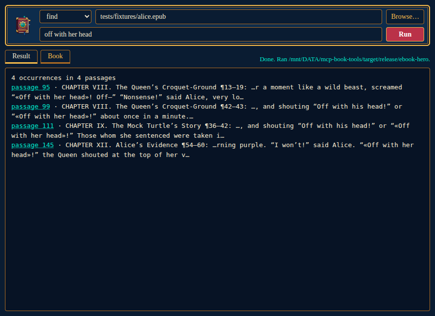
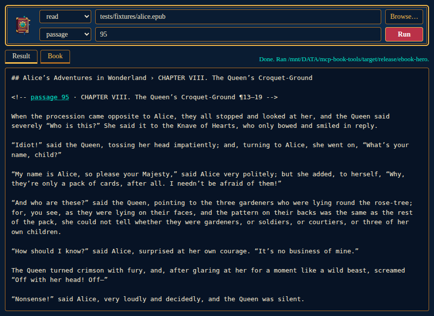
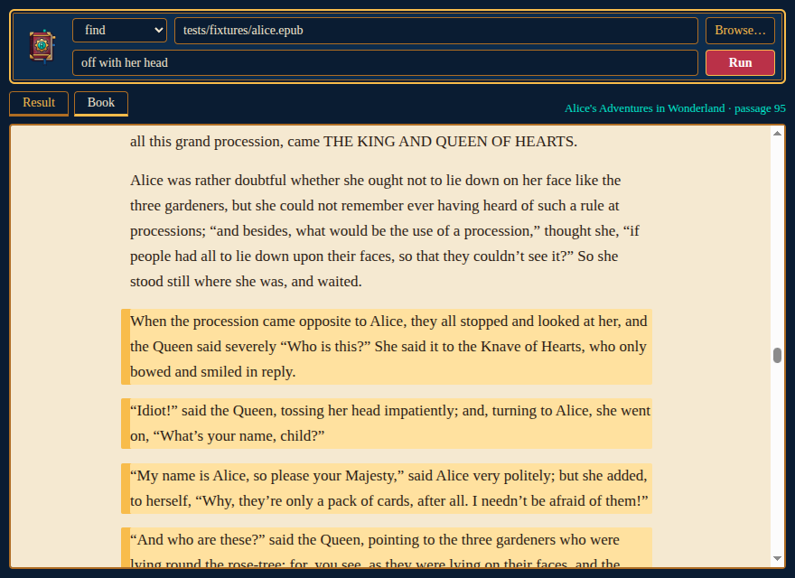

<p align="center"></p>

# ebook-hero

ebook-hero searches a PDF or EPUB, reads the text around what it finds, and checks whether a quote really occurs in the book. There are three ways to use it: as a [command-line tool](#command-line), as an [MCP server](#mcp-server) over stdio for agents, and in a small [desktop window](#desktop-window). Each call names one book file: the first call indexes that book, and later calls reuse the index.

## Install

```sh
cargo install --locked --git https://github.com/AhmedKishki/ebook-hero
```

From a clone:

```sh
cargo build --release
sudo install target/release/ebook-hero /usr/local/bin/
```

This installs the command-line tool and the MCP server, which are the same binary. The desktop window is separate and runs this binary; see [Desktop window](#desktop-window).

## Example

These commands run on `tests/fixtures/alice.epub`, the copy of *Alice's Adventures in Wonderland* in this repository, so you can repeat them from a clone. The output is shortened.

`search` returns the passages that best answer a question:

```console
$ ebook-hero search tests/fixtures/alice.epub "why does the Queen want to cut off heads"
1. passage 93 · Alice’s Adventures in Wonderland › CHAPTER VIII. The Queen’s Croquet-Ground ¶10  (score 0.907)
    Five and Seven said nothing, but looked at Two. Two began in a low voice, “Why the fact is, you see, Miss, this here ought to have been a red rose-tree, and we put a white one in by mistake; and if the «Queen» was to find it out, we should all have our «heads» «cut» «off», you know. …

2. passage 104 · Alice’s Adventures in Wonderland › CHAPTER VIII. The Queen’s Croquet-Ground ¶64–69  (score 0.610)
    When she got back to the Cheshire Cat, she was surprised to find quite a large crowd collected round it: there was a dispute going on between the executioner, the King, and the «Queen», …
```

Each hit gives its passage id, its place in the book and its score. In an EPUB the place is the chapter and the paragraphs counted from its heading; in a PDF it is the page, followed by the chapter. The words that matched the query are marked «like this».

`read` prints a hit in full, as Markdown, from its passage id. To see the text around it, add `--before` or `--after`:

```console
$ ebook-hero read tests/fixtures/alice.epub 104
## Alice’s Adventures in Wonderland › CHAPTER VIII. The Queen’s Croquet-Ground

<!-- passage 104 · CHAPTER VIII. The Queen’s Croquet-Ground ¶64–69 -->

When she got back to the Cheshire Cat, she was surprised to find quite a large crowd collected round it: …
```

`find` lists every occurrence of an exact phrase, in reading order:

```console
$ ebook-hero find tests/fixtures/alice.epub "off with her head"
4 occurrences in 4 passages
passage 95 · CHAPTER VIII. The Queen’s Croquet-Ground ¶13–19: …r a moment like a wild beast, screamed “«Off with her head»! Off—” “Nonsense!” said Alice, very lo…
passage 99 · CHAPTER VIII. The Queen’s Croquet-Ground ¶42–43: …, and shouting “Off with his head!” or “«Off with her head»!” about once in a minute.…
…
```

`verify` checks a quote. `exact` means it occurs as written, `equivalent` means only case, punctuation or spacing differ, and `none` names the passage that shares the longest run of its words:

```console
$ ebook-hero verify tests/fixtures/alice.epub "Off with her head!"
exact: passage 95 · CHAPTER VIII. The Queen’s Croquet-Ground ¶13–19
$ ebook-hero verify tests/fixtures/alice.epub "off with their heads"
equivalent: passage 96 · CHAPTER VIII. The Queen’s Croquet-Ground ¶20–28
$ ebook-hero verify tests/fixtures/alice.epub "the Queen was very kind to everyone"
none; closest passage 93 · CHAPTER VIII. The Queen’s Croquet-Ground ¶10 (3 of 7 words; differs at "very")
```

`graph` lists the book's concepts, the phrases that mark its topics, in communities of concepts that share passages more often than chance. Each line gives a concept's number of passages, the first of them, and the concepts it links to with their NPMI, which is 1 when two only ever occur together and 0 when they meet as often as chance would have them:

```console
$ ebook-hero graph tests/fixtures/alice.epub
60 concepts in 8 communities · 166 passages · 13 topics
…
Community 8: time, hatter, march hare, dormouse
  time        47 passages, first 3    found 0.18, march hare 0.17, hatter 0.15
  hatter      18 passages, first 77   march hare 0.92, dormouse 0.76, court 0.38, time 0.15
  march hare  17 passages, first 77   hatter 0.92, dormouse 0.72, majesty 0.24, time 0.17
  dormouse    13 passages, first 80   hatter 0.76, march hare 0.72, court 0.48
```

The graph comes from the text alone, without the outline or the embedding model. It takes seconds and is kept with the index. With `--json`, every concept and every link lists its passages, so each one can be read.

## How search works

Search ranks passages: runs of whole paragraphs, up to 220 words, that never cross a heading or, in an EPUB, a file. `--mode` chooses how they are ranked:

- `lexical` ranks by BM25 on stemmed words, so "heads" also matches "head". Common words such as "the" and "how" are ignored. It finds the words you typed.
- `semantic` ranks by the cosine similarity between the query and each passage, embedded with bge-small-en-v1.5. It finds passages that say the same thing in other words. Passages below 0.55 are dropped, so an unrelated query returns nothing.
- `hybrid`, the default, merges the top 50 lexical and the top 50 semantic passages by reciprocal rank fusion, with BM25 weighted 1.25, so a passage can rank high for its words or for its meaning. The jina-reranker-v1-turbo-en model then reorders the best 30 by reading the query and each passage together. `--no-rerank` skips this step.

`--top-k` sets how many passages come back: 5 by default, at most 20.

## Command line

```sh
ebook-hero info book.pdf
ebook-hero search book.pdf "how do institutions change"
ebook-hero search book.pdf "institutional change" --mode lexical
ebook-hero search book.pdf "how do rules persist over time" --mode semantic --top-k 10
ebook-hero find book.pdf "social structure"
ebook-hero read book.pdf --page 42
ebook-hero verify book.pdf "a quote you want to check"
ebook-hero graph book.pdf
ebook-hero extract book.pdf --format markdown > book.md
```

`--page` is the physical page of the PDF, counted from 1, as is `page` in the MCP `read` tool; the printed page label is shown in the locator. `outline`, `read` (by passage id or outline entry), `index` and `cache` are also commands. For `info`, `outline`, `search`, `find`, `read`, `verify` and `graph`, `--json` prints what the MCP tools `book_info`, `outline`, `search`, `find`, `read`, `verify_quote` and `concept_graph` return. `ebook-hero <command> --help` lists the flags.

## MCP server

With Claude Code:

```sh
claude mcp add ebook-hero -- ebook-hero mcp
```

For any other client, add this server entry:

```json
{"command": "ebook-hero", "args": ["mcp"]}
```

| Tool | What it does |
|---|---|
| `book_info` | Title, authors, format, size, and whether the semantic index is built. |
| `outline` | The table of contents, with the passage each entry starts at. |
| `search` | The passages that best answer a query: `hybrid` (default), `lexical` or `semantic`. |
| `find` | Every passage that contains an exact phrase, with the total number of occurrences. |
| `read` | Passages as Markdown, by passage id, PDF page or outline entry. |
| `verify_quote` | Whether a quote occurs in the book, and where. |
| `concept_graph` | The book's concepts, the links between those that share passages more often than chance, and the communities they form. |

## Desktop window

`gui/` holds a small Electron window over the same commands. It has a select for the tool, the path of a book (or Browse…) and one box for the query, phrase, quote or number. It shows what the command prints, and beside the tabs, which binary ran. It runs the `ebook-hero` binary and does not link the library.





Each passage a result names, such as `passage 95`, is a link. Clicking it opens the Book tab, which shows the whole book as `ebook-hero extract` reads it, scrolled to that passage and with its paragraphs marked. In an EPUB the match is exact. In a PDF the passage's paragraphs are marked when they can be matched, and otherwise its whole page range, which the line beside the tabs says. The Book tab also opens the book from its start. It shows the extracted text, not the book's own layout, so there are no images.



It needs Node.js with npm. Once, from a clone:

```sh
cd gui
npm install
npm link
```

Then `ebook-hero-gui` opens the window from any directory. `npm start` in `gui/` does the same without the link. `npm link` makes a symlink to the clone, so after you move or delete the clone, run it again from the new place.

The window runs the first of these that exists: `$EBOOK_HERO_BIN`, `target/release/ebook-hero` in the clone, then `ebook-hero` on the `PATH`. After the [install](#install) above it needs no build in the clone. For `read`, choose passage, page or outline and type its number. A first `search` of a book builds its index and, in the default hybrid mode, downloads the models (see [Storage](#storage)), so the window shows "Running…" for a while. `npm test` in `gui/` checks how the form becomes a command; the tests that need a binary skip themselves if there is none.

## Storage

- Indexes are cached in `$TMPDIR/ebook-hero`, a private directory (mode 0700). `ebook-hero cache list` shows them and `ebook-hero cache clear` deletes them.
- The two models live in the user cache directory (`~/.cache/ebook-hero/models` on Linux, `~/Library/Caches/ebook-hero/models` on macOS) or in `$EBOOK_HERO_MODELS` if it is set. The first hybrid or semantic search downloads about 270 MB, then embeds the whole book, which can take minutes. `ebook-hero index book.pdf` does the embedding ahead of time. Lexical search needs neither.
- Logs go to stderr. `EBOOK_HERO_LOG=debug` turns them up (the default is `warn`).

## Limits

- English only.
- PDFs need a text layer. OCR is not supported.
- Formulas and figures are not extracted yet.

## Licence

MIT
