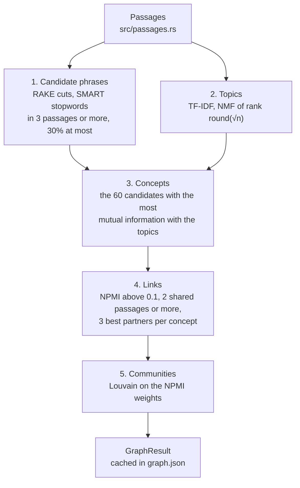

# The concept graph

The concept graph shows which subjects a book keeps returning to and which of them it treats together. A concept is a phrase from the book, such as "march hare" or "transcendental realism". Two concepts are linked when they stand in the same passages more often than chance predicts, and linked concepts fall into communities. Every concept and every link carries the ids of its passages, so each one can be checked against the text with `read`.

The graph gives a map of a book before you know what to search for: its recurring subjects, which of them go together, and where in the book each one appears. It is built from the passages alone, without the outline or the embedding model, takes seconds, and is cached with the book's index.

```sh
ebook-hero graph book.epub
ebook-hero graph book.epub --json
ebook-hero graph book.epub --json --full
```

The MCP tool `concept_graph` takes `path` and an optional `full`, false by default. `--json` prints exactly what the tool returns.

## The pipeline

`build` in `src/graph/mod.rs` turns the book's passages into a graph in five steps.



The passages are the ones search ranks (`build_passages` in `src/passages.rs`): runs of whole paragraphs, list items and notes of at most `PASSAGE_MAX_WORDS` = 220 words that never cross a heading or, in an EPUB, a file. A passage is the unit of co-occurrence. Two concepts occur together when both stand in one passage, wherever they are inside it. Heading blocks reach a passage only as its section path, so their text never enters the graph.

Below, n is the number of passages. `build` refuses a book with fewer than `GRAPH_MIN_BOOK_PASSAGES` = 20 passages, with an error such as "the book has 19 passages; a concept graph needs at least 20, so use search or find on a book this short".

### Step 1: candidate phrases

`candidates` in `src/graph/phrases.rs` finds candidates as RAKE does: a candidate is a run of words between stopwords and punctuation. The text is lowercased and read word by word.

- A word is a run of letters that may hold `-`, `'` or `’` between two letters, so "labor-power" and "naïve" stay whole.
- A final possessive `'s` or `’s` is dropped, so "Kant’s" becomes "kant".
- A word that still holds an apostrophe, a contraction such as "doesn't", cuts the run.
- Any other character that is neither a letter nor whitespace cuts the run: punctuation, digits and symbols. Whitespace, line breaks included, only separates words.
- A word cuts the run when it is one of the 571 SMART stopwords in `src/graph/smart_stopwords.txt` or has fewer than `MIN_WORD_LETTERS` = 3 letters.

The words that do not cut are content words. A run of 1 to `GRAPH_PHRASE_MAX_WORDS` = 3 content words is a phrase. A longer run is dropped whole, not split. The unit tests pin examples. "The transcendental realism of science, in 1975, rejects positivism." gives "transcendental realism", "science" and "rejects positivism". "Kant’s critique doesn't answer Hume's problem" gives "kant critique" and "answer hume problem". "red green blue yellow" gives nothing.

A phrase is keyed by its words stemmed with the search index's English stemmer (`stem_word` in `src/analysis.rs`, which stems a hyphenated word part by part), so "head" and "heads" share a key. Its label is the lowercased form it most often has, ties going to the form seen first.

A phrase becomes a candidate when it stands in at least `GRAPH_CANDIDATE_MIN_PASSAGES` = 3 passages and in at most `GRAPH_CANDIDATE_MAX_SHARE` = 0.3 of them. Both limits count passages, not occurrences. In the unit test with 10 passages, "mock turtle" stands in 3 and is kept, "gryphon" stands in 2 and is too rare, and "queen" stands in 4 and is too common.

A phrase stands in a passage only as a run of its own. "turtle" inside "mock turtle" does not count for a phrase "turtle". This is why `find` can list more mentions of a concept's words than the concept has passages.

RAKE goes on to score each candidate by the degree and frequency of its words. ebook-hero takes only RAKE's way of cutting candidates and chooses among them in step 3.

### Step 2: topics

`passage_topics` in `src/graph/topics.rs` sorts the passages into topics by non-negative matrix factorization (NMF). The output does not list the topics, only their number; step 3 uses them to choose concepts.

The number of topics k is `topic_count(n)`: the square root of n, rounded, and at least 2. The 166 passages of `tests/fixtures/alice.epub` give 13 topics.

The matrix X has a row per passage and a column per word. Its words are the `STEMMED` tokens of the search index (`src/analysis.rs`): lowercased and stemmed, without tantivy's English stopwords, question words such as "how" and "why", or tokens of 40 bytes or more. The SMART list of step 1 plays no part here. A word gets a column when it is in at least `MIN_PASSAGES` = 2 passages and in at most `MAX_SHARE` = 0.5 of them; a word in more passages is, as the code's comment puts it, in every topic. Columns are in alphabetical order, so the same book always gets the same matrix. A cell holds

$$x = (1 + \ln \mathrm{tf}) \cdot \left( \ln \frac{1 + n}{1 + \mathrm{df}} + 1 \right)$$

where tf is how often the word occurs in the passage and df is how many passages hold it. Each row is then scaled to unit length.

NMF approximates X by WH, where W is n × k, H is k × (number of words), and both are non-negative. The rank of the factorization is the number of topics. `nmf` lowers the squared error ‖X − WH‖² by Lee and Seung's multiplicative updates, H first and then W in each iteration:

$$H \leftarrow H \circ \frac{W^\top X}{W^\top W H + \epsilon} \qquad W \leftarrow W \circ \frac{X H^\top}{W H H^\top + \epsilon}$$

The product and the division are taken entry by entry, and `EPSILON` = 1e-10 prevents division by zero. Each factor is non-negative, so W and H stay non-negative without any clipping, and Lee and Seung (2001) prove that these updates never increase the error.

The starting values come from a SplitMix64 generator seeded with `NMF_SEED` = 1. Each entry of W and H is uniform on [0, 2√(x̄/k)), where x̄ is the mean cell of X with zeros included, so that WH starts with the same mean as X. A fixed seed gives the same start on every machine.

The loop runs at most `NMF_MAX_ITERATIONS` = 500 times. Every `CHECK_EVERY` = 10 iterations it computes the error, without forming WH, and it stops when the error fell by less than `NMF_TOLERANCE` = 1e-4 of its value at the previous check. The earliest stop is therefore after 20 iterations.

A passage's topic is the column of its row of W with the largest value, ties going to the lower topic. When no word passes the column limits, every passage is in topic 0.

### Step 3: choosing concepts

`select` in `src/graph/mod.rs` keeps the candidates that best predict a passage's topic. For a candidate, let G say whether a passage holds it and T be the passage's topic. The candidate's score is their mutual information in nats:

$$I(T;G) = \sum_{t} \sum_{g \in \{0,1\}} p(t,g) \ln \frac{p(t,g)}{p(t)\,p(g)}$$

Every probability is a share of the n passages: p(t) is the share in topic t, p(g = 1) the share that hold the phrase, p(t, 1) the share that are in topic t and hold it, and p(t, 0) the share in topic t that do not. A term without passages counts as 0. The unit test pins hand values: with four passages in topics 0, 0, 1, 1, a phrase in the first two scores ln 2 and a phrase in the first and the third scores 0.

The score is high for a phrase whose passages fall in few topics. It can never exceed the entropy of G, so a phrase in only 3 passages scores low however concentrated it is.

The `GRAPH_CONCEPTS` = 60 highest scores become the concepts, ties going to the phrase in more passages, then to the lower key. The concepts are then sorted by their first passage, ties by label, and numbered from 0 in that order.

### Step 4: links

`links` in `src/graph/mod.rs` scores each pair of concepts by normalized pointwise mutual information (NPMI). With $d_a$ and $d_b$ the numbers of passages each concept stands in and $s$ the number both stand in, `npmi` computes

$$\mathrm{npmi}(a,b) = \frac{\ln \dfrac{s\,n}{d_a\,d_b}}{-\ln \dfrac{s}{n}}$$

This is $\ln \frac{p(a,b)}{p(a)\,p(b)}$ divided by $-\ln p(a,b)$, with each probability a share of passages. It is 1 when the two only ever stand together ($s = d_a = d_b$), 0 when they share as many passages as independence predicts ($s = d_a d_b / n$), and negative when they share fewer. The unit test pins both values: `npmi(2, 2, 2, 10)` is 1 and `npmi(4, 5, 2, 10)` is 0.

In `alice.epub`, "hatter" stands in 18 passages, "march hare" in 17, and they share 16 of the 166:

$$\frac{\ln (16 \cdot 166 / (18 \cdot 17))}{\ln (166 / 16)} = \frac{\ln 8.68}{\ln 10.38} = \frac{2.161}{2.339} = 0.924$$

Each concept keeps up to `GRAPH_PARTNERS` = 3 partners. The partners it can keep are the concepts that share at least `GRAPH_MIN_SHARED` = 2 passages with it and have an NPMI above `GRAPH_NPMI_FLOOR` = 0.1; it keeps those with the highest NPMI, ties going to the lower id. A link exists when either concept keeps the other. A concept that many others keep can therefore have more than three links ("king" in `alice.epub` has eight), and a concept that keeps no partner and is kept by none has no link.

The share limit of step 1 keeps the formula defined. Both concepts stand in at most 0.3n passages, so s is at most 0.3n and the denominator is at least ln(1/0.3) ≈ 1.20, never 0. The minimum of 2 shared passages keeps the logarithms finite.

The output rounds NPMI to three decimals. Step 5 uses the unrounded value.

### Step 5: communities

`louvain` in `src/graph/communities.rs` finds communities by the Louvain method of Blondel, Guillaume, Lambiotte and Lefebvre. Its graph has the concepts as nodes and the links as undirected edges weighted by their NPMI. The method looks for the division into communities with the highest modularity:

$$Q = \frac{1}{2m} \sum_{i,j} \left( A_{ij} - \frac{k_i k_j}{2m} \right) \delta(c_i, c_j)$$

Here $A_{ij}$ is the weight between i and j, $k_i$ is the sum of i's weights, m is the sum of all edge weights, and $\delta(c_i, c_j)$ is 1 when i and j are in one community and 0 otherwise. Q compares the weight inside the communities with the weight a random graph with the same weighted degrees would put there.

The method alternates two phases. In the first, `move_nodes`, every node starts in a community of its own. The nodes are visited in index order, which at the first level is the order in which the book first mentions the concepts. A node i is taken out of its community. For that community and for each community C that i has a link into, the gain in modularity from putting i into C is

$$\Delta Q = \frac{k_{i,C}}{m} - \frac{\Sigma_C \, k_i}{2m^2}$$

where $k_{i,C}$ is the weight of i's links into C and $\Sigma_C$ is the sum of the degrees of the nodes in C, i excluded. The node joins the community with the largest gain. Its own community is the first best, and another replaces the best so far only when its gain is larger by more than `MIN_GAIN` = 1e-7, so that rounding cannot make a node move back and forth. Sweeps over all nodes repeat until a sweep moves no node.

In the second phase, `aggregate`, each community becomes one node. The links between two communities add up to one link, and the links inside a community become a self-loop holding twice their weight, as the adjacency matrix would. The first phase then runs on this smaller graph, and the two phases repeat until a first phase moves no node.

There is no resolution parameter, so the gains are those of the plain modularity above, and there is no limit on the number of passes. A concept without links stays a community of its own, and a graph without links has one community per concept.

`build` orders the communities largest first, ties going to the community whose first concept the book mentions earlier, and numbers them in that order. The integration test in `tests/graph.rs` pins two results for `alice.epub`: "mock turtle" and "gryphon" are in one community, and so are "hatter" and "march hare".

### What the graph leaves out

The graph filters no apparatus. It reads every passage, and the passages hold everything the readers keep.

- Notes count. The EPUB reader keeps footnotes and endnotes (`epub:type` footnote, endnote or rearnote, or `role` doc-footnote or doc-endnote) as note blocks, the PDF reader sets footnotes apart as note blocks, and `build_passages` packs notes into passages like paragraphs. The EPUB reader drops the note reference markers in the text.
- A contents page counts unless it is navigation. The EPUB reader skips `<nav>` elements, so the navigation document's table of contents never reaches a passage. A contents page set as ordinary text stays; in `alice.epub` it is passage 1.
- A bibliography and an index count. Nothing marks them, so they are read as paragraphs.
- Page furniture does not count. The PDF reader moves lines that repeat from page to page, such as running heads, out of the blocks into the document's `furniture`, which passages do not read ([furniture-detection.md](furniture-detection.md)).

## Output

`GraphResult` in `src/graph/mod.rs` holds the graph:

| Field | What it holds |
|---|---|
| `passages` | n, the number of passages in the book |
| `topics` | k, the number of topics of step 2 |
| `concepts[]` | `id`, `label`, `passage_count`, `passages` (ids in reading order) and `community` |
| `links[]` | `a` (the lower id), `b`, `npmi` (three decimals), and the `passage_count` and `passages` of the passages both concepts stand in |
| `communities[]` | `id` and `concepts` (ids, ascending) |

Concepts come in the order the book first mentions them, links sorted by `a` and then `b`, and communities largest first.

Unless `full` is set, each concept's and each link's `passages` holds only its first `GRAPH_PASSAGES_SHOWN` = 10 ids, while `passage_count` still gives the whole number. `Session::graph` applies this cut through `GraphResult::abridged` on every call, so the cache always holds the full lists. A link's passages are passages of both its concepts, which `tests/graph.rs` checks, and every id can be given to `read` as a passage id.

The text output starts with a summary line and then lists the communities, numbered from 1 where the JSON numbers them from 0. A community's heading names up to five of its concepts by passage count. Each concept then gets one line: its label, its passage count, its first passage, and its links with their NPMI to two decimals, highest first. `--full` changes only the JSON.

```console
$ ebook-hero graph tests/fixtures/alice.epub
60 concepts in 8 communities · 166 passages · 13 topics
…
Community 8: time, hatter, march hare, dormouse
  time        47 passages, first 3    found 0.18, march hare 0.17, hatter 0.15
  hatter      18 passages, first 77   march hare 0.92, dormouse 0.76, court 0.38, time 0.15
  march hare  17 passages, first 77   hatter 0.92, dormouse 0.72, majesty 0.24, time 0.17
  dormouse    13 passages, first 80   hatter 0.76, march hare 0.72, court 0.48
```

A book in which no phrase is a candidate gets an empty graph, and the text output says why: "no phrase occurs in at least 3 passages and in at most 30% of them, so the book has no concepts".

The Graph tab of the desktop window runs `ebook-hero graph --json --full` and reads `passages`, `concepts[].{id, label, passage_count, passages, community}`, `links[].{a, b, npmi, passages}` and `communities[].{id, concepts}` (`gui/graph.js`). Renaming or removing one of these fields breaks the window.

## Caching

`Book::graph` in `src/index/book.rs` builds the graph on the first call and writes it to `graph.json` in the book's cache directory, beside `manifest.json`, `passages.json` and the lexical index. The file holds the full graph and the `GRAPH_VERSION` that made it, now 2. Later calls on the open book use the copy in memory. Any other call, in this process or another, reads the file when its version matches. A file from another version, or one that does not parse, is rebuilt, and a warning on stderr says why. Reading and building happen under the book's build lock, so two processes never build the same graph at once.

When the index itself is stale because a reader, the passage packing, an analyzer, the document schema or the tool version changed, the whole cache directory is rebuilt and `graph.json` goes with it. A cache directory deleted after the book was opened, for example by `ebook-hero cache clear`, gives an error that asks for another call, which builds it again.

## Why it works this way

Phrases. A concept is named in the book's own words and backed by the passages that hold them, so every concept can be checked by reading. Cutting at stopwords and punctuation keeps a multi-word name such as "march hare" or "mock turtle" whole without a parser or a model. Stemmed keys gather the inflected forms of a phrase under one concept.

Topics. Frequency alone favours phrases spread evenly through a book. Mutual information with the topics favours phrases that tell its parts apart: of two phrases in the same number of passages, the one whose passages fall in fewer topics scores higher. The share limits remove what is everywhere before either count is made.

NPMI rather than shared counts. The number of passages two concepts share grows with how common each of them is. In `alice.epub`, "time" stands in 47 passages and shares 8 with "hatter", half as many as "march hare" shares with it. Yet chance alone predicts 47 · 18 / 166 ≈ 5.1 shared passages for "time", so its NPMI with "hatter" is 0.149 against 0.924 for "march hare". Plain PMI errs the other way and favours rare pairs: two concepts in 3 passages each that share 2 have a PMI of ln 36.9 = 3.61, above the 2.16 of "hatter" and "march hare", but an NPMI of 0.82, below their 0.92. Dividing by −ln p(a,b) bounds the score between −1 and 1 with fixed meanings at −1, 0 and 1 (Bouma 2009), so one floor of 0.1 serves every pair in every book.

Communities. A community is a set of concepts "more linked to each other than to the rest", as the comment on `Community` says. Modularity measures that against what the concepts' degrees alone predict, so a concept with many links does not draw every concept it touches into its community. In `alice.epub`, "hatter", "march hare" and "dormouse" form one community, and "king", "jury", "trial", "court" and "slates" another.

Determinism. The same book gives the same graph on every machine. The NMF start comes from a fixed seed, the matrix columns are in word order, Louvain visits nodes in index order, and every sort breaks ties by count, id or key. The integration test builds the graph of `alice.epub` in two separate caches and requires them to be equal. A cached graph is therefore the graph a fresh build would give.

## Limits

- A book needs at least 20 passages.
- A graph has at most 60 concepts, however long the book. In a long book more subjects compete for the 60 places, and a subject whose phrases score lower is left out however often it occurs.
- The method is for English: the SMART stopwords and the stemmer are English.
- A phrase is any run of up to three content words, not a noun phrase. In `alice.epub` "thought alice" is a concept, because "said" is a SMART stopword and "thought" is not.
- A name that holds a stopword, a digit or a word of fewer than three letters is split or lost: "queen of hearts" gives "queen" and "hearts". A run of more than three content words gives nothing.
- The 30% limit can remove a book's most frequent subject. In `alice.epub` "alice" stands alone in more than 100 of the 166 passages, where the limit allows 49, so the heroine is not a concept.
- Only stand-alone mentions count. Pronouns, synonyms and a concept's words inside a longer phrase add nothing to its passages, and "hatter" and "mad hatter" would be two concepts.
- Whitespace never cuts a phrase, and the blocks of a passage are joined by a blank line. A paragraph or list item that ends without punctuation therefore runs into the first words of the next block.
- A link says only that two concepts share passages more often than chance predicts. It has no direction or kind, and a passage of up to 220 words counts as one place whatever the distance between the two inside it.
- Each passage belongs to exactly one topic, and the number of topics is fixed at √n rounded. The concepts are chosen by these topics, so a different factorization would choose different concepts.
- Louvain returns a local optimum of modularity, the one its fixed visiting order reaches.
- Apparatus counts like text. The Project Gutenberg header and licence of `alice.epub` (passage 0 and passages 149 to 165) give concepts such as "project gutenberg", "electronic works", "www", "gutenberg" and "org", and three of the eight communities consist mostly of them. "www", "gutenberg" and "org" are linked with an NPMI of 1, because the dots of www.gutenberg.org cut it into three phrases that always stand together.

## References

- Stuart Rose, Dave Engel, Nick Cramer and Wendy Cowley. "Automatic Keyword Extraction from Individual Documents". In Michael W. Berry and Jacob Kogan (eds.), *Text Mining: Applications and Theory*, John Wiley & Sons, 2010, pp. 1–20. RAKE, whose candidate step is step 1.
- David D. Lewis, Yiming Yang, Tony G. Rose and Fan Li. "RCV1: A New Benchmark Collection for Text Categorization Research". *Journal of Machine Learning Research* 5 (2004), pp. 361–397. Its Appendix 11 republishes the SMART stopword list in `src/graph/smart_stopwords.txt`.
- Daniel D. Lee and H. Sebastian Seung. "Learning the parts of objects by non-negative matrix factorization". *Nature* 401 (1999), pp. 788–791. NMF, applied there to images and to text.
- Daniel D. Lee and H. Sebastian Seung. "Algorithms for Non-negative Matrix Factorization". In *Advances in Neural Information Processing Systems 13* (NIPS 2000), MIT Press, 2001, pp. 556–562. The multiplicative updates for the squared error used in step 2.
- Guy L. Steele Jr., Doug Lea and Christine H. Flood. "Fast Splittable Pseudorandom Number Generators". In *Proceedings of the 2014 ACM International Conference on Object Oriented Programming Systems Languages & Applications* (OOPSLA 2014), ACM, 2014. SplitMix64, the generator that seeds NMF.
- Gerlof Bouma. "Normalized (Pointwise) Mutual Information in Collocation Extraction". In *From Form to Meaning: Processing Texts Automatically, Proceedings of the Biennial GSCL Conference 2009*, Gunter Narr, 2009, pp. 31–40. NPMI, used in step 4.
- Mark E. J. Newman and Michelle Girvan. "Finding and evaluating community structure in networks". *Physical Review E* 69 (2004), 026113. Modularity.
- Vincent D. Blondel, Jean-Loup Guillaume, Renaud Lambiotte and Etienne Lefebvre. "Fast unfolding of communities in large networks". *Journal of Statistical Mechanics: Theory and Experiment* (2008), P10008. The Louvain method of step 5.
