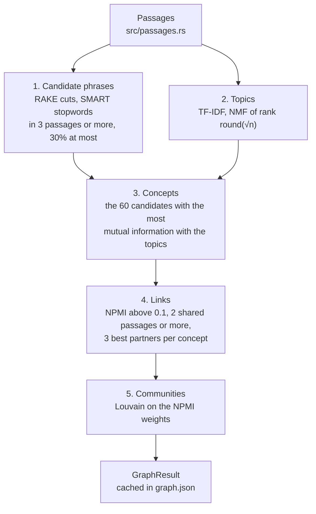

# The concept graph

The concept graph shows which subjects a book keeps returning to and which of them it treats together. A concept is a phrase from the book, such as "march hare" or "transcendental realism". Two concepts are linked when they stand in the same passages more often than chance predicts, and linked concepts fall into communities. Every concept and every link carries the ids of its passages, so each one can be checked against the text with `read`.

The graph gives a map of a book before you know what to search for: its recurring subjects, which of them go together, and where in the book each one appears. It is built from the passages alone, without the outline or the embedding model, takes seconds, and is cached with the book's index.

```sh
ebook-hero graph book.epub
ebook-hero graph book.epub --json
ebook-hero graph book.epub --json --full
```

The MCP tool `concept_graph` takes `path` and an optional `full`, false by default. `--json` prints exactly what the tool returns.

## The pipeline

The [concept-map](https://crates.io/crates/concept-map) crate builds the graph from the book's passages: `build` in `src/graph/mod.rs` hands it their texts and turns its result into the `GraphResult` described under [Output](#output). [concept-map's documentation](https://github.com/AhmedKishki/concept-map/blob/main/docs/concept-map.md) explains each step from the basics, with worked examples on `alice.epub`.



The passages are the ones search ranks (`build_passages` in `src/passages.rs`): runs of whole paragraphs, list items and notes of at most `PASSAGE_MAX_WORDS` = 220 words that never cross a heading or, in an EPUB, a file. A passage is the unit of co-occurrence. Two concepts occur together when both stand in one passage, wherever they are inside it. Heading blocks reach a passage only as its section path, so their text never enters the graph.

Below, n is the number of passages. `build` refuses a book with fewer than `GRAPH_MIN_BOOK_PASSAGES` = 20 passages, with an error such as "the book has 19 passages; a concept graph needs at least 20, so use search or find on a book this short".

The five steps, in short:

1. **Candidate phrases.** As RAKE cuts keywords, a phrase is a run of one to three content words between stopwords (the 571 of the SMART list), punctuation, digits and words of fewer than three letters. Its words are stemmed, so "head" and "heads" are one phrase, and it becomes a candidate when it stands on its own in at least 3 passages and in at most 30% of them. "turtle" inside "mock turtle" does not count for a phrase "turtle", which is why `find` can list more mentions of a concept's words than the concept has passages.
2. **Topics.** The passages are sorted into round(√n) topics, at least 2, by non-negative matrix factorization (NMF) of their TF-IDF weights, started from a fixed seed. The 166 passages of `tests/fixtures/alice.epub` give 13 topics. The output gives only their number.
3. **Concepts.** The 60 candidates with the most mutual information with the topics, the phrases whose passages fall in few topics, become the concepts. They are numbered in the order the book first mentions them.
4. **Links.** Each concept keeps up to three partners among the concepts that share at least 2 passages with it and have a normalized pointwise mutual information (NPMI) above 0.1, and a link exists when either concept keeps the other. NPMI is 1 for two concepts that only ever stand together and 0 for two that share passages as often as chance predicts. In `alice.epub`, "hatter" and "march hare" stand in 18 and 17 passages, share 16, and score 0.924. The output rounds NPMI to three decimals.
5. **Communities.** The Louvain method divides the linked concepts into communities that are more linked to each other than to the rest, by modularity, visiting the concepts in a fixed order, and the communities are numbered largest first. The integration test in `tests/graph.rs` pins two results for `alice.epub`: "mock turtle" and "gryphon" are in one community, and so are "hatter" and "march hare".

### What the graph leaves out

The graph filters no apparatus. It reads every passage, and the passages hold everything the readers keep.

- Notes count. The EPUB reader keeps footnotes and endnotes (`epub:type` footnote, endnote or rearnote, or `role` doc-footnote or doc-endnote) as note blocks, the PDF reader sets footnotes apart as note blocks, and `build_passages` packs notes into passages like paragraphs. The EPUB reader drops the note reference markers in the text.
- A contents page counts unless it is navigation. The EPUB reader skips `<nav>` elements, so the navigation document's table of contents never reaches a passage. A contents page set as ordinary text stays; in `alice.epub` it is passage 1.
- A bibliography and an index count. Nothing marks them, so they are read as paragraphs.
- Page furniture does not count. The PDF reader moves lines that repeat from page to page, such as running heads, out of the blocks into the document's `furniture`, which passages do not read ([furniture-detection.md](furniture-detection.md)).

## Output

`GraphResult` in `src/graph/mod.rs` holds the graph:

| Field | What it holds |
|---|---|
| `passages` | n, the number of passages in the book |
| `topics` | k, the number of topics of step 2 |
| `concepts[]` | `id`, `label`, `passage_count`, `passages` (ids in reading order) and `community` |
| `links[]` | `a` (the lower id), `b`, `npmi` (three decimals), and the `passage_count` and `passages` of the passages both concepts stand in |
| `communities[]` | `id` and `concepts` (ids, ascending) |

Concepts come in the order the book first mentions them, links sorted by `a` and then `b`, and communities largest first.

Unless `full` is set, each concept's and each link's `passages` holds only its first `GRAPH_PASSAGES_SHOWN` = 10 ids, while `passage_count` still gives the whole number. `Session::graph` applies this cut through `GraphResult::abridged` on every call, so the cache always holds the full lists. A link's passages are passages of both its concepts, which `tests/graph.rs` checks, and every id can be given to `read` as a passage id.

The text output starts with a summary line and then lists the communities, numbered from 1 where the JSON numbers them from 0. A community's heading names up to five of its concepts by passage count. Each concept then gets one line: its label, its passage count, its first passage, and its links with their NPMI to two decimals, highest first. `--full` changes only the JSON.

```console
$ ebook-hero graph tests/fixtures/alice.epub
60 concepts in 8 communities · 166 passages · 13 topics
…
Community 8: time, hatter, march hare, dormouse
  time        47 passages, first 3    found 0.18, march hare 0.17, hatter 0.15
  hatter      18 passages, first 77   march hare 0.92, dormouse 0.76, court 0.38, time 0.15
  march hare  17 passages, first 77   hatter 0.92, dormouse 0.72, majesty 0.24, time 0.17
  dormouse    13 passages, first 80   hatter 0.76, march hare 0.72, court 0.48
```

A book in which no phrase is a candidate gets an empty graph, and the text output says why: "no phrase occurs in at least 3 passages and in at most 30% of them, so the book has no concepts".

The Graph tab of the desktop window runs `ebook-hero graph --json --full` and reads `passages`, `concepts[].{id, label, passage_count, passages, community}`, `links[].{a, b, npmi, passages}` and `communities[].{id, concepts}` (`gui/graph.js`). Renaming or removing one of these fields breaks the window.

## Caching

`Book::graph` in `src/index/book.rs` builds the graph on the first call and writes it to `graph.json` in the book's cache directory, beside `manifest.json`, `passages.json` and the lexical index. The file holds the full graph and the `GRAPH_VERSION` that made it, now 2. Later calls on the open book use the copy in memory. Any other call, in this process or another, reads the file when its version matches. A file from another version, or one that does not parse, is rebuilt, and a warning on stderr says why. Reading and building happen under the book's build lock, so two processes never build the same graph at once.

The graphs also depend on the concept-map crate, so moving to a version of it whose graphs differ bumps `GRAPH_VERSION`.

When the index itself is stale because a reader, the passage packing, an analyzer, the document schema or the tool version changed, the whole cache directory is rebuilt and `graph.json` goes with it. A cache directory deleted after the book was opened, for example by `ebook-hero cache clear`, gives an error that asks for another call, which builds it again.

## Why it works this way

Phrases. A concept is named in the book's own words and backed by the passages that hold them, so every concept can be checked by reading. Cutting at stopwords and punctuation keeps a multi-word name such as "march hare" or "mock turtle" whole without a parser or a model. Stemmed keys gather the inflected forms of a phrase under one concept.

Topics. Frequency alone favours phrases spread evenly through a book. Mutual information with the topics favours phrases that tell its parts apart: of two phrases in the same number of passages, the one whose passages fall in fewer topics scores higher. The share limits remove what is everywhere before either count is made.

NPMI rather than shared counts. The number of passages two concepts share grows with how common each of them is. In `alice.epub`, "time" stands in 47 passages and shares 8 with "hatter", half as many as "march hare" shares with it. Yet chance alone predicts 47 · 18 / 166 ≈ 5.1 shared passages for "time", so its NPMI with "hatter" is 0.149 against 0.924 for "march hare". Plain PMI errs the other way and favours rare pairs: two concepts in 3 passages each that share 2 have a PMI of ln 36.9 = 3.61, above the 2.16 of "hatter" and "march hare", but an NPMI of 0.82, below their 0.92. Dividing by −ln p(a,b) bounds the score between −1 and 1 with fixed meanings at −1, 0 and 1 (Bouma 2009), so one floor of 0.1 serves every pair in every book.

Communities. A community is a set of concepts "more linked to each other than to the rest", as the comment on `Community` says. Modularity measures that against what the concepts' degrees alone predict, so a concept with many links does not draw every concept it touches into its community. In `alice.epub`, "hatter", "march hare" and "dormouse" form one community, and "king", "jury", "trial", "court" and "slates" another.

Determinism. The same book gives the same graph on every machine. The NMF start comes from a fixed seed, the matrix columns are in word order, Louvain visits nodes in index order, and every sort breaks ties by count, id or key. The integration test builds the graph of `alice.epub` in two separate caches and requires them to be equal. A cached graph is therefore the graph a fresh build would give.

## Limits

- A book needs at least 20 passages.
- A graph has at most 60 concepts, however long the book. In a long book more subjects compete for the 60 places, and a subject whose phrases score lower is left out however often it occurs.
- The method is for English: the SMART stopwords and the stemmer are English.
- A phrase is any run of up to three content words, not a noun phrase. In `alice.epub` "thought alice" is a concept, because "said" is a SMART stopword and "thought" is not.
- A name that holds a stopword, a digit or a word of fewer than three letters is split or lost: "queen of hearts" gives "queen" and "hearts". A run of more than three content words gives nothing.
- The 30% limit can remove a book's most frequent subject. In `alice.epub` "alice" stands alone in more than 100 of the 166 passages, where the limit allows 49, so the heroine is not a concept.
- Only stand-alone mentions count. Pronouns, synonyms and a concept's words inside a longer phrase add nothing to its passages, and "hatter" and "mad hatter" would be two concepts.
- Whitespace never cuts a phrase, and the blocks of a passage are joined by a blank line. A paragraph or list item that ends without punctuation therefore runs into the first words of the next block.
- A link says only that two concepts share passages more often than chance predicts. It has no direction or kind, and a passage of up to 220 words counts as one place whatever the distance between the two inside it.
- Each passage belongs to exactly one topic, and the number of topics is fixed at √n rounded. The concepts are chosen by these topics, so a different factorization would choose different concepts.
- Louvain returns a local optimum of modularity, the one its fixed visiting order reaches.
- Apparatus counts like text. The Project Gutenberg header and licence of `alice.epub` (passage 0 and passages 149 to 165) give concepts such as "project gutenberg", "electronic works", "www", "gutenberg" and "org", and three of the eight communities consist mostly of them. "www", "gutenberg" and "org" are linked with an NPMI of 1, because the dots of www.gutenberg.org cut it into three phrases that always stand together.

## References

- Stuart Rose, Dave Engel, Nick Cramer and Wendy Cowley. "Automatic Keyword Extraction from Individual Documents". In Michael W. Berry and Jacob Kogan (eds.), *Text Mining: Applications and Theory*, John Wiley & Sons, 2010, pp. 1–20. RAKE, whose candidate step is step 1.
- David D. Lewis, Yiming Yang, Tony G. Rose and Fan Li. "RCV1: A New Benchmark Collection for Text Categorization Research". *Journal of Machine Learning Research* 5 (2004), pp. 361–397. Its Appendix 11 republishes the SMART stopword list that concept-map cuts phrases at.
- Daniel D. Lee and H. Sebastian Seung. "Learning the parts of objects by non-negative matrix factorization". *Nature* 401 (1999), pp. 788–791. NMF, applied there to images and to text.
- Daniel D. Lee and H. Sebastian Seung. "Algorithms for Non-negative Matrix Factorization". In *Advances in Neural Information Processing Systems 13* (NIPS 2000), MIT Press, 2001, pp. 556–562. The multiplicative updates for the squared error used in step 2.
- Guy L. Steele Jr., Doug Lea and Christine H. Flood. "Fast Splittable Pseudorandom Number Generators". In *Proceedings of the 2014 ACM International Conference on Object Oriented Programming Systems Languages & Applications* (OOPSLA 2014), ACM, 2014. SplitMix64, the generator that seeds NMF.
- Gerlof Bouma. "Normalized (Pointwise) Mutual Information in Collocation Extraction". In *From Form to Meaning: Processing Texts Automatically, Proceedings of the Biennial GSCL Conference 2009*, Gunter Narr, 2009, pp. 31–40. NPMI, used in step 4.
- Mark E. J. Newman and Michelle Girvan. "Finding and evaluating community structure in networks". *Physical Review E* 69 (2004), 026113. Modularity.
- Vincent D. Blondel, Jean-Loup Guillaume, Renaud Lambiotte and Etienne Lefebvre. "Fast unfolding of communities in large networks". *Journal of Statistical Mechanics: Theory and Experiment* (2008), P10008. The Louvain method of step 5.
