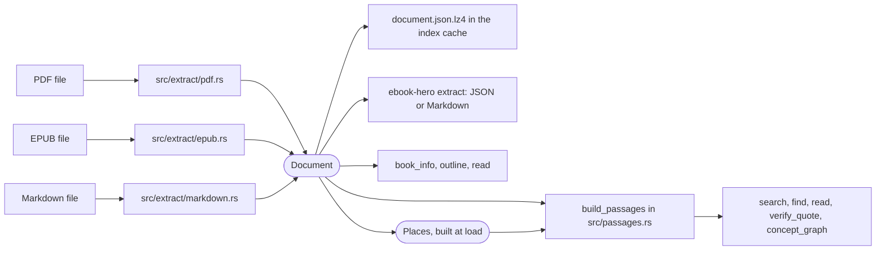
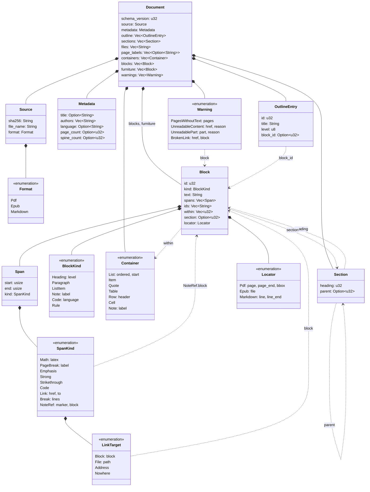

# The Document model

The three readers in `src/extract/` turn a PDF, an EPUB or a Markdown file into a `Document`, the type defined in `src/document/mod.rs`. Passage packing, the indexes, search, reading, quote verification and the concept graph all start from that value and never change it. Code after the readers therefore handles one shape of book, whatever format the file had. Only the locators keep each format's own way of saying where a piece of text sits.

`docs/pdf-reading.md`, `docs/epub-reading.md` and `docs/markdown-reading.md` describe how each reader fills the model.

## Where the model sits



`src/index/book.rs` runs the reader once per book, packs the blocks into passages and writes the document and the passages to the user cache as `document.json.lz4` and `passages.json.lz4`, in a directory named by the file's SHA-256. Later calls load the cached `Document` instead of reading the file again, and loading builds the book's `Places` from it and the passages from the stored pieces (see [Each fact once](#each-fact-once)). `ebook-hero extract` runs the reader on every call and prints the `Document`: as JSON with `--format json` or `--json`, otherwise as Markdown.

## Structure



A `Document` holds the text as two lists of blocks: `blocks` for the reading text and `furniture` for the lines the reader took out of it. Beside them sit facts about the file (`source`, `metadata`), the table of contents (`outline`), the tables that blocks point into (`sections`, `files`, `page_labels`, `containers`) and the parts the reader could not read (`warnings`). The JSON form uses the field names above, except where [The JSON form](#the-json-form) says a value is left out. `BlockKind`, `Container`, `SpanKind`, `LinkTarget` and `Warning` carry their variant in a `type` field, in snake case.

### Source

| Field | Content |
|---|---|
| `sha256` | The SHA-256 of the file's bytes as 64 hex digits, from `sha256_file` in `src/index/cache.rs`. It names the book's cache directory. |
| `file_name` | The last component of the path, converted to UTF-8 with invalid bytes replaced. |
| `format` | `"pdf"`, `"epub"` or `"markdown"`, decided from the file's content by `detect_format` in `src/extract/mod.rs`, whose tests `docs/markdown-reading.md` lists in order. |

### Metadata

| Field | PDF | EPUB | Markdown |
|---|---|---|---|
| `title` | The Info dictionary's `Title`, normalized; null when missing or empty | The package's main title, normalized; null when empty | Always null, since CommonMark defines no title |
| `authors` | The Info dictionary's `Author` as one entry, not split into names | Every creator in order, normalized, empty ones dropped | Always empty |
| `language` | Always null | The package's main language, trimmed | Always null |
| `page_count` | The number of pages | Always null | Always null |
| `spine_count` | Always null | The number of spine entries, skipped ones included | Always null |

### Blocks

A block is one unit of reading text: a heading, a paragraph, a list item, a note, a code block or a rule. The lists, tables and notes it sits in are not blocks. They are listed beside the blocks, and [Containers](#containers) describes them.

`id` numbers the blocks from 0 in reading order, so a block's id equals its index in `blocks`. JSON therefore leaves it out, and loading sets it from the position. `OutlineEntry.block_id`, `Section.heading` and the `BlockRange.block_id` of a passage in `src/passages.rs` refer to blocks by this number. `first_passage` in `src/read.rs` binary-searches the passages by block id, which works because ids rise in reading order.

`kind` is a `BlockKind`:

| Variant | JSON | Written by |
|---|---|---|
| `Heading { level }` | `{"type": "heading", "level": 2}` | EPUB: `h1` to `h6`, with the tag's level. PDF: a bookmark's heading, with the bookmark's depth, the top level being 1. Markdown: an ATX or setext heading, with its level. |
| `Paragraph` | `{"type": "paragraph"}` | All three readers. The Markdown reader also writes the text of a table cell or of an item in a tight list as one. |
| `ListItem` | `{"type": "list_item"}` | EPUB only: text directly inside an `li` |
| `Note { label }` | `{"type": "note", "label": "n1"}` | EPUB: footnotes and endnotes, labelled with the note element's id. PDF: notes found by the layout, always without a label. |
| `Code { language }` | `{"type": "code", "language": "rust"}` | Markdown: a fenced or indented code block. `language` is the first word of the fence's info string, or null. |
| `Rule` | `{"type": "rule"}` | Markdown: a thematic break, with empty text. |

The kind decides what happens downstream. `build_passages` packs paragraphs, list items, notes and code blocks into passages. A heading opens a section, through which it reaches the passages under it as their section path. A rule closes the passage being built as a heading does, but opens no section, because a rule separates parts of a text without naming a new one. A block without words, such as a rule or an empty table cell, goes into no passage and does not close the one being built.

`text` is the block's text after `normalize` in `src/normalize.rs`: Latin ligatures expanded, soft hyphens, zero-width spaces, byte-order marks and non-whitespace control characters dropped, composed to NFC, every whitespace run collapsed to one space, and trimmed. It is a single line without markup. A code block is the one exception. Collapsing its whitespace would change the code, so its `text` keeps its lines and indentation as written, without the final newline. Quote verification still finds a quote in it, because `find_exact` in `src/verify.rs` collapses the whitespace of the text it searches. The markup that the model names survives as spans over `text`, so a reader that marks spans normalizes through `normalize_with_spans`, which takes the same steps and moves the spans onto the normalized text, as `docs/markdown-reading.md` describes.

`section` is the index in `sections` of the section the block is in. A block before the first heading has none, and [Sections](#sections) explains how the others get theirs. `within` lists the containers the block sits in, and [Containers](#containers) explains how to read it. `locator` says where the block is in the file, with the fields that [Locators](#locators) lists.

`ids` holds the element ids of an EPUB block: the ids of the elements that start in the block, its own included, and of the empty elements met since the block before. The EPUB reader resolves a table-of-contents fragment to the first block whose `ids` hold it. The Markdown reader gives a heading the id GitHub gives it, taken from the heading's text as written, and resolves a `#` link through `ids` the same way. The PDF reader writes none.

`spans` marks ranges of `text` without changing it. A `Span` covers `start..end`, counted in Unicode code points of `text`, and its `SpanKind` says what the range is:

| Variant | JSON | Marks |
|---|---|---|
| `PageBreak { label }` | `{"type": "page_break", "label": "45"}` | A point where a page of the printed edition starts. The EPUB reader puts each break at offset 0 of the first block whose text starts on the new page. |
| `Math { latex }` | `{"type": "math", "latex": "H"}` | A formula. Reserved: no reader writes one. |
| `Emphasis`, `Strong`, `Strikethrough` | `{"type": "emphasis"}` | Text in that style. The Markdown reader writes them. |
| `Code` | `{"type": "code"}` | Inline code. The Markdown reader writes it. |
| `Link { href, to }` | `{"type": "link", "href": "#setup", "to": {"type": "block", "block": 12}}` | A link. `href` is the target as the file wrote it, and `to` is where the reader found that it leads. The Markdown reader writes one for each link with text, and `docs/markdown-reading.md` gives the rules it resolves `to` by. |
| `Break { lines }` | `{"type": "break", "lines": 2}` | The space in `text` that stands for line breaks. `lines` counts them, so 2 leaves a blank line, as between two stanzas of a poem. The Markdown reader writes one for each run of hard breaks. |
| `NoteRef { marker, block }` | `{"type": "note_ref", "marker": "1", "block": 7}` | A footnote reference, as a point. `marker` is what the reference shows and `block` the note's first block, or null when the reader did not find the note. The Markdown reader writes one for each footnote reference, with its label as `marker`. |

`LinkTarget` is the `to` of a link. The reader decides what a link is, so the window acts on `to` and never on the book's format.

| Variant | JSON | Leads to |
|---|---|---|
| `Block { block }` | `{"type": "block", "block": 12}` | A block of this document |
| `File { path }` | `{"type": "file", "path": "ch2.md"}` | A file beside this one, as a path relative to its directory |
| `Address` | `{"type": "address"}` | An address with a scheme, such as `https:` or `mailto:` |
| `Nowhere` | `{"type": "nowhere"}` | A target the reader could not find, or one outside what the model holds |

The spans of one block follow four rules. `span_errors` in `src/document/mod.rs` returns a message for each rule a block breaks, so that a reader's tests can check what the reader wrote.

- `start` and `end` count code points of `text`, and no `end` lies past the text. `extract --format json` prints the `Document` as it is and the window reads it, and AGENTS.md fixes code points for output. Library code that needs a byte offset converts through `byte_offset`, the one helper for it.
- Spans are well nested: two spans either do not overlap or one holds the other. The view and the writer can then open and close marks with a stack.
- Spans are sorted by `start`, and the longer first when two start together. A walk from the first span to the last therefore meets every span after the one that holds it, which is the order a stack opens them in.
- Only a `NoteRef` or a `PageBreak` may be empty (`start` equals `end`), since each marks a point. A note marker is apparatus and a page break is a position, so neither adds characters to `text`, and a quote that runs across either still verifies.

An EPUB note as JSON, the first block on printed page 45:

```json
{
  "kind": { "type": "note", "label": "n1" },
  "text": "1 Source.",
  "spans": [{ "start": 0, "end": 0, "kind": { "type": "page_break", "label": "45" } }],
  "ids": ["n1"],
  "section": 3,
  "locator": { "file": 2 }
}
```

### Containers

`containers` lists what the blocks sit in, each container once, in the order it opens, and a container's id is its index. A block's `within` holds the ids of the containers around it, outermost first. JSON leaves both lists out when they are empty. Only the Markdown reader writes containers, so the PDF and EPUB readers leave both lists empty.

| Variant | JSON | Stands for |
|---|---|---|
| `List { ordered, start }` | `{"type": "list", "ordered": true, "start": 3}` | A list. `start` is the first number of an ordered list, kept because readers cite an item by its number. |
| `Item` | `{"type": "item"}` | One item of a list |
| `Quote` | `{"type": "quote"}` | A block quote |
| `Table` | `{"type": "table"}` | A table |
| `Row { header }` | `{"type": "row", "header": true}` | A row of a table; `header` marks the header row |
| `Cell` | `{"type": "cell"}` | A cell of a row |
| `Note { label }` | `{"type": "note", "label": "n1"}` | A footnote or endnote. `label` is the note's id in an EPUB or its label in Markdown, and null in a PDF. |

Storing each container once keeps a block's path to a few numbers: a table of 1,000 cells would otherwise repeat its table and row in every cell. Ids follow the order the containers open, so two adjacent lists differ by id. A paragraph in the second item of a list inside a quote has a `within` like `[0, 1, 3]`: quote 0, list 1, and item 3, the first item being 2. A table is built like a list, and its cells hold ordinary blocks. This Markdown:

```markdown
## Registers

| Register | Address |
|----------|---------|
| STATUS   | 0x1A    |
| CONTROL  |         |
```

gives `containers` `[table, row (header), cell, cell, row, cell, cell, row, cell, cell]` with ids 0 to 9, and these blocks, all under the section `Registers`:

| id | kind | text | within | line |
|---|---|---|---|---|
| 0 | heading 2 | Registers | | 1 |
| 1 | paragraph | Register | 0, 1, 2 | 3 |
| 2 | paragraph | Address | 0, 1, 3 | 3 |
| 3 | paragraph | STATUS | 0, 4, 5 | 5 |
| 4 | paragraph | 0x1A | 0, 4, 6 | 5 |
| 5 | paragraph | CONTROL | 0, 7, 8 | 6 |
| 6 | paragraph | (empty) | 0, 7, 9 | 6 |

A cell that holds two paragraphs gives two blocks with the same `within`.

A container exists only through the blocks inside it, so an empty one would vanish from the document. A reader therefore writes an empty `Paragraph` into a container that would otherwise hold no block, such as the empty cell in block 6 or an empty list item. Passages skip such a block, because an empty text has no words.

Three models of nesting were weighed. A tree, as in Pandoc's AST or in mdast, holds the same structure, but a block's id would stop being its index in `blocks`, and every reader of the `Document` would have to walk the tree. Docling's `DoclingDocument` keeps a flat list with references to parents, so a consumer follows links to learn where a block sits. The path puts that answer on the block, and a view opens and closes containers by comparing the paths of neighbouring blocks in one pass. The containers' kinds sit in one list beside the blocks, so the path costs a few ids per block.

Containers add structure that search does not use. Passages, search, verify and the concept graph go on reading `text`, so a table cell packs like a paragraph and the passages of a table read as its cells in order.

### Sections

`sections` holds one `Section` per heading, in reading order. `heading` is the heading's block. `parent` is the section around it, always an earlier one, or null at the top. A block's `section` names the innermost section it is in, which for a heading is the section it opens. A block's section path follows the chain of parents up from its section and lists it outermost first, each title taken from a heading block's text. [`Places`](#places) builds these paths when a book is loaded.

`assign_sections` in `src/extract/mod.rs` builds the sections for every reader once all blocks exist. It walks the blocks in order with a stack of open sections. A heading of level n closes every open section of level n or deeper and opens its own inside the one left on top, which becomes its `parent`. Blocks before the first heading are in no section. Levels the book skips open nothing, so a book whose chapters are all `h2` gets one top-level section per chapter.

The test `skipped_levels_replace_deeper_entries` shows the rule through the paths that result:

| Heading | Level | Section path |
|---|---|---|
| A | 1 | `["A"]` |
| C | 3 | `["A", "C"]` |
| C2 | 3 | `["A", "C2"]` |
| B | 2 | `["A", "B"]` |
| D | 4 | `["A", "B", "D"]` |
| B2 | 2 | `["A", "B2"]` |

The levels come from the heading blocks, not from the outline. An EPUB heading has the level of its tag, a PDF heading the depth of its bookmark, and a Markdown heading the level its `#` marks or its setext underline gives. In `tests/fixtures/sample.pdf` the bookmarks give three headings, and `sections` reads `[{"heading": 3, "parent": null}, {"heading": 7, "parent": 0}, {"heading": 16, "parent": null}]`. Block 7, `Joint entropy`, opens its section inside the one of `Entropy`, so a paragraph under it has the path `["Entropy", "Joint entropy"]`.

### Locators

A `Locator` has one variant per format and holds only what differs from one block to the next. What many blocks share sits once in the `Document`, and [`Places`](#places) derives what follows from it.

`Locator::Pdf`:

| Field | Content |
|---|---|
| `page` | The 1-based physical page where the block starts |
| `page_end` | The page where the block ends, set only when that is a later page |
| `bbox` | `[left, top, right, bottom]` of the block's lines on `page`, in points measured from the top-left corner of the page's media box, so `top` is less than `bottom`; null for a heading the reader inserts because no paragraph on the bookmark's page matched it |

A page's printed label sits in `Document.page_labels`, one entry per physical page with page 1 first, filled from the PDF's page-label ranges. The list is empty when the PDF defines no ranges or they could not be read. `Document::page_label(page)` reads it and gives `None` for a page the list does not hold.

`Locator::Epub`:

| Field | Content |
|---|---|
| `file` | The index in `Document.files` of the block's content document |

`files` lists the content documents the reader read, in spine order, each as its path relative to the package document's directory, percent-decoded and stripped of control characters, such as `text/ch 1.xhtml`. A document skipped with a warning is not in it, while one that gave no text keeps its entry, so `files` can name a document that holds no block.

`Places` derives the other EPUB facts a locator needs:

- `para`, the block's 1-based position among the blocks of its content document, restarting at 1 in every document;
- `print_page`, the printed page in effect where the block's text starts: the label of the last `PageBreak` at or before the block's start, in that block or an earlier one, so a page carries from one content document to the next and is absent before the first break.

The passage locator built from `para` in `src/passages.rs` adds a paragraph count from the nearest heading, which `Places::section_para` gives. `locator_text` in `src/read.rs` prints that count, or the file and the `para` range for text before the first heading.

`Locator::Markdown`:

| Field | Content |
|---|---|
| `line` | The line of the file where the block starts, counted from 1 |
| `line_end` | The line where the block ends, set only when that is a later line |

A Markdown file has no pages, files or printed pages. `Places` gives its blocks `para` 0 as it does a PDF's, and `section_para` counts them under their heading as for an EPUB. The passage locator built from them, `PassageLocator::Markdown` in `src/passages.rs`, takes `line_start` from the first block's `line` and `line_end` from the last block's `line_end`, or its `line` when that is unset, and `under_heading` as the EPUB form does. `locator_text` prints it as `search ¶3–5, lines 260–284`, and as `lines 260–284` for text before the first heading.

The model stores no anchor, the last element id at or before a block's start, because a link into the book resolves through the `ids` of the block that holds its target.

A PDF locator as JSON:

```json
{
  "page": 2,
  "page_end": 3,
  "bbox": [72.0, 96.5, 523.3, 240.1]
}
```

### Outline

`outline` lists the table of contents in reading order.

| Field | Content |
|---|---|
| `id` | The entry's position in the list, from 0 |
| `title` | The entry's text, normalized; entries with an empty title are dropped before numbering |
| `level` | The depth in the tree, the top level being 1; a depth above 255 is stored as 255 |
| `block_id` | The block where the entry's text starts, or null when the reader could not place it |

The PDF reader takes the bookmarks that lead to a page of the book. For each one it marks the matching paragraph as a `Heading` or inserts a new `Heading` block, so every PDF entry points at a heading. The EPUB reader takes the navigation document or the NCX and points each entry at the block that carries the target's element id, or at the first block of the target file. An EPUB entry can point at a paragraph, and its level need not equal the tag level of the heading it points at. The Markdown reader makes one entry per heading with text, at the heading's level, pointing at the heading block.

The `outline` tool lists these entries. Reading by outline entry starts at the entry's first passage and stops before the first passage of the next entry at the same level or nearer the top (`entry_range` in `src/read.rs`).

### Furniture

`furniture` holds the lines the reader took out of the reading text. Only the PDF reader fills it. `furniture` from the furniture-detection crate picks the lines that other pages predict, such as running heads and page numbers ([furniture-detection.md](furniture-detection.md)), and `build_document` in `src/extract/pdf.rs` makes each into a block:

- kind `Paragraph`, text normalized, lines whose text is empty left out;
- no `section`;
- a PDF locator with the page and the line's box, and `page_end` null;
- ids counting from 0 inside `furniture`, independent of the ids in `blocks`, which loading sets as it does for `blocks`.

The EPUB and Markdown readers write an empty list. Nothing after the readers reads `furniture`, so these lines never enter passages, search hits or the Markdown output. They appear only in `document.json.lz4` and in the output of `ebook-hero extract --format json`. `docs/furniture-detection.md` explains how the PDF reader finds them.

### Warnings

| Variant | JSON `type` | Fields | Written by |
|---|---|---|---|
| `PagesWithoutText` | `pages_without_text` | `pages` | PDF: the pages that were read and hold no text |
| `UnreadableContent` | `unreadable_content` | `href`, `reason` | EPUB: a spine item that was skipped, named by its href, or by its `idref` when the manifest lacks it |
| `UnreadablePart` | `unreadable_part` | `part`, `reason` | PDF: a part left out or replaced, named `page 7`, `page labels`, `outline` or `word spacing`. Markdown: an HTML block or the front matter left out, named by its line, such as `HTML block at line 12` |
| `BrokenLink` | `broken_link` | `href`, `block` | Markdown: a `#` link that no block's `ids` hold, with the target as written and the block that holds the link |

A warning means the reader left part of the book out and read the rest. A book with no text at all is an error instead: `Unreadable` with "no readable text" for an EPUB or a Markdown file, and `NoTextLayer` ("no text layer; OCR is not supported") or `Unreadable` for a PDF. The warnings reach the `book_info` result (`BookInfo.warnings` in `src/read.rs`) and the output of `ebook-hero info`, which words a broken link as `the link to #setup in block 12 leads nowhere in this document`.

## Each fact once

A fact is stored once, at the level where it holds: the document, a run of blocks, one block, or a point in a block's text. What follows from the stored facts is computed when a book is loaded, so neither `document.json.lz4` nor the output of `extract --format json` repeats it. The output of search, read and verify loses nothing by this: each passage carries its full section path and locator, which `build_passages` derives as it builds the passages.

| Fact | Stored as |
|---|---|
| a block's section | `section`, an index into `sections` |
| a section's path | derived: the chain of `parent`s, titled by the heading blocks |
| an EPUB block's file | `file` in the locator, an index into `files` |
| an EPUB block's paragraph number | derived: its position among the blocks of its file |
| an EPUB printed page | a `PageBreak` span where the page starts |
| the printed page at a block | derived: the last `PageBreak` at or before the block's start |
| a PDF page's label | `page_labels`, one entry per page |
| an element id | `ids` on the block where the element is |
| a container | `containers`, once, its id being its index |
| the containers around a block | `within` on the block, their ids outermost first |
| a block's id | derived: its position in `blocks` |
| a locator's format | derived: `source.format`, and the locator's own fields |
| a passage's text, section and locator | derived: `passages.json.lz4` stores its pieces as a block, an offset and a length |

Alice's 875 blocks lie in 19 sections and 14 content documents, so a block holds two small numbers where it would otherwise repeat the heading texts above it and its document's name. Its document takes 304 KB as `extract --format json` prints it, against 523 KB when every block carried these facts.

### Places

`Places` in `src/document/places.rs` holds what is derived. `Places::new` builds it in one pass over the sections and one over the blocks, so every lookup afterwards takes constant time:

| Method | Gives |
|---|---|
| `section_path(block)` | the heading texts above the block, outermost first; a heading's own path ends with its text |
| `para(block)` | the block's position among the blocks of its EPUB file, from 1; 0 in a PDF or a Markdown file |
| `section_para(block)` | the block's number among the non-heading blocks of its section, from 1; 0 for a heading |
| `print_page(block)` | the label of the last `PageBreak` at or before the block's start |

`Places` keeps its own copies of the paths and labels it returns, so it can sit beside the `Document` in `Book` (`src/index/book.rs`), which builds it whenever it loads a book. `build_passages` takes it with the document and reads from it each passage's section path and EPUB locator. A PDF page's label needs no table of its own, because `page_labels` already holds one entry per page.

### Passages

`passages.json.lz4` stores each passage as its pieces and no text. A piece is `len` bytes of the text of block `block`, from byte `offset`, and `StoredPiece` in `src/passages.rs` is those three numbers. Every piece is part of a block, and `document.json.lz4` already holds the text of every block, so storing a passage's text would store it twice. Alice's `passages.json.lz4` takes 7.2 KB, against 119 KB when each passage also carried its text.

`stored_form` turns the passages `build_passages` made into pieces, and `assemble` turns them back when a book is loaded. `assemble` cuts each piece out of its block, joins the pieces with a blank line, and takes the section path and the locator from `Places`. `build_passages` makes a passage with the same function, so a loaded passage equals the built one in its text, its `BlockRange`s, its section and its locator, and nothing after loading sees that passages are stored as pieces. Loading assembles every text once, because search, find and verify scan the passage texts many times; that copy lives only in memory.

The pieces come from a file on disk, so `assemble` checks them. A piece in a block that does not exist, a piece that runs past the end of its block or starts or ends inside a character, and a passage without pieces are each an `Error::Index` that names `passages.json.lz4` and says to run `ebook-hero cache clear`. Opening a book handles that error like any cache file that does not load: it logs a warning and builds the index again. The stored form is part of what `PASSAGES_VERSION` versions, so an index made before pieces, which stores each passage's text, is built again when its book is opened.

### The JSON form

Serde writes each field under its name, except where a value is derived or empty:

- A block's `id` is left out, and `numbered` in `src/document/mod.rs` restores it: serde reads the `blocks` and `furniture` lists through it, and it numbers each list from 0.
- A locator carries no `format` tag, since its fields tell the variants apart: a PDF locator has `page`, an EPUB locator `file`, a Markdown locator `line`. `Locator` is written untagged, and its hand-written `Deserialize` reads every field a locator may have into `LocatorFields` in one pass and picks the variant from the fields present. A locator with fields of two formats, such as `page` and `file`, or with none, does not load. Serde's untagged enums would buffer each locator and try one variant after the other, which is slower and fails with a message that names no field.
- `containers`, `spans`, `ids`, `within` and a block's `section` are left out when they are empty or absent, and take their defaults when the JSON lacks them.

## Design principles

### Readers write it, nothing rewrites it

AGENTS.md sets the boundary: readers turn a file into a `Document`, and everything after them reads it and never changes it. The code keeps to it: `build_passages` takes `&Document` with its `Places`, `read_passages` takes `&Document`, and the cache stores the `Document` as the reader wrote it. `Places` is derived from the document and never written back into it. A change in what downstream code sees must therefore come from a reader, and AGENTS.md requires every reader change to bump `PDF_READER_VERSION`, `EPUB_READER_VERSION` or `MARKDOWN_READER_VERSION` in `src/settings.rs`, which rebuilds the cached indexes.

### Flat blocks

`blocks` is one list in reading order. Structure travels as data on each block (`kind`) and as numbers that point into lists: a block's `section` into `sections`, its `within` into `containers`, and `Section.heading`, `OutlineEntry.block_id` and `BlockRange.block_id` into `blocks`. Lists, quotes and tables therefore nest through paths and not through a tree, for the reasons that [Containers](#containers) gives. A consumer walks one sequence: `build_passages` packs consecutive blocks, and `gui/book.js` draws the book as "its text in order". The formats reach this shape in different ways. The EPUB reader flattens a tree of elements, the Markdown reader writes each block as pulldown-cmark's events close it, with a stack of the containers open around it, and the PDF reader builds paragraphs up from positioned lines.

### Plain text with standoff spans

`text` holds plain characters with no markup. A span marks a range of `text` by offset and leaves the characters alone. A `PageBreak` marks the point where a printed page starts and adds no character, so search, passage packing and quote verification read the same characters at the same offsets whether a book marks its pages or not. Emphasis, links and note references work the same way, and so does a `Break`, which marks the one space that stands for line breaks. A future `Math` span could carry LaTeX for a formula in the same way. `src/normalize.rs` is "shared by every reader and by quote verification", so a quote and the text it is checked against pass through the same function.

### Locators per format

A PDF places a block by physical page and box, an EPUB by content document, and a Markdown file by line. The locator holds only these, while the printed label, the paragraph number and the printed page come from the document's tables and from `Places`. An EPUB has no physical pages, a PDF has no files or element ids, and a Markdown file has neither pages nor files, so the model gives each format its own variant and no shared fields. Each consumer handles every variant explicitly. `PassageLocator` in `src/passages.rs` keeps the split. `locator_text` in `src/read.rs` prints `p. 12–13 (xii–xiii)` for a PDF, `CHAPTER I ¶3–5, print p. 45` for an EPUB and `search ¶3–5, lines 260–284` for a Markdown file. `gui/book.js` handles neither variant, because `read --json` gives each passage the ids of its blocks (`PassageRef.blocks` in `src/read.rs`, taken from the passage's `BlockRange`s) and the window marks those.

### Furniture kept apart

Running heads and page numbers left in `blocks` would enter passages and match searches. Dropped altogether, they would leave no trace of what the reader decided. A separate list keeps them out of every downstream step and keeps them visible in the JSON output.

### Additive schema changes with a version

`SCHEMA_VERSION` in `src/document/mod.rs` is 3, and every reader writes it into `Document.schema_version`. AGENTS.md requires a schema change to be additive and to bump `SCHEMA_VERSION`. Additive means a change adds fields or variants and leaves existing names and meanings alone. Version 2 was additive: commit 85c7cd9 added `Warning::UnreadablePart` and changed nothing else. Version 3 is the one exception the user allowed. It moves the facts that blocks repeated into the tables of [Each fact once](#each-fact-once), so it removes and changes block fields, and schema 3 does not read a schema 2 document.

Two consumers check the version, so a document of another schema is never read as this one.

- The cache. `Manifest` in `src/index/cache.rs` records `schema_version` with `tool_version`, `pdf_reader`, `epub_reader`, `markdown_reader`, `passages` and `analyzers`. `is_current_stage1` reuses a cached index only when every one of them equals the running build's value, so a bump rebuilds each cached book the next time it is opened.
- The desktop window. `gui/book.js` accepts a `Document` whose `schema_version` is at least `MIN_SCHEMA_VERSION` (3) and otherwise asks for a rebuilt binary. It takes a block's id from its index, since JSON leaves the id out. Because changes are additive, a newer `Document` still carries every field the window reads. Renaming or removing one of those fields breaks the window, and AGENTS.md asks for `MIN_SCHEMA_VERSION` to be bumped with it.

### Byte offsets inside, code points outside

AGENTS.md fixes two units: offsets inside the library count UTF-8 bytes, and ranges in output count Unicode code points.

Inside, `BlockRange` in `src/passages.rs` maps passage text to block text by byte offsets: `passage.text[start..end]` is `block.text[block_offset..block_offset + end - start]`. `match_ranges` and `phrase_ranges` in `src/search/highlight.rs` return byte ranges too. Rust slices a `str` by byte offset, so these ranges index the text with no conversion.

On the way out, `to_char_ranges` in `src/search/highlight.rs` turns byte ranges into `[start, end]` pairs of code points. It produces the `matches` of `search` and `find` hits and the `matched` range of `verify_quote`, and each of these tools' descriptions ends "Ranges are Unicode code points." A code-point count stays the same whatever encoding a client stores the text in, while a byte offset holds only for UTF-8. In `café au lait`, `é` takes two bytes and one code point, so `au` starts at byte 6 and at code point 5.

The `Document` holds one pair of offsets itself, `Span.start` and `Span.end`. They count code points of the block's `text`, like the ranges in output, because `extract --format json` prints them for other programs to read. Code that has to slice the text at a span converts through `byte_offset` in `src/document/mod.rs`, which gives the byte where a code point starts, or the text's length for a code point past its end. In `café au lait`, `byte_offset(text, 5)` is 6.

## Markdown rendering

`src/document/markdown.rs` writes a `Document` as Markdown for `ebook-hero extract` when JSON is not asked for. `document_to_markdown` writes `# {title}` when `metadata.title` is known, then the blocks. `blocks_to_markdown` separates blocks with a blank line and ends the text with one newline. With no blocks it writes nothing but the title line, if there is a title.

| Block | Markdown |
|---|---|
| `Heading { level }` | `#` repeated `level` times, clamped to 1 to 6, a space, the text |
| `Paragraph` | The text |
| `ListItem` | `- ` and the text |
| `Note { label }` | `> [label] text`, or `> text` without a label; each line of the text gets its own `> ` |
| `Code { .. }`, `Rule` | The text as it is, as for a paragraph: a code block's lines without a fence, and for a rule nothing between its blank lines. The renderer ignores containers and spans. |

A PDF block whose `page` differs from the previous PDF block's is preceded by `<!-- page N -->`, where N is the physical page. EPUB blocks get no page comments, printed pages included. The renderer writes nothing for `furniture`, `outline`, `warnings`, `sections`, `files` or `page_labels`, nor for a block's `section`, `ids` or `spans`.

From the tests, a PDF with the title "Test Book" and one paragraph renders as:

```markdown
# Test Book

<!-- page 1 -->

One.
```

An EPUB list item, a labelled note and an unlabelled note render as:

```markdown
- First

> [1] See chapter 2.

> Aside.
```

The `read` tool does not use this file. It writes its own Markdown from passages (`render` in `src/read.rs`), with a `<!-- passage N · locator -->` comment before each passage.

The title and a level-1 heading both get one `#`, so a book whose chapters are `h1` shows its chapter headings at the title's level. Block text is written without escaping. A paragraph that starts with `# ` or `1. ` renders as a heading or a numbered list in a Markdown viewer, and text such as `<b>` is read as HTML.

## Limits

- Structure the readers do not write. Only the Markdown reader writes containers, code blocks, rules and inline spans other than page breaks. The PDF reader writes headings, paragraphs and notes. The EPUB reader also writes list items and page breaks, and it turns table cells, block quotes, code and verse into paragraphs, so `normalize` turns the line breaks of code and verse into spaces.
- No images and no formulas. The model has no field for an image, and the `Math` span that would hold a formula has no writer.
- Inline markup from Markdown only. The Markdown reader keeps emphasis, strikethrough, inline code, links, line breaks and footnote references as spans, while the PDF and EPUB readers keep the text inside such markup without the marks. Superscript markup leaves no trace in any reader, but characters such as `²` survive, since `normalize` keeps them.
- A link from a note reference to its note in Markdown only. The EPUB reader deletes `noteref` elements, an EPUB `Note` keeps only the note element's id as `label`, and a PDF note has no label.
- One box per block. `bbox` covers the block's lines on its first page, and the part of a paragraph that runs on to `page_end` has no box.
- Levels are `u8`. An outline deeper than 255 levels is capped, and the Markdown renderer writes at most six `#`.
- Missing per-format facts. A PDF never has a `language`, an EPUB never has a `page_count`, and an EPUB without page-break markers has no page numbers at all.
- Page breaks at block starts. The EPUB reader puts each `PageBreak` at offset 0 of the first block whose text starts on the new page, so a page that starts inside a paragraph is marked at the next block.

## References

- F. Yergeau. "UTF-8, a transformation format of ISO 10646." RFC 3629, Internet Engineering Task Force, November 2003. https://www.rfc-editor.org/rfc/rfc3629. The encoding whose bytes the library's offsets count.
- T. Bray, editor. "The JavaScript Object Notation (JSON) Data Interchange Format." RFC 8259, Internet Engineering Task Force, December 2017. https://www.rfc-editor.org/rfc/rfc8259. The format of the JSON in `document.json.lz4` and of `ebook-hero extract --format json`.
- John MacFarlane. "CommonMark Spec", version 0.31.2, 28 January 2024. https://spec.commonmark.org/0.31.2/. ATX headings of one to six `#`, block quotes, bullet list items and HTML comments, which the Markdown renderer writes, and the lists, quotes, code blocks and thematic breaks that `Container`, `BlockKind::Code` and `BlockKind::Rule` model.
- "pandoc-types: Text.Pandoc.Definition." Hackage. https://hackage.haskell.org/package/pandoc-types/docs/Text-Pandoc-Definition.html. Pandoc's AST, a tree of blocks and inlines, the first of the models of nesting that [Containers](#containers) compares.
- "mdast: Markdown Abstract Syntax Tree format." syntax-tree. https://github.com/syntax-tree/mdast. A tree of nodes like Pandoc's, which remark builds.
- "Docling document." Docling documentation. https://docling-project.github.io/docling/concepts/docling_document/. `DoclingDocument`, whose lists of items refer to their parents and children by JSON pointer, the model whose parent links the path puts on the block.
- ISO 32000-2:2020. "Document management — Portable document format — Part 2: PDF 2.0." International Organization for Standardization, 2020. The page labels, document outline, Info dictionary and media box behind `Locator::Pdf`, `OutlineEntry` and `Metadata`.
- Matt Garrish, Ivan Herman and Dave Cramer, editors. "EPUB 3.3." W3C Recommendation, 25 May 2023. https://www.w3.org/TR/epub-33/. The package document, spine and navigation document behind `Locator::Epub`, `OutlineEntry` and `Metadata`.
