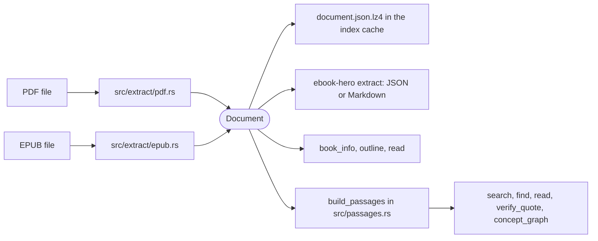
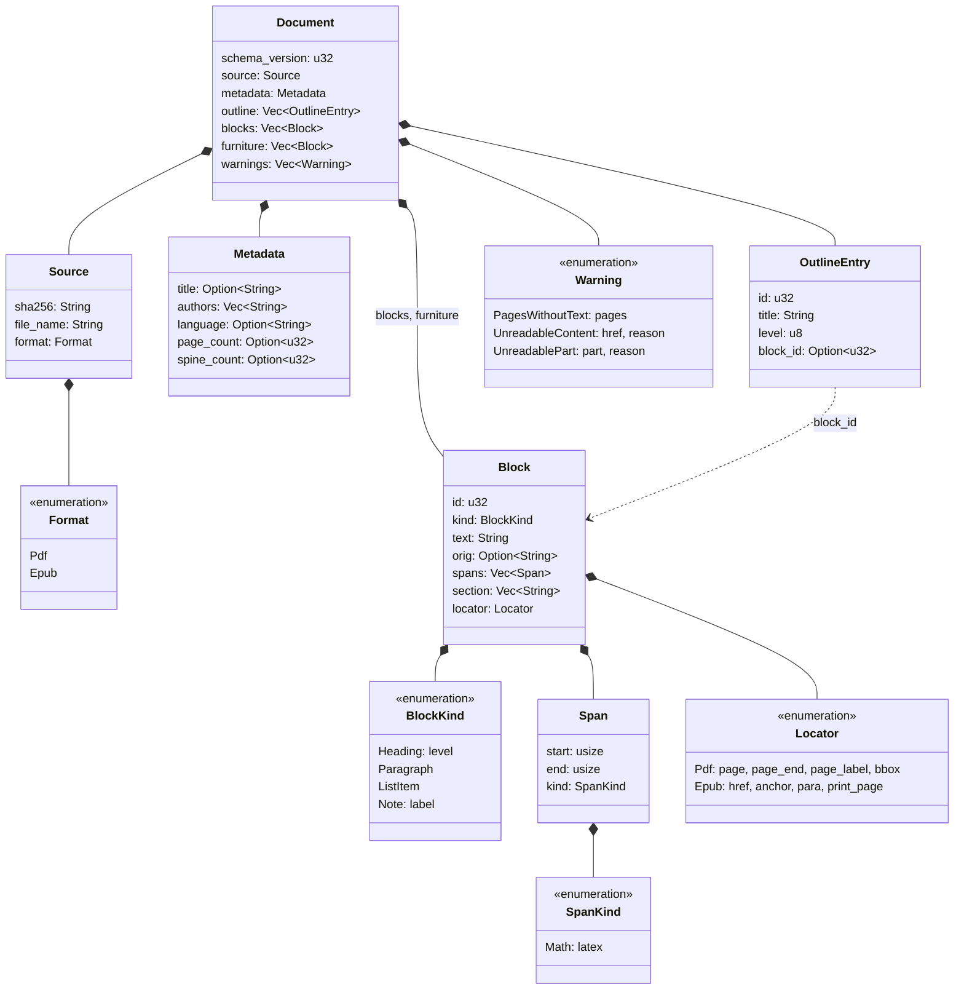

# The Document model

The two readers in `src/extract/` turn a PDF or an EPUB into a `Document`, the type defined in `src/document/mod.rs`. Passage packing, the indexes, search, reading, quote verification and the concept graph all start from that value and never change it. Code after the readers therefore handles one shape of book, whatever format the file had. Only the locators keep each format's own way of saying where a piece of text sits.

`docs/pdf-reading.md` and `docs/epub-reading.md` describe how each reader fills the model.

## Where the model sits



`src/index/book.rs` runs the reader once per book, packs the blocks into passages and writes both to the user cache as `document.json.lz4` and `passages.json.lz4`, in a directory named by the file's SHA-256. Later calls load the cached `Document` instead of reading the file again. `ebook-hero extract` runs the reader on every call and prints the `Document`: as JSON with `--format json` or `--json`, otherwise as Markdown.

## Structure



A `Document` holds the text as two lists of blocks: `blocks` for the reading text and `furniture` for the lines the reader took out of it. Beside them sit facts about the file (`source`, `metadata`), the table of contents (`outline`) and the parts the reader could not read (`warnings`). Every type derives serde's `Serialize` and `Deserialize`, so the JSON form uses the field names above. `BlockKind`, `SpanKind` and `Warning` carry their variant in a `type` field, in snake case, and `Locator` carries it in a `format` field.

### Source

| Field | Content |
|---|---|
| `sha256` | The SHA-256 of the file's bytes as 64 hex digits, from `sha256_file` in `src/index/cache.rs`. It names the book's cache directory. |
| `file_name` | The last component of the path, converted to UTF-8 with invalid bytes replaced. |
| `format` | `"pdf"` or `"epub"`, decided from the file's content by `detect_format` in `src/extract/mod.rs`. |

### Metadata

| Field | PDF | EPUB |
|---|---|---|
| `title` | The Info dictionary's `Title`, normalized; null when missing or empty | The package's main title, normalized; null when empty |
| `authors` | The Info dictionary's `Author` as one entry, not split into names | Every creator in order, normalized, empty ones dropped |
| `language` | Always null | The package's main language, trimmed |
| `page_count` | The number of pages | Always null |
| `spine_count` | Always null | The number of spine entries, skipped ones included |

### Blocks

A block is one unit of reading text: a heading, a paragraph, a list item or a note.

`id` numbers the blocks from 0 in reading order, so a block's id equals its index in `blocks`. `OutlineEntry.block_id` and the `BlockRange.block_id` of a passage in `src/passages.rs` refer to blocks by this number. `first_passage` in `src/read.rs` binary-searches the passages by block id, which works because ids rise in reading order.

`kind` is a `BlockKind`:

| Variant | JSON | Written by |
|---|---|---|
| `Heading { level }` | `{"type": "heading", "level": 2}` | EPUB: `h1` to `h6`, with the tag's level. PDF: a bookmark's heading, with the bookmark's depth, the top level being 1. |
| `Paragraph` | `{"type": "paragraph"}` | Both readers |
| `ListItem` | `{"type": "list_item"}` | EPUB only: text directly inside an `li` |
| `Note { label }` | `{"type": "note", "label": "n1"}` | EPUB: footnotes and endnotes, labelled with the note element's id. PDF: notes found by the layout, always without a label. |

The kind decides what happens downstream. `build_passages` packs paragraphs, list items and notes into passages. A heading reaches a passage only through the `section` of the blocks under it.

`text` is the block's text after `normalize` in `src/normalize.rs`: Latin ligatures expanded, soft hyphens, zero-width spaces, byte-order marks and non-whitespace control characters dropped, composed to NFC, every whitespace run collapsed to one space, and trimmed. It is a single line without markup.

`section` is the path of heading texts above the block, outermost first, and `locator` says where the block is in the file.

`orig` and `spans` are reserved. No reader writes them. When they are empty, serde leaves both out of the JSON, and when the JSON lacks them, serde fills in their defaults. A `Span` marks the range `start..end` of `text` with a `SpanKind`, whose only variant is `Math { latex }`, and its doc comment reads "Reserved for the formula spec; the core writes none." The code says nothing about the purpose of `orig`. Its round-trip test fills it with `"Entropy  measures surprise."` for the text `"Entropy measures surprise."`, the same words before whitespace was collapsed.

An EPUB note as JSON:

```json
{
  "id": 41,
  "kind": { "type": "note", "label": "n1" },
  "text": "1 Source.",
  "section": ["Chapter 2"],
  "locator": {
    "format": "epub",
    "href": "text/ch2.xhtml",
    "anchor": "n1",
    "para": 7,
    "print_page": "45"
  }
}
```

### Sections

`assign_sections` in `src/extract/mod.rs` fills `section` for both readers once all blocks exist. It walks the blocks in order with a stack of open headings. A heading of level n pops every entry of level n or deeper and pushes itself, so a heading's own section ends with its text. Blocks before the first heading get an empty path. Levels the book skips add no empty entries, so a book whose chapters are all `h2` gets a one-entry path per chapter.

The test `skipped_levels_replace_deeper_entries` shows the rule:

| Heading | Level | `section` |
|---|---|---|
| A | 1 | `["A"]` |
| C | 3 | `["A", "C"]` |
| C2 | 3 | `["A", "C2"]` |
| B | 2 | `["A", "B"]` |
| D | 4 | `["A", "B", "D"]` |
| B2 | 2 | `["A", "B2"]` |

The levels come from the heading blocks, not from the outline. An EPUB heading has the level of its tag, and a PDF heading the depth of its bookmark.

### Locators

A `Locator` has one variant per format.

`Locator::Pdf`:

| Field | Content |
|---|---|
| `page` | The 1-based physical page where the block starts |
| `page_end` | The page where the block ends, set only when that is a later page |
| `page_label` | The printed label of `page` from the PDF's page-label ranges; null when the PDF defines none or they could not be read |
| `bbox` | `[left, top, right, bottom]` of the block's lines on `page`, in points measured from the top-left corner of the page's media box, so `top` is less than `bottom`; null for a heading the reader inserts because no paragraph on the bookmark's page matched it |

`Locator::Epub`:

| Field | Content |
|---|---|
| `href` | The content document's path relative to the package document's directory, percent-decoded and stripped of control characters, such as `text/ch 1.xhtml` |
| `anchor` | The last element id met at or before the block's start in that document; null before the first id |
| `para` | The block's 1-based position among the blocks of its content document |
| `print_page` | The printed page in effect where the block's text starts, taken from page-break markers and carried from one content document to the next; null before the first marker |

`para` restarts at 1 in every content document. The passage locator built from it in `src/passages.rs` adds a paragraph count from the nearest heading. `locator_text` in `src/read.rs` prints that count, or the file and the `para` range for text before the first heading.

A PDF locator as JSON:

```json
{
  "format": "pdf",
  "page": 2,
  "page_end": 3,
  "page_label": "ii",
  "bbox": [72.0, 96.5, 523.3, 240.1]
}
```

### Outline

`outline` lists the table of contents in reading order.

| Field | Content |
|---|---|
| `id` | The entry's position in the list, from 0 |
| `title` | The entry's text, normalized; entries with an empty title are dropped before numbering |
| `level` | The depth in the tree, the top level being 1; a depth above 255 is stored as 255 |
| `block_id` | The block where the entry's text starts, or null when the reader could not place it |

The PDF reader takes the bookmarks that lead to a page of the book. For each one it marks the matching paragraph as a `Heading` or inserts a new `Heading` block, so every PDF entry points at a heading. The EPUB reader takes the navigation document or the NCX and points each entry at the block that carries the target's element id, or at the first block of the target file. An EPUB entry can point at a paragraph, and its level need not equal the tag level of the heading it points at.

The `outline` tool lists these entries. Reading by outline entry starts at the entry's first passage and stops before the first passage of the next entry at the same level or nearer the top (`entry_range` in `src/read.rs`).

### Furniture

`furniture` holds the lines the reader took out of the reading text. Only the PDF reader fills it. `furniture` from the furniture-detection crate picks the lines that other pages predict, such as running heads and page numbers ([furniture-detection.md](furniture-detection.md)), and `build_document` in `src/extract/pdf.rs` makes each into a block:

- kind `Paragraph`, text normalized, lines whose text is empty left out;
- `section` empty;
- a PDF locator with the page, its label and the line's box, and `page_end` null;
- ids counting from 0 inside `furniture`, independent of the ids in `blocks`.

The EPUB reader writes an empty list. Nothing after the readers reads `furniture`, so these lines never enter passages, search hits or the Markdown output. They appear only in `document.json.lz4` and in the output of `ebook-hero extract --format json`. `docs/furniture-detection.md` explains how the PDF reader finds them.

### Warnings

| Variant | JSON `type` | Fields | Written by |
|---|---|---|---|
| `PagesWithoutText` | `pages_without_text` | `pages` | PDF: the pages that were read and hold no text |
| `UnreadableContent` | `unreadable_content` | `href`, `reason` | EPUB: a spine item that was skipped, named by its href, or by its `idref` when the manifest lacks it |
| `UnreadablePart` | `unreadable_part` | `part`, `reason` | PDF: a part left out or replaced, named `page 7`, `page labels`, `outline` or `word spacing` |

A warning means the reader left part of the book out and read the rest. A book with no text at all is an error instead: `Unreadable` with "no readable text" for an EPUB, and `NoTextLayer` ("no text layer; OCR is not supported") or `Unreadable` for a PDF. The warnings reach the `book_info` result (`BookInfo.warnings` in `src/read.rs`) and the output of `ebook-hero info`.

## Design principles

### Readers write it, nothing rewrites it

AGENTS.md sets the boundary: readers turn a file into a `Document`, and everything after them reads it and never changes it. The code keeps to it: `build_passages` takes `&[Block]`, `read_passages` takes `&Document`, and the cache stores the `Document` as the reader wrote it. A change in what downstream code sees must therefore come from a reader, and AGENTS.md requires every reader change to bump `PDF_READER_VERSION` or `EPUB_READER_VERSION` in `src/settings.rs`, which rebuilds the cached indexes.

### Flat blocks

`blocks` is one list in reading order. Structure travels as data on each block (`kind`, `section`) and as numbers that point into the list (`OutlineEntry.block_id`, `BlockRange.block_id`). A consumer walks one sequence: `build_passages` packs consecutive blocks, and `gui/book.js` draws the book as "its text in order". The two formats reach this shape from opposite ends. The EPUB reader flattens a tree of elements, and the PDF reader builds paragraphs up from positioned lines.

### Plain text with standoff spans

`text` holds plain characters with no markup. A span marks a range of `text` by offset and leaves the characters alone. A future `Math` span could carry LaTeX for a formula while search, passage packing and quote verification go on reading the same characters at the same offsets. `src/normalize.rs` is "shared by every reader and by quote verification", so a quote and the text it is checked against pass through the same function.

### Locators per format

A PDF places text by physical page, printed label and box. An EPUB places it by file, element id, paragraph and printed page. An EPUB has no physical pages, and a PDF has no files or element ids, so the model gives each format its own variant and no shared fields. Each consumer handles both variants explicitly. `PassageLocator` in `src/passages.rs` keeps the split. `locator_text` in `src/read.rs` prints `p. 12–13 (xii–xiii)` for a PDF and `CHAPTER I ¶3–5, print p. 45` for an EPUB. `gui/book.js` handles neither variant, because `read --json` gives each passage the ids of its blocks (`PassageRef.blocks` in `src/read.rs`, taken from the passage's `BlockRange`s) and the window marks those.

### Furniture kept apart

Running heads and page numbers left in `blocks` would enter passages and match searches. Dropped altogether, they would leave no trace of what the reader decided. A separate list keeps them out of every downstream step and keeps them visible in the JSON output.

### Additive schema changes with a version

`SCHEMA_VERSION` in `src/document/mod.rs` is 2, and every reader writes it into `Document.schema_version`. AGENTS.md requires a schema change to be additive and to bump `SCHEMA_VERSION`. Additive means a change adds fields or variants and leaves existing names and meanings alone. Version 2 is an example: commit 85c7cd9 added `Warning::UnreadablePart` and changed nothing else.

Two consumers check the version.

- The cache. `Manifest` in `src/index/cache.rs` records `schema_version` with `tool_version`, `pdf_reader`, `epub_reader`, `passages` and `analyzers`. `is_current_stage1` reuses a cached index only when every one of them equals the running build's value, so a bump rebuilds each cached book the next time it is opened.
- The desktop window. `gui/book.js` accepts a `Document` whose `schema_version` is at least `MIN_SCHEMA_VERSION` (2) and otherwise asks for a rebuilt binary. Because changes are additive, a newer `Document` still carries every field the window reads. Renaming or removing one of those fields breaks the window, and AGENTS.md asks for `MIN_SCHEMA_VERSION` to be bumped with it.

### Byte offsets inside, code points outside

AGENTS.md fixes two units: offsets inside the library count UTF-8 bytes, and ranges in output count Unicode code points.

Inside, `BlockRange` in `src/passages.rs` maps passage text to block text by byte offsets: `passage.text[start..end]` is `block.text[block_offset..block_offset + end - start]`. `match_ranges` and `phrase_ranges` in `src/search/highlight.rs` return byte ranges too. Rust slices a `str` by byte offset, so these ranges index the text with no conversion.

On the way out, `to_char_ranges` in `src/search/highlight.rs` turns byte ranges into `[start, end]` pairs of code points. It produces the `matches` of `search` and `find` hits and the `matched` range of `verify_quote`, and each of these tools' descriptions ends "Ranges are Unicode code points." A code-point count stays the same whatever encoding a client stores the text in, while a byte offset holds only for UTF-8. In `café au lait`, `é` takes two bytes and one code point, so `au` starts at byte 6 and at code point 5.

The `Document` holds one pair of offsets itself, `Span.start` and `Span.end`. The code does not say which unit they count, and no reader writes spans yet.

## Markdown rendering

`src/document/markdown.rs` writes a `Document` as Markdown for `ebook-hero extract` when JSON is not asked for. `document_to_markdown` writes `# {title}` when `metadata.title` is known, then the blocks. `blocks_to_markdown` separates blocks with a blank line and ends the text with one newline. With no blocks it writes nothing but the title line, if there is a title.

| Block | Markdown |
|---|---|
| `Heading { level }` | `#` repeated `level` times, clamped to 1 to 6, a space, the text |
| `Paragraph` | The text |
| `ListItem` | `- ` and the text |
| `Note { label }` | `> [label] text`, or `> text` without a label; each line of the text gets its own `> ` |

A PDF block whose `page` differs from the previous PDF block's is preceded by `<!-- page N -->`, where N is the physical page. EPUB blocks get no page comments, printed pages included. The renderer writes nothing for `furniture`, `outline`, `warnings`, `section`, `spans` or `orig`.

From the tests, a PDF with the title "Test Book" and one paragraph renders as:

```markdown
# Test Book

<!-- page 1 -->

One.
```

An EPUB list item, a labelled note and an unlabelled note render as:

```markdown
- First

> [1] See chapter 2.

> Aside.
```

The `read` tool does not use this file. It writes its own Markdown from passages (`render` in `src/read.rs`), with a `<!-- passage N · locator -->` comment before each passage.

The title and a level-1 heading both get one `#`, so a book whose chapters are `h1` shows its chapter headings at the title's level. Block text is written without escaping. A paragraph that starts with `# ` or `1. ` renders as a heading or a numbered list in a Markdown viewer, and text such as `<b>` is read as HTML.

## Limits

- Four kinds of block. Table cells, figure captions, block quotes, code and verse have no kind of their own. The EPUB reader writes them as paragraphs, and `normalize` turns the line breaks of code and verse into spaces.
- No images and no formulas. The model has no field for an image, and the `Math` span that would hold a formula has no writer.
- No inline markup. Emphasis, links and superscript markup leave no trace in `text`. Characters such as `²` survive, since `normalize` keeps them.
- No link from a note reference to its note. The EPUB reader deletes `noteref` elements, an EPUB `Note` keeps only the note element's id as `label`, and a PDF note has no label.
- Heading text, not identity. `section` stores heading texts, so two headings with the same text give equal paths. `build_passages` handles this by closing the passage at every heading, even one whose path repeats the previous one.
- One box per block. `bbox` covers the block's lines on its first page, and the part of a paragraph that runs on to `page_end` has no box.
- Levels are `u8`. An outline deeper than 255 levels is capped, and the Markdown renderer writes at most six `#`.
- Missing per-format facts. A PDF never has a `language`, an EPUB never has a `page_count`, and an EPUB without page-break markers has no page numbers at all.
- The unit of `Span.start` and `Span.end` is undefined.

## References

- F. Yergeau. "UTF-8, a transformation format of ISO 10646." RFC 3629, Internet Engineering Task Force, November 2003. https://www.rfc-editor.org/rfc/rfc3629. The encoding whose bytes the library's offsets count.
- T. Bray, editor. "The JavaScript Object Notation (JSON) Data Interchange Format." RFC 8259, Internet Engineering Task Force, December 2017. https://www.rfc-editor.org/rfc/rfc8259. The format of the JSON in `document.json.lz4` and of `ebook-hero extract --format json`.
- John MacFarlane. "CommonMark Spec", version 0.31.2, 28 January 2024. https://spec.commonmark.org/0.31.2/. ATX headings of one to six `#`, block quotes, bullet list items and HTML comments, which the Markdown renderer writes.
- ISO 32000-2:2020. "Document management — Portable document format — Part 2: PDF 2.0." International Organization for Standardization, 2020. The page labels, document outline, Info dictionary and media box behind `Locator::Pdf`, `OutlineEntry` and `Metadata`.
- Matt Garrish, Ivan Herman and Dave Cramer, editors. "EPUB 3.3." W3C Recommendation, 25 May 2023. https://www.w3.org/TR/epub-33/. The package document, spine and navigation document behind `Locator::Epub`, `OutlineEntry` and `Metadata`.
