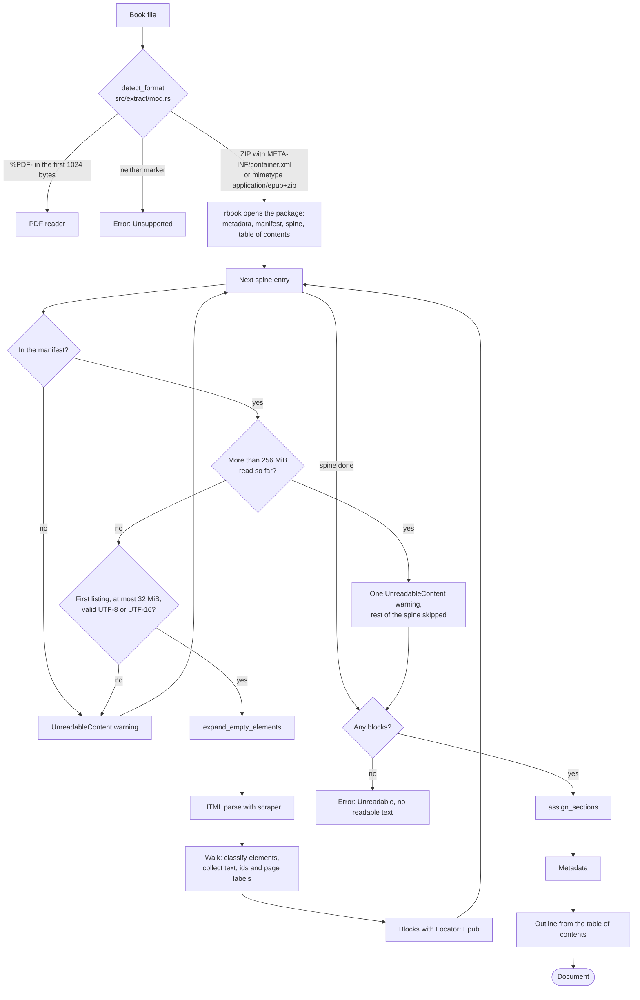

# Reading an EPUB

`src/extract/epub.rs` reads an EPUB 2 or EPUB 3 file into the `Document` model described in `docs/document-model.md`. It reads the content documents of the spine in reading order and turns each one into blocks with `src/extract/xhtml.rs`. Every block gets a locator made of its file, the nearest element id, its paragraph number and the printed page. The reader then places the table of contents on those blocks. Passages, search, reading and quote checks of an EPUB all work on the `Document` that comes out.

## Pipeline

## Detecting the format

`extract` in `src/extract/mod.rs` calls `detect_format`, which decides from the file's content and never from its name.

1. A missing path is `NotFound`, and a path that is not a regular file is `NotAFile`.
2. A file with `%PDF-` anywhere in its first 1024 bytes (`PDF_MARKER_WINDOW`) is a PDF. This test runs first, so a file that passes it never reaches the EPUB test.
3. Otherwise a ZIP archive is an EPUB when it holds `META-INF/container.xml`, or when its `mimetype` entry, read up to 64 bytes and trimmed of whitespace, equals `application/epub+zip`.
4. Anything else is `Unsupported`, with the message "unsupported format; expected a PDF or an EPUB".

The test does not check that `mimetype` is the archive's first entry and stored uncompressed, as the EPUB container format requires. An archive that breaks those rules still passes, and opening the package decides whether it can be read. `extract` then builds the `Source` from the SHA-256 its caller passes, the file name and the format, and calls `read_epub`.

## Opening the package

`read_epub` opens the file with the `rbook` crate, which finds the package document through `META-INF/container.xml` and parses its metadata, manifest, spine and table of contents. When rbook fails, the book fails with `Unreadable` and rbook's message as the reason. The reader keeps the package document's directory (`package_dir`) to make hrefs relative to it.

The content documents do not come through rbook, which would copy an entry into memory whatever its size. The reader opens the file a second time as a ZIP archive with the `zip` crate and reads each entry itself under the bounds below.

## Reading the spine

The reader takes the spine entries in order, non-linear ones included. Each skip below writes an `UnreadableContent` warning.

1. An entry without a manifest item is skipped with "the spine item is not in the manifest". Its `idref` stands in for the href, since there is no path to name.
2. The item's decoded path is made relative to `package_dir` by `relative_to`, and `without_controls` drops its control characters, which a terminal would act on when a locator is printed. This `href` goes into `Document.files` and into warnings. A path outside the package directory keeps all its components: `/shared/a.xhtml` under the package directory `/OEBPS` becomes `shared/a.xhtml`.
3. When more than `MAX_BOOK_CONTENT_BYTES` (256 MiB) has been read, the reader writes one warning, "book exceeds 256 MiB of content; the rest is not read", and stops reading the spine.
4. A content document already read is skipped with "listed again in the spine; read once".
5. `read_entry` reads the entry. One that holds more than `MAX_CONTENT_BYTES` (32 MiB) once uncompressed is skipped with "content document exceeds 32 MiB". Any other ZIP error is skipped with that error's message.
6. `decode_text` turns the bytes into a string.
7. The document's `href` is added to `Document.files`, and `xhtml_blocks` turns the string into raw blocks, each of which becomes a `Block`. Its `id` is the number of blocks read before it in the whole book. Its `Locator::Epub` holds the index of the document in `files`, and its `ids` are the raw block's. When the raw block's `print_page` differs from the previous block's, the block starts with a `PageBreak` span that carries the new label.

For each content document the reader records, in a `FileBlocks` value, the id of its first block and, for every element id a raw block carries, the first block that carries it. The outline resolves against these records.

When the spine yields no block at all, the book fails with `Unreadable` and the reason "no readable text".

### Bounds on what is read

Both caps count the bytes that actually come out of the decompressor, because the size an archive declares for an entry can be false. `read_entry` reads at most 32 MiB plus one byte of an entry, and a refused entry counts toward the book's total with the bytes read before it was refused. The book total is checked before each entry. The entry that takes the total past 256 MiB is therefore read in full, the next one is not, and one book reads at most 288 MiB and one byte.

The code comments state the reasons: the per-entry cap means "a small archive cannot expand without bound in memory", and the book cap means "a small archive cannot fill memory with many large documents". Reading each content document once closes a third route: one large document listed many times in the spine.

### Decoding

`decode_text` reads UTF-16 when the bytes start with a byte order mark, little-endian after `FF FE` and big-endian after `FE FF`. An odd number of bytes or a broken surrogate pair makes the document "not valid UTF-16". Every other document must be valid UTF-8, or it is skipped as "not valid UTF-8". The `encoding` named in an XML declaration is not read.

## From XHTML to blocks

`xhtml_blocks` in `src/extract/xhtml.rs` turns one content document into `RawBlock` values in document order. A `RawBlock` has a `kind`, a `text`, an `anchor`, a list of `ids` and a `print_page`. The EPUB reader keeps the kind, the text and the ids, turns a change of `print_page` into a page break, and adds the id, the section and the locator.

### Repairing self-closed tags

An HTML parser ignores the slash in a self-closed tag such as `<x/>`. A `` would then stay open and contain everything after it. `expand_empty_elements` rewrites each self-closed element as `<x></x>` before parsing. The 14 void elements in `VOID_ELEMENTS` (`area`, `base`, `br`, `col`, `embed`, `hr`, `img`, `input`, `link`, `meta`, `param`, `source`, `track`, `wbr`) become `<x>`, since HTML gives them no content and no end tag.

The scan respects quoted attribute values, so `
b">` stays one tag. Comments, declarations, processing instructions and end tags pass through unchanged. The content of `script` and `style` is copied as raw text up to the closing tag, so `if (a<b && c)` inside a script is not read as a tag.

### Parsing and walking

`scraper::Html::parse_document` parses the repaired text with an HTML parser, not an XML parser, although the files are XHTML. Malformed markup therefore still yields a tree. The HTML parser does not resolve XML namespace prefixes in attribute names, so the reader matches the attribute name `epub:type` literally.

The walk visits the nodes in document order with its own cursor instead of recursion. Deep nesting therefore cannot overflow the stack; a test walks 4,000 nested `div` elements.

### Classifying elements

`classify` puts each element in one of five classes. Its checks are fixed rules, lists of tag names and attribute tokens, applied in this order:

| Order | Check | Class | Effect |
|---|---|---|---|
| 1 | `epub:type` has `noteref`, or `role` has `doc-noteref` | Skipped | The element and its text are dropped |
| 2 | `epub:type` has `pagebreak`, or `role` has `doc-pagebreak` | PageBreak | Its label sets the printed page, and its content is dropped |
| 3 | The tag is `head`, `nav`, `script` or `style` | Skipped | The element and its content are dropped |
| 4 | `epub:type` has `footnote`, `endnote` or `rearnote`, or `role` has `doc-footnote` or `doc-endnote` | Leaf | One `Note` block, labelled with the element's id |
| 5 | The tag is `h1` to `h6` | Leaf | One `Heading` block with the tag's level |
| 6 | The tag is `p`, or `role` has `paragraph` | Leaf | One `Paragraph` block |
| 7 | The tag is one of the 33 in `CONTAINERS` | Container | Not a block; its children are blocks, and its loose text forms runs |
| 8 | Anything else | Inline | Part of the text around it |

An attribute check splits the value on whitespace and matches when any token does. The order matters: an `aside` with `epub:type="footnote"` is a note, not a container, because check 4 comes before check 7.

`CONTAINERS` holds `address`, `article`, `aside`, `blockquote`, `body`, `caption`, `dd`, `details`, `div`, `dl`, `dt`, `fieldset`, `figcaption`, `figure`, `footer`, `form`, `header`, `hgroup`, `html`, `li`, `main`, `ol`, `pre`, `section`, `summary`, `table`, `tbody`, `td`, `tfoot`, `th`, `thead`, `tr` and `ul`.

### Leaves, containers and runs

A leaf's whole content becomes the text of one block. Inside a leaf, an element that would be a block elsewhere puts a space before and after its text. A `br` puts a space, and other inline elements put nothing, so `
ab
` reads `ab`.

A container is not a block itself. Its leaf children become blocks, and the text directly inside it forms runs. A run starts at the first text that is not only whitespace, takes in the inline content that follows, and ends where the next leaf or container starts or where the container ends. It takes its kind from the innermost container: `ListItem` inside an `li`, `Paragraph` inside any other. `
Loose text 
B
 tail
` gives three paragraphs, `Loose text`, `B` and `tail`. `<ul><li>One</li><li>Two</li></ul>` gives two list items.

When a block ends, `flush` normalizes its text. A block whose text is then empty is dropped, and its element ids pass to the next block.

### Element ids and anchors

`element_id` ignores an id that is empty or longer than `MAX_ID_BYTES` (256 bytes). Every block copies the last id before it into its anchor, so without the cap a hostile file could multiply one huge id by its number of blocks.

A raw block's `anchor` is the last id met at or before its start, the block's own id included. Its `ids` are every id met since the previous emitted block, plus the block's own id and the ids of its descendants. In the test `anchors_and_ids`, `<section id="s1"><h1 id="h">T</h1>
P
</section>` gives the heading the anchor `h` and the ids `["s1", "h"]`, and the paragraph the anchor `h` and no ids.

The `ids` go into the block, where they resolve table-of-contents targets. The `anchor` is not stored, because a link into the book resolves through the `ids` of the block that holds its target.

### Notes

A note reference is deleted with its text, so `
Claim<a epub:type="noteref" href="#n1">1</a> continues.
` gives `Claim continues.` as its text.

A note becomes one `Note` block where it stands in the document, labelled with its element's id. `<aside epub:type="footnote" id="n1">
1 Source.
</aside>` gives a note with the label `n1` and the text `1 Source.`, so the printed number stays in the text. Paragraphs inside a note join into its one block: `

One.

Two.

` gives `One. Two.` with no label, since the `div` has no id.

### Printed pages

`read_epub` holds one `print_page` value for the whole book and passes it to `xhtml_blocks` for each content document in turn. A page-break marker sets it, and the page stays in effect across documents until the next marker. The reader stores the page once, as a `PageBreak` span at offset 0 of the first block whose text starts on it, and `Places::print_page` gives each later block the label of the last break before it, in the same document or an earlier one. The marker's own content is dropped, so `
Before 12after.
` gives `Before after.` as its text.

`page_break` takes the label from the first usable of four candidates:

1. the `title` attribute;
2. the `aria-label` attribute;
3. the marker's text, read only while it holds at most 32 characters that are not whitespace, so a marker wrapped around a whole chapter stops being read early;
4. the last run of ASCII digits in the marker's `id`.

A candidate is trimmed and passed over when it is longer than `MAX_PAGE_LABEL_CHARS` (32 characters) or empty after `normalize`. A marker with no usable candidate leaves the page as it was. The fourth rule is a heuristic: `id="ch2_page_47"` gives `47`, while `id="p-xii"` holds no digits and changes nothing. The 32-character cap has the same reason as the id cap, since every block copies the page in effect.

A block takes the page in effect when its first text that is not whitespace arrives. A marker before a paragraph's text applies to that paragraph, and a marker in the middle of it applies from the next block on. In the test `the_printed_page_is_the_one_where_the_text_starts`, `
 <b> </b> text more
` gives the paragraph the page `2` and leaves `3` in effect for what follows.

## Normalizing text

`normalize` in `src/normalize.rs` runs on block text, page labels, the title, author names and table-of-contents titles. It applies four steps in order:

1. expand the Latin ligatures U+FB00 to U+FB06 to `ff`, `fi`, `fl`, `ffi`, `ffl`, `st` and `st`;
2. drop U+00AD (soft hyphen), U+200B (zero-width space), U+FEFF (byte order mark) and every control character that is not whitespace;
3. compose to NFC;
4. collapse every whitespace run to one space and trim.

Composing after the drops means that a combining mark which followed a dropped character composes with its base. The output is therefore NFC, and a second call returns it unchanged. The PDF reader and quote verification call the same function, so a quote is compared with book text in the same form.

## Sections

`assign_sections` in `src/extract/mod.rs` opens a section at every heading and gives each block the section it is in, across content documents. The PDF reader calls the same function. In an EPUB the heading levels are the numbers of the `h1` to `h6` tags. A heading of level n closes the sections of level n and deeper, and skipped levels open nothing, so a book whose chapters are all `h2` has a one-entry path per chapter. `docs/document-model.md` works through an example.

## Metadata

| Field | Value |
|---|---|
| `title` | The package's main title as rbook reports it, normalized; null when empty |
| `authors` | Every creator in order, normalized, empty ones dropped |
| `language` | The package's main language, trimmed; null when empty |
| `page_count` | Null |
| `spine_count` | The number of spine entries, skipped ones included |

The EPUB reader writes an empty `furniture` list.

## Outline

`outline` reads the table of contents from `epub.toc().contents()`. With its default options, rbook takes the EPUB 3 navigation document's `toc` nav and falls back to the EPUB 2 NCX `navMap`. The entries are flattened depth first, so they keep the order of the table.

- `title` is the entry's label, normalized. An entry whose title is empty is dropped.
- `level` is the entry's depth, the top level being 1, capped at 255.
- `id` is the entry's position among the entries kept.
- `block_id` comes from the entry's href. Its path must name a content document the reader read from the spine. The fragment after `#` then picks the first block in that document that carries the element id. When the fragment is missing or no block carries it, the entry gets the document's first block. When the path names no document that was read, or the document gave no blocks, `block_id` is null.

A block's `ids` include the ids met before it since the previous block. A fragment that names a wrapper, such as a `<section id="ch2">` around a chapter, therefore resolves to the chapter's first block.

The outline does not depend on the heading blocks. An entry's level is its depth in the table, not the tag of the heading it points at, and an entry may point at a paragraph.

## Reader version

`EPUB_READER_VERSION` in `src/settings.rs` is 3. AGENTS.md requires a bump with every change to the reader. `Manifest` in `src/index/cache.rs` records it with the schema, tool, PDF reader, passage and analyzer versions. `is_current_stage1` reuses a cached index only when all of them match the running build. A bump therefore rebuilds every cached index the next time its book is opened, PDF books included, because the comparison covers the whole manifest.

## Design principles

### Content decides the format

`detect_format` "tells the format of a file from its content, never from its name". A PDF renamed `.epub` is still read as a PDF, and an EPUB without the extension is still read as an EPUB.

### Every quantity a file controls has a bound

The code comments treat the input as possibly hostile, and the reader bounds each thing such a file could inflate: the size of one content document (32 MiB), the content of the book (256 MiB), the number of times a document is read (once), the length of an element id (256 bytes) and the length of a page label (32 characters). The walk does not recurse, so nesting depth costs no stack. Two tests check that hostile documents take linear time: 150,000 empty paragraphs with ids, and a paragraph of 80,000 blank inline runs, each within `HOSTILE_LIMIT` (10 seconds). The test comment explains the limit: "Linear code reads these documents in a few seconds at most in a debug build; quadratic code takes from twenty seconds to minutes."

### Skip and report

A spine item that cannot be read becomes an `UnreadableContent` warning, and the rest of the book is still read. The book fails only when no text remains. This follows the AGENTS.md rule that nothing falls back silently: a user sees in `book_info` which files are missing and why.

### Locators that cite the book

A block's `file` names its content document, the `para` that `Places` derives counts blocks within it, and the page breaks name the pages of the printed edition when the book marks them. The passage locator in `src/passages.rs` builds on these, which lets `locator_text` cite an EPUB passage as `CHAPTER I ¶3–5, print p. 45`.

### The book's markup decides, by fixed rules

The reader trusts the book's own markup: tag names, `epub:type` and `role`. It applies fixed lists of tags and tokens, and nothing in it is fitted to the book being read.

## Limits

- Encodings. Only UTF-8, and UTF-16 with a byte order mark, are read. Any other document is decoded as UTF-8 whatever its XML declaration says, so an ISO-8859-1 document with accented letters fails to decode and is skipped.
- No styles. The reader applies no CSS, so text that a style sheet hides is read. An element styled as a block whose tag is not in `CONTAINERS`, such as a `span` with `display: block`, joins the text around it.
- Tables. Each cell becomes a paragraph, and the relation of cells in rows and columns is lost.
- Line breaks. `br` becomes a space, and `normalize` collapses the whitespace of `pre`, so code and verse lose their lines.
- Images. An `img` gives no text, and its `alt` attribute is not read.
- Formulas. MathML elements are inline, so their text joins the paragraph without spaces: `<mi>x</mi><mo>=</mo><mn>2</mn>` reads `x=2`. No `Math` span is written.
- Notes without semantic markup. A reference marked only as `<a href="#n1">1</a>` keeps its number in the text (`Claim1 continues.`), and the note it points to becomes an ordinary paragraph.
- Inline notes. A note on an element the HTML parser keeps inside a paragraph, such as a `span`, joins the paragraph's text, because inside a leaf a nested leaf only separates words.
- List items in paragraphs. `<li>
One
</li>` gives a `Paragraph`, not a `ListItem`, because `p` is a leaf and only loose text takes the kind of its container.
- Navigation in the spine. A navigation document listed in the spine adds no text from its `nav` elements.
- Printed pages. A book without page-break markers has no `print_page`. A label found only in an `id` is read only as digits, so roman numerals there are lost. A page that changes in the middle of a paragraph shows from the next block on.
- Trailing ids. Element ids after the last block of a document belong to no block. A table-of-contents fragment that names one falls back to the document's first block.
- Unreached targets. A table-of-contents entry whose document is outside the spine, or was skipped, gets no `block_id`.
- Namespace prefixes. `epub:type` is matched by its literal name. A book that binds the same namespace to another prefix has its notes, note references and page breaks read as ordinary content.
- Encryption. Neither the reader nor rbook reads `META-INF/encryption.xml`, so encrypted content documents are not supported.
- Size. A content document above 32 MiB is skipped, and the spine stops once more than 256 MiB has been read.

## References

- Matt Garrish, Ivan Herman and Dave Cramer, editors. "EPUB 3.3." W3C Recommendation, 25 May 2023. https://www.w3.org/TR/epub-33/. The OCF container (`mimetype`, `META-INF/container.xml`), the package document (metadata, manifest, spine and the `linear` attribute), XHTML content documents and the navigation document.
- "EPUB 3 Structural Semantics Vocabulary 1.1." W3C Group Note. https://www.w3.org/TR/epub-ssv-11/. The `epub:type` values `noteref`, `footnote`, `endnote`, `rearnote` and `pagebreak`.
- Matt Garrish, Tzviya Siegman, Markus Gylling and Shane McCarron, editors. "Digital Publishing WAI-ARIA Module 1.0." W3C Recommendation, 14 December 2017. https://www.w3.org/TR/dpub-aria-1.0/. The roles `doc-noteref`, `doc-footnote`, `doc-endnote` and `doc-pagebreak`.
- "Accessible Rich Internet Applications (WAI-ARIA) 1.2." W3C Recommendation, 6 June 2023. https://www.w3.org/TR/wai-aria-1.2/. The `paragraph` role.
- "HTML Living Standard." WHATWG. https://html.spec.whatwg.org/. The void elements, the parser's handling of a self-closing slash on other elements, and the raw-text content of `script` and `style`.
- "Open Packaging Format (OPF) 2.0.1." International Digital Publishing Forum, 2010. https://idpf.org/epub/20/spec/OPF_2.0.1_draft.htm. The EPUB 2 package document and its NCX table of contents.
- Ken Whistler, editor. "Unicode Standard Annex #15: Unicode Normalization Forms." Unicode Consortium. https://www.unicode.org/reports/tr15/. Normalization Form C, which `normalize` produces.
