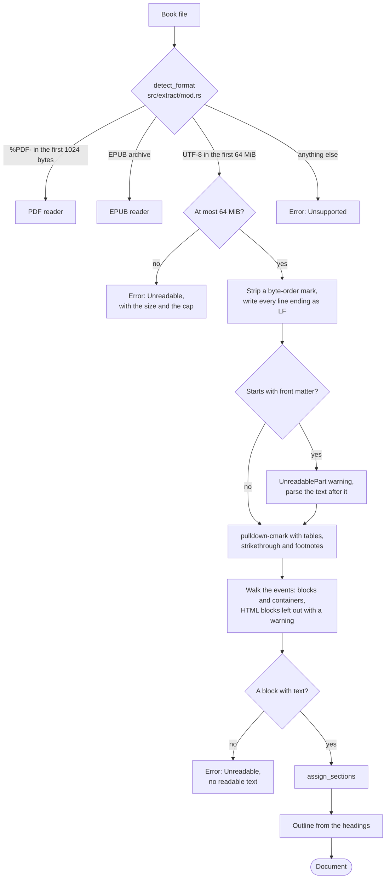

# Reading a Markdown file

`src/extract/markdown.rs` reads a Markdown file into the `Document` model described in `docs/document-model.md`. pulldown-cmark parses the file as CommonMark, and one pass over its events writes the blocks in reading order. Each block records the containers it sits in, such as a list item or a table cell, and the lines of the file it covers. Passages, search, reading and quote checks then work on that `Document` as they do on one read from a PDF or an EPUB.

## Pipeline



## Detecting the format

`extract` in `src/extract/mod.rs` calls `detect_format`, which decides from the file's content and never from its name. Its first two tests are the ones `docs/epub-reading.md` describes: `%PDF-` in the first 1024 bytes makes a PDF, and an EPUB archive makes an EPUB. A file that passes neither is Markdown when its bytes are UTF-8, because every UTF-8 text is a valid CommonMark document. A plain `.txt` file therefore opens as Markdown, and so does an empty file, which the reader then refuses for having no text. A UTF-8 byte-order mark needs no test of its own, since its three bytes are UTF-8 themselves. Every other file is `Unsupported`, with the message "unsupported format; expected a PDF, an EPUB or a UTF-8 text file". Text in another encoding fails this way, such as a Latin-1 file with an accented letter or a UTF-16 file, whose byte-order mark is not UTF-8.

`is_utf8` reads the file 64 KiB at a time (`UTF8_CHUNK`), so detection holds one chunk in memory however long the file is. The bytes of a character that a read cuts in two are carried into the next read. The check stops at the first byte that is not UTF-8, so a binary file is usually refused within its first chunk. It reads no more than `MAX_MARKDOWN_BYTES`, so a longer text file passes detection and reaches the reader, whose error gives the file's size and the cap instead of "unsupported format".

## Reading the file

`read_markdown` takes the file's size before it reads anything, and it refuses a file over `MAX_MARKDOWN_BYTES`, 64 MiB, with `Unreadable`: "the file holds 67108865 bytes, more than the 64 MiB a Markdown file may hold; split it into smaller files". The cap keeps one file from filling memory without refusing a real book, since 64 MiB of text is about ten million words. The reader then reads at most one byte past the cap and checks the count again, so a file that grew after its size was taken is refused as well, never cut short.

The bytes must be UTF-8 here too. They passed detection, so this fails only for a file that changed in between, with "the file is not UTF-8 text; save it as UTF-8". A byte-order mark at the start is removed, and `markdown_document` reads the text that remains.

### Line endings

CommonMark ends a line at a line feed, at a carriage return, or at a carriage return followed by a line feed, so the three must give the same document. pulldown-cmark takes a CRLF as one ending, but it does not end a fence's opening line at a lone carriage return: in a file with the old Mac endings, `` ``` `` and the code under it read as one paragraph. `with_line_feeds` therefore writes every line ending as a line feed before parsing. Each ending stays one character, so every line keeps its number. The test `crlf_and_bom_give_the_same_document_as_lf` reads a file with CRLF endings and a byte-order mark and gets the document of its LF form, and `crlf_and_lone_cr_count_lines_as_lf_does_in_code_too` does the same for CR endings around a code block.

### Front matter

pulldown-cmark recognises YAML front matter only when `ENABLE_YAML_STYLE_METADATA_BLOCKS` is set. Without the option, a file that starts with `---`, `title: x` and `---` reads as a thematic break followed by the setext heading `title: x`. With it, pulldown-cmark takes any `---` line with text on the next line, up to a later `---` or `...` line, for a metadata block, wherever the lines stand. A document with a thematic break followed directly by text, and another break further down, would then lose everything between the two.

`front_matter_end` therefore asks pulldown-cmark, with that option alone, only whether the text opens with a metadata block that starts at its first byte. When it does, the reader writes an `UnreadablePart` warning, `front matter at line 1`, with the reason "the reader does not read front matter, so its text is left out", and parses the text after the block. The text is parsed without the option either way, so a later `---` is a thematic break or a setext underline, as CommonMark has it. The test `only_the_start_of_the_file_is_front_matter` checks both cases. A text that does not start with `---` skips the question, so only a file that may hold front matter is parsed twice.

## Parsing

`markdown_document` parses the text with three extensions, `EXTENSIONS` in the code:

| Option | Effect |
|---|---|
| `ENABLE_TABLES` | GFM tables become `Table`, `Row` and `Cell` containers |
| `ENABLE_STRIKETHROUGH` | `~~text~~` is struck-through text |
| `ENABLE_FOOTNOTES` | `[^n]` is a footnote reference, and `[^n]:` starts a footnote definition |

Every other extension stays off, and its syntax reads as CommonMark has it: a task list's `[x]` stays text, as do `$x$`, `^sup^` and a heading's `{#id}`.

`into_offset_iter` gives each event the byte range it covers. `Lines`, a table of the offset where each line starts, is built once and turns a range into lines by binary search. A block's `line` is the line of its first byte, and its `line_end` is the line of its last byte when that is a later line. A paragraph on lines 3 and 4 thus gets `{"line": 3, "line_end": 4}`. A fenced code block's range includes its fences, so a block from `` ```rust `` on line 1 to its closing fence on line 5 gets `{"line": 1, "line_end": 5}`.

## The walk

`Walk` reads the events in order. Block events open and close blocks and containers, while inline events add text to the open block. Three pieces of state carry from one event to the next: the block being read, the stack of open containers, and whether the walk is inside an image or an HTML block, whose events it leaves out.

### Blocks

| Markdown | Block |
|---|---|
| ATX or setext heading | `Heading`, at its level from 1 to 6 |
| Paragraph | `Paragraph` |
| Text directly in a table cell or in an item of a tight list | `Paragraph` |
| Fenced or indented code block | `Code`, with the language its fence names |
| Thematic break | `Rule`, with empty text |

The third row is needed because pulldown-cmark gives the text of a table cell, and of an item in a tight list, without paragraph events, as HTML writes them without `<p>`. The first inline event outside a block therefore opens a paragraph, and the next block event closes it, which is safe because a paragraph holds only inline content. Every paragraph of a list item is then a `Paragraph` inside an `Item`, whether the list is tight or loose, and the reader writes no `ListItem` block.

The text of a heading or a paragraph is normalized by `normalize` in `src/normalize.rs` when the block closes, as in the other readers. A code block keeps its lines, its indentation and every character as written, and loses only its final newline, because collapsing its whitespace would change the code. Its language is the first word of the fence's info string, as CommonMark has it, so `~~~ python extra` names `python`. A fence without an info string, and an indented code block, name none.

### Containers

| Markdown | Container |
|---|---|
| Block quote | `Quote` |
| Bullet list | `List`, with `ordered` false and `start` null |
| Ordered list | `List`, with `ordered` true and `start` the first item's number |
| List item | `Item` |
| Table | `Table` |
| Header row | `Row`, with `header` true |
| Body row | `Row`, with `header` false |
| Table cell | `Cell` |
| Footnote definition | `Note`, with `label` as written after `[^` |

A container takes the next id when its start event arrives, and it goes on the stack of open containers until its end event. Each block written meanwhile lists it in `within`, so `within` names a block's containers outermost first, with rising ids. In the test `nested_lists_quotes_and_numbering`, this Markdown:

```markdown
> 3. a
>    - b
>
>    c
```

gives the containers `[quote, list (ordered, start 3), item, list, item]` with ids 0 to 4. The paragraphs `a` and `c` have the `within` `[0, 1, 2]`, and `b` has `[0, 1, 2, 3, 4]`.

A footnote definition becomes a `Note` container where it stands in the file, and its blocks keep their kinds. A note can therefore hold paragraphs, a list and a code block, each a block with the note in its `within`.

A container exists only through the blocks inside it, so one that closes without a block gets an empty `Paragraph` at the line where it starts. An empty table cell, an empty list item `- `, an empty quote `>` and an empty footnote definition keep their place in the document that way, and passages pass over the empty block, since it has no words. GFM fills a row that is shorter than the header with empty cells, and pulldown-cmark gives each added cell an empty range just after its row, at the start of the next line. The reader places the paragraph of such a cell at the start of its row instead.

### Text

Inline events add their characters to the open block. The reader writes no spans, so inline markup leaves only its text:

- Emphasis, strong emphasis, strikethrough and a link give their text.
- Inline code gives its content, which `normalize` then collapses like any other text.
- A soft or a hard line break gives a space.
- A footnote reference gives nothing, so `Text.[^n]` reads `Text.`.
- An inline HTML tag or comment is dropped and the text around it kept, so `<b>bold</b>` reads `bold`.
- An image is left out with its alt text, as the EPUB reader leaves images out. The walk counts nested images and leaves every event out until the outermost one ends.

### HTML blocks

An HTML block is left out, because the reader does not parse HTML. It may hold text, so the reader writes an `UnreadablePart` warning that names its first line, such as `HTML block at line 5`, with the reason "the reader does not read HTML, so any text in it is left out". A block of nothing but comments and whitespace goes without a warning, since a comment is not part of the text. `only_comments` decides this by removing comments from the start of the block one after the other, so a block that opens with a comment and holds more after it, such as `<!-- a --> <div>x</div>`, still gets a warning.

### No readable text

A file that leaves no block with text fails with `Unreadable` and the reason "no readable text", as an EPUB without text does. An empty file, a file of blank lines and a file of nothing but rules, comments or front matter all fail this way. `markdown_document` knows the file only by the name in `source`, so `read_markdown` puts the full path into the error in its place.

## Sections, outline and metadata

`assign_sections` in `src/extract/mod.rs` gives each block its section from the heading levels, as it does for the PDF and EPUB readers. The outline has one entry per heading with text, at the heading's level, and each entry points at its heading block. A heading with empty text still opens its section but gets no entry, as an EPUB table-of-contents entry with an empty title gets none.

CommonMark gives a file no title, authors or language, so the metadata is empty:

| Field | Value |
|---|---|
| `title` | Null |
| `authors` | Empty |
| `language` | Null |
| `page_count` | Null |
| `spine_count` | Null |

Of the document's other tables, the reader fills `sections`, `containers` and `warnings`. `files`, `page_labels` and `furniture` stay empty, and no block has `ids` or `spans`.

## Reader version

`MARKDOWN_READER_VERSION` in `src/settings.rs` is 1. AGENTS.md requires a bump with every change to the reader. `Manifest` in `src/index/cache.rs` records it as `markdown_reader` with the schema, tool, PDF reader, EPUB reader, passage and analyzer versions, and `is_current_stage1` reuses a cached index only when all of them match the running build. A manifest written before the Markdown reader existed lacks the field, which then reads as 0, so its index is built again.

## Design principles

### A text file is a Markdown file

Every UTF-8 text is a valid CommonMark document, so detection needs neither a marker nor an extension to read one. Plain prose reads as paragraphs split at its blank lines, so a text file never written as Markdown still reads as the text it is. The price is that such a file can trip Markdown's syntax: a line of `===` under a line of text makes that text a heading.

### One pass with a stack

The walk writes each block when it closes and never returns to it, and the stack of open containers gives the block its `within` at that moment. Reading therefore takes one pass over the events, and the blocks come out as the flat list in reading order that `docs/document-model.md` asks of every reader.

### Leave out and report

HTML blocks and front matter may hold text that the model cannot store, so each one the reader leaves out becomes an `UnreadablePart` warning that names its line. This follows the AGENTS.md rule that nothing falls back silently. A comment holds no text of the document, so leaving one out needs no warning.

## Limits

- Inline markup. Emphasis, strikethrough, links, inline code, line breaks and footnote references leave only their text, and no block has spans. A heading carries no id, so the document does not record where a link leads.
- HTML. Neither an HTML block nor an inline tag is read. The text of an HTML block is left out with a warning, and the text inside inline tags is kept without the tags.
- Front matter. Its fields, a title among them, are not read.
- Weak structure. A column's alignment and whether a list is tight or loose are not stored.
- Images. An image gives no text, and its alt text is left out.
- Encodings. Only UTF-8 is read, so a text file in another encoding is `Unsupported`.
- Extensions. Task lists, math, superscript, subscript, definition lists and heading attributes read as plain CommonMark, and their markers stay in the text.
- Size. A file over 64 MiB is refused.
- Memory on short table rows. pulldown-cmark builds the whole document before it gives the first event, and it fills each short row with empty cells up to the header's width, at most 2^18 cells per table. A file of many wide tables with short rows therefore costs memory far beyond its size: 120 KB of tables 512 columns wide gave 10.5 million cells and 500 MB in pulldown-cmark alone, before the reader writes a block for any of them. The 64 MiB cap does not bound this.

## References

- John MacFarlane. "CommonMark Spec", version 0.31.2, 28 January 2024. https://spec.commonmark.org/0.31.2/. Line endings, ATX and setext headings, fenced and indented code blocks and their info strings, block quotes, lists and their tightness, HTML blocks and thematic breaks.
- "GitHub Flavored Markdown Spec", version 0.29-gfm, 6 April 2019. https://github.github.com/gfm/. Tables, including the empty cells added to a short row, and strikethrough.
- pulldown-cmark 0.13.5. https://docs.rs/pulldown-cmark/0.13.5/pulldown_cmark/. The parser, its events with their byte ranges, and the options for tables, strikethrough, footnotes and YAML metadata blocks.
- F. Yergeau. "UTF-8, a transformation format of ISO 10646." RFC 3629, Internet Engineering Task Force, November 2003. https://www.rfc-editor.org/rfc/rfc3629. The encoding detection checks for.
