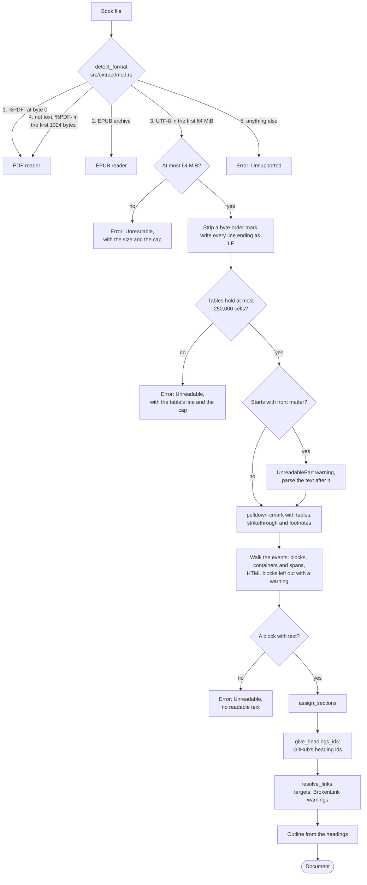

# Reading a Markdown file

`src/extract/markdown.rs` reads a Markdown file into the `Document` model described in `docs/document-model.md`. pulldown-cmark parses the file as CommonMark, and one pass over its events writes the blocks in reading order. Each block records the containers it sits in, such as a list item or a table cell, and the lines of the file it covers, and its inline markup becomes spans over its text. Once every block is read, headings get the ids GitHub gives them and every link is resolved to where it leads. Passages, search, reading and quote checks then work on that `Document` as they do on one read from a PDF or an EPUB.

## Pipeline



## Detecting the format

`extract` in `src/extract/mod.rs` calls `detect_format`, which decides from the file's content and never from its name. It runs five tests in order:

1. A file that starts with `%PDF-` is a PDF.
2. A ZIP archive that holds `META-INF/container.xml`, or whose `mimetype` entry reads `application/epub+zip`, is an EPUB.
3. A file whose bytes are UTF-8 is Markdown, because every UTF-8 text is a valid CommonMark document.
4. A file with `%PDF-` later in its first 1024 bytes is a PDF.
5. Every other file is `Unsupported`, with the message "unsupported format; expected a PDF, an EPUB or a UTF-8 text file".

The marker test is split around the text test because a PDF may carry bytes before its header, while a Markdown file may mention that header in its text. This document names `%PDF-` in its first kilobyte, and when the marker counted anywhere in that kilobyte before any other test, it read as a broken PDF. The tolerance for bytes before the header is there for binary junk, so it applies only to a file that is not text, and a text file is a PDF only when it starts with the marker. The test `text_that_mentions_the_pdf_marker_after_its_start_is_markdown` reads this document and `docs/epub-reading.md` as Markdown.

By test 3, a plain `.txt` file opens as Markdown, and so does an empty file, which the reader then refuses for having no text. A UTF-8 byte-order mark needs no test of its own, since its three bytes are UTF-8 themselves. Text in another encoding fails test 3 and is `Unsupported`, such as a Latin-1 file with an accented letter or a UTF-16 file, whose byte-order mark is not UTF-8.

`is_utf8` reads the file 64 KiB at a time (`UTF8_CHUNK`), so detection holds one chunk in memory however long the file is. The bytes of a character that a read cuts in two are carried into the next read. The check stops at the first byte that is not UTF-8, so a binary file is usually refused within its first chunk. It reads no more than `MAX_MARKDOWN_BYTES`, so a longer text file passes detection and reaches the reader, whose error gives the file's size and the cap instead of "unsupported format".

## Reading the file

`read_markdown` takes the file's size before it reads anything, and it refuses a file over `MAX_MARKDOWN_BYTES`, 64 MiB, with `Unreadable`: "the file holds 67108865 bytes, more than the 64 MiB a Markdown file may hold; split it into smaller files". The cap bounds the memory the text itself takes without refusing a real book, since 64 MiB of text is about ten million words. [Table cells](#table-cells) covers the memory that parsing adds. The reader then reads at most one byte past the cap and checks the count again, so a file that grew after its size was taken is refused as well, never cut short.

The bytes must be UTF-8 here too. They passed detection, so this fails only for a file that changed in between, with "the file is not UTF-8 text; save it as UTF-8". A byte-order mark at the start is removed, and `markdown_document` reads the text that remains.

### Line endings

CommonMark ends a line at a line feed, at a carriage return, or at a carriage return followed by a line feed, so the three must give the same document. pulldown-cmark takes a CRLF as one ending, but it does not end a fence's opening line at a lone carriage return: in a file with the old Mac endings, `` ``` `` and the code under it read as one paragraph. `with_line_feeds` therefore writes every line ending as a line feed before parsing. Each ending stays one character, so every line keeps its number. The test `crlf_and_bom_give_the_same_document_as_lf` reads a file with CRLF endings and a byte-order mark and gets the document of its LF form, and `crlf_and_lone_cr_count_lines_as_lf_does_in_code_too` does the same for CR endings around a code block.

### Table cells

GFM fills a table row that is shorter than the header with empty cells, up to the header's width. pulldown-cmark builds the whole document before it gives the first event, and it caps these added cells at 2^18 per table but not per file. Forty tables 512 columns wide, each followed by 512 one-character lines, take 120 KB, and they gave pulldown-cmark 10.5 million cells and 500 MB of memory before the reader saw an event. A file well within the size cap can therefore take more memory than the machine has, so the size cap does not bound what parsing costs.

`check_table_cells` therefore counts the cells the tables could hold before the parser runs, and it refuses a file whose count passes `MAX_TABLE_CELLS`, 250,000. A table starts at a line that can be a delimiter row under a non-blank line, and `delimiter_columns` gives its columns as pulldown-cmark counts them, after block-quote markers and indentation. Each table then counts its columns once for the header and once for every non-blank line up to the next blank line, which ends a GFM table. The count can only come out high: it takes a delimiter-like line in a code block for a table, and it counts on past a table that a heading ends.

The refusal is the size cap's error, `Unreadable`, and its reason names the delimiter row, the size the table had reached and the cap: "the table whose delimiter row is line 2 reaches 489 rows × 512 columns, which takes the file past the 250000 table cells a Markdown file may hold; split the table or the file". A real table stays far below the cap, since 1,000 rows of 5 columns are 5,005 cells.

### Front matter

pulldown-cmark recognises YAML front matter only when `ENABLE_YAML_STYLE_METADATA_BLOCKS` is set. Without the option, a file that starts with `---`, `title: x` and `---` reads as a thematic break followed by the setext heading `title: x`. With it, pulldown-cmark takes any `---` line with text on the next line, up to a later `---` or `...` line, for a metadata block, wherever the lines stand. A document with a thematic break followed directly by text, and another break further down, would then lose everything between the two.

`front_matter_end` therefore asks pulldown-cmark, with that option alone, only whether the text opens with a metadata block that starts at its first byte. When it does, the reader writes an `UnreadablePart` warning, `front matter at line 1`, with the reason "the reader does not read front matter, so its text is left out", and parses the text after the block. The text is parsed without the option either way, so a later `---` is a thematic break or a setext underline, as CommonMark has it. The test `only_the_start_of_the_file_is_front_matter` checks both cases. A text that does not start with `---` skips the question, so only a file that may hold front matter is parsed twice.

## Parsing

`markdown_document` parses the text with three extensions, `EXTENSIONS` in the code:

| Option | Effect |
|---|---|
| `ENABLE_TABLES` | GFM tables become `Table`, `Row` and `Cell` containers |
| `ENABLE_STRIKETHROUGH` | `~~text~~` is struck-through text |
| `ENABLE_FOOTNOTES` | `[^n]` is a footnote reference, and `[^n]:` starts a footnote definition |

Every other extension stays off, and its syntax reads as CommonMark has it: a task list's `[x]` stays text, as do `$x$`, `^sup^` and a heading's `{#id}`.

`into_offset_iter` gives each event the byte range it covers. `Lines`, a table of the offset where each line starts, is built once and turns a range into lines by binary search. A block's `line` is the line of its first byte, and its `line_end` is the line of its last byte when that is a later line. A paragraph on lines 3 and 4 thus gets `{"line": 3, "line_end": 4}`. A fenced code block's range includes its fences, so a block from `` ```rust `` on line 1 to its closing fence on line 5 gets `{"line": 1, "line_end": 5}`.

## The walk

`Walk` reads the events in order. Block events open and close blocks and containers, while inline events add text and spans to the open block. Three pieces of state carry from one event to the next: the block being read, with its spans still open, the stack of open containers, and whether the walk is inside an image or an HTML block, whose events it leaves out.

### Blocks

| Markdown | Block |
|---|---|
| ATX or setext heading | `Heading`, at its level from 1 to 6 |
| Paragraph | `Paragraph` |
| Text directly in a table cell or in an item of a tight list | `Paragraph` |
| Fenced or indented code block | `Code`, with the language its fence names |
| Thematic break | `Rule`, with empty text |

The third row is needed because pulldown-cmark gives the text of a table cell, and of an item in a tight list, without paragraph events, as HTML writes them without `<p>`. The first inline event outside a block therefore opens a paragraph, and the next block event closes it, which is safe because a paragraph holds only inline content. Every paragraph of a list item is then a `Paragraph` inside an `Item`, whether the list is tight or loose, and the reader writes no `ListItem` block.

The text of a heading or a paragraph is normalized by `normalize` in `src/normalize.rs` when the block closes, as in the other readers. A code block keeps its lines, its indentation and every character as written, and loses only its final newline, because collapsing its whitespace would change the code. Its language is the first word of the fence's info string, as CommonMark has it, so `~~~ python extra` names `python`. A fence without an info string, and an indented code block, name none.

### Containers

| Markdown | Container |
|---|---|
| Block quote | `Quote` |
| Bullet list | `List`, with `ordered` false and `start` null |
| Ordered list | `List`, with `ordered` true and `start` the first item's number |
| List item | `Item` |
| Table | `Table` |
| Header row | `Row`, with `header` true |
| Body row | `Row`, with `header` false |
| Table cell | `Cell` |
| Footnote definition | `Note`, with `label` as written after `[^` |

A container takes the next id when its start event arrives, and it goes on the stack of open containers until its end event. Each block written meanwhile lists it in `within`, so `within` names a block's containers outermost first, with rising ids. In the test `nested_lists_quotes_and_numbering`, this Markdown:

```markdown
> 3. a
>    - b
>
>    c
```

gives the containers `[quote, list (ordered, start 3), item, list, item]` with ids 0 to 4. The paragraphs `a` and `c` have the `within` `[0, 1, 2]`, and `b` has `[0, 1, 2, 3, 4]`.

A footnote definition becomes a `Note` container where it stands in the file, and its blocks keep their kinds. A note can therefore hold paragraphs, a list and a code block, each a block with the note in its `within`.

A container exists only through the blocks inside it, so one that closes without a block gets an empty `Paragraph` at the line where it starts. An empty table cell, an empty list item `- `, an empty quote `>` and an empty footnote definition keep their place in the document that way, and passages pass over the empty block, since it has no words. GFM fills a row that is shorter than the header with empty cells, and pulldown-cmark gives each added cell an empty range just after its row, at the start of the next line. The reader places the paragraph of such a cell at the start of its row instead.

### Text and spans

Inline events add their characters to the open block, and inline markup becomes a span over the characters it marks:

| Markdown | Text | Span |
|---|---|---|
| `*a*` or `_a_` | `a` | `Emphasis` |
| `**a**` or `__a__` | `a` | `Strong` |
| `~~a~~` or `~a~` | `a` | `Strikethrough` |
| `` `a` `` | `a` | `Code` |
| `[a](x.md)`, `[a][ref]` or `<https://x.org>` | `a`, or the address | `Link`, with the destination as `href` |
| `<me@x.org>` | `me@x.org` | `Link`, with `mailto:me@x.org` as `href`, the destination CommonMark gives an email autolink |
| A hard break: `\` or two spaces at the end of a line | A space | `Break`, with `lines` 1 |
| A soft break | A space | None |
| `[^n]` | Nothing | `NoteRef`, empty, with `n` as `marker` |
| An inline HTML tag or comment | Nothing | None |
| An image | Nothing, alt text included | None |

The walk opens a span where the block's text has got to when the markup starts, and a stack of the spans still open lets the markup's end close the innermost one. Spans therefore nest as the markup does, so `[**b** c](#x)` gives a link over `b c` that holds strong emphasis over `b`. Inline code, a hard break and a footnote reference are spans of their own event, with no end to wait for. An image is left out with everything in it, as the EPUB reader leaves images out: the walk counts nested images and leaves every event out until the outermost one ends. An inline HTML tag is dropped while the text between tags is kept, so `<b>bold</b>` reads `bold`.

A link's target is left open until every block is read, because a link may lead to a heading further down; [Links](#links) describes how it is resolved.

### Normalizing with spans

A block's text must equal `normalize` of itself, since search and quote verification rely on it, while its spans count code points of that normalized text. The walk therefore collects the block's raw text with each span as a byte range of it, a `RawSpan`, and `normalize_with_spans` in `src/normalize.rs` normalizes once and moves the spans onto the result. `normalize` takes the same three steps without spans, so a block's text cannot differ from `normalize` of its raw text.

Each step takes the offsets the spans need, in ascending order, and records where each one lands in its output:

1. `expand` writes the letters of the Latin ligatures and drops soft hyphens and invisible characters. An offset lands before the output of the character at it, so a span that starts at a dropped character starts at the next one.
2. `compose` cuts the text into pieces before each starter that composes with nothing before it, a character with canonical combining class 0 that passes the NFC quick check, and composes each piece to NFC alone. NFC of the whole text is then the pieces laid end to end, because such a starter's decomposition starts with a starter of the same kind, so nothing before it is composed with or reordered across it. `every_character_that_starts_a_piece_decomposes_to_such_a_starter` checks that for every code point. An offset at the start of a piece lands at the start of its output, and an offset inside a piece lands past its output, so emphasis around the `e` of `e` and U+0301 covers the composed `é`.
3. `collapse` turns every whitespace run into one space and trims the ends. An offset at the first character of a run lands on the space, one further into the run lands past the space, and one in a trimmed run lands where the text then is.

No step reverses two offsets, so spans that nested in the raw text still nest, and spans that did not overlap still do not. A span that covered only what the steps removed comes out empty and is dropped, such as a link with no text, emphasis around an image, or a code span of one space between spaces. A `NoteRef` stays, since it marks a point. A `Break` marks the space that its whitespace run becomes, wherever its own space was in the run, unless trimming removes the run, which drops the break.

Each hard break adds a space, and normalizing leaves one space for a run of them, so the breaks of a run land on one space and become one `Break` whose `lines` adds them up. In `one\`, `two\`, `\`, `three` on four lines, the block reads `one two three` with a break of 1 line after `one` and a break of 2 lines after `two`, the blank line that separates two stanzas of a poem.

The positions count code points, so in `😀 *x*` the emphasis runs from 2 to 3, although `x` starts at byte 5 of the text. The spans then go through a stable sort by start, the longer first, which keeps the outer of two spans over the same text first, as for the emphasis and the strong emphasis of `***c***`.

### Paragraphs left without text

Images and inline tags can be all a paragraph holds. A paragraph that they leave with neither text nor a span is not written when it sits in no container, since it would add a block without words and nothing else. Inside a container it is kept, because a container exists only through its blocks, so an item holding only an image keeps its place in its list. A heading left without text is kept too, because its level still divides the sections, although the outline leaves it out.

### HTML blocks

An HTML block is left out, because the reader does not parse HTML. It may hold text, so the reader writes an `UnreadablePart` warning that names its first line, such as `HTML block at line 5`, with the reason "the reader does not read HTML, so any text in it is left out". A block of nothing but comments and whitespace goes without a warning, since a comment is not part of the text. `only_comments` decides this by removing comments from the start of the block one after the other, so a block that opens with a comment and holds more after it, such as `<!-- a --> <div>x</div>`, still gets a warning.

### No readable text

A file that leaves no block with text fails with `Unreadable` and the reason "no readable text", as an EPUB without text does. An empty file, a file of blank lines and a file of nothing but rules, comments or front matter all fail this way. `markdown_document` knows the file only by the name in `source`, so `read_markdown` puts the full path into the error in its place.

## Sections, outline and metadata

`assign_sections` in `src/extract/mod.rs` gives each block its section from the heading levels, as it does for the PDF and EPUB readers. The outline has one entry per heading with text, at the heading's level, and each entry points at its heading block. A heading with empty text still opens its section but gets no entry, as an EPUB table-of-contents entry with an empty title gets none.

CommonMark gives a file no title, authors or language, so the metadata is empty:

| Field | Value |
|---|---|
| `title` | Null |
| `authors` | Empty |
| `language` | Null |
| `page_count` | Null |
| `spine_count` | Null |

Of the document's other tables, the reader fills `sections`, `containers` and `warnings`. `files`, `page_labels` and `furniture` stay empty, and only a heading has `ids`.

## Heading ids

`give_headings_ids` runs once every block is read and gives each heading, in reading order, the id GitHub gives it, which goes into the heading block's `ids`. The rule is `heading_id`, ported from `slugger` in `gui/markdown.js`, which the window uses for the usage guide's headings: the heading's text in lower case, without the characters other than letters, marks, numbers, connector punctuation, spaces and `-`, and with each space turned into `-`. The general categories that `\p{L}`, `\p{M}`, `\p{N}` and `\p{Pc}` name in the JavaScript come from the `unicode-properties` crate. The test `heading_id_gives_what_slugger_in_gui_markdown_js_gives` checks the port against the ids that `render` in `gui/markdown.js` gave for the same texts.

A repeated id gets `-1`, `-2` and so on, counted for the id that repeats. A numbered id that a heading already took is passed over, as `a-1` is in the last row:

| Headings | Ids |
|---|---|
| `## Outline`, `## Outline`, ``## `cache` list!`` | `outline`, `outline-1`, `cache-list` |
| `# a`, `# a`, `# a-1`, `# a` | `a`, `a-1`, `a-1-1`, `a-2` |
| `# a-1`, `# a`, `# a` | `a-1`, `a`, `a-2` |

A heading whose id comes out empty, such as `# !!!`, keeps none, because an empty id names nothing. `slugger` still counts the empty id as given, and the reader follows it, so a second `# !!!` gets `-1`.

The rule is GitHub's because `docs/usage.md`, like most Markdown files, was written to be read on GitHub, so a link such as ``[`outline`](#outline-1)``, which leads to the second heading named `outline`, resolves here where it resolves there. The test `the_usage_guide_has_no_broken_link` checks this on the guide.

## Links

`resolve_links` runs after the ids are given, because a link may lead to a heading further down. It sets the `to` of every `Link` span from the `href` the file wrote:

| `href` | `to` |
|---|---|
| `#id` | `Block`, the first block whose `ids` hold the id, after its percent escapes are decoded, so `#caf%C3%A9` leads to the heading `Café` |
| `#` | `Block` 0, the top of the document, which is where HTML takes an empty fragment |
| An address with a scheme, such as `https://x.org` or `mailto:me@x.org` | `Address` |
| A relative path, such as `search.md` or `my%20notes.md#part` | `File`, with the path percent-decoded and without its query or fragment, such as `search.md` or `my notes.md` |
| An absolute path, such as `/x.md`, or an empty destination | `Nowhere`, because `File` holds a path relative to the file's directory |
| `#id` that no block holds | `Nowhere`, with a `BrokenLink` warning that names the `href` and the block holding the link |

A scheme is a letter followed by letters, digits, `+`, `-` or `.`, then a colon, as RFC 3986 defines it, so `a/b:c.md` is a path. A percent escape is decoded only when every `%` starts two hex digits and the decoded bytes are UTF-8. Otherwise the text is kept as written, as `gui/markdown.js` keeps it where JavaScript's `decodeURIComponent` fails.

A `NoteRef` leads to the first block of the first `Note` container whose label matches its marker. pulldown-cmark matches footnote labels without regard to case, through the `unicase` crate, so the reader matches them through `unicase` as well, which lets `[^Note]` find `[^note]:`. A reference to no note would get a null `block` and a `BrokenLink` warning whose `href` is `[^label]`, but pulldown-cmark reads such a reference as text, so no file produces one.

`ebook-hero info` words a broken link as `the link to #setup in block 12 leads nowhere in this document`.

## Reader version

`MARKDOWN_READER_VERSION` in `src/settings.rs` is 1. AGENTS.md requires a bump with every change to the reader. `Manifest` in `src/index/cache.rs` records it as `markdown_reader` with the schema, tool, PDF reader, EPUB reader, passage and analyzer versions, and `is_current_stage1` reuses a cached index only when all of them match the running build. A manifest written before the Markdown reader existed lacks the field, which then reads as 0, so its index is built again.

## Design principles

### A text file is a Markdown file

Every UTF-8 text is a valid CommonMark document, so detection needs neither a marker nor an extension to read one. Plain prose reads as paragraphs split at its blank lines, so a text file never written as Markdown still reads as the text it is. The price is that such a file can trip Markdown's syntax: a line of `===` under a line of text makes that text a heading.

### One pass with a stack

The walk writes each block when it closes and never returns to it, and the stack of open containers gives the block its `within` at that moment. Reading therefore takes one pass over the events, and the blocks come out as the flat list in reading order that `docs/document-model.md` asks of every reader.

### Resolve once everything is read

A link can lead to a heading that the walk has not reached yet. The walk therefore writes each link with its target open, and two passes over the finished blocks then give the headings their ids and the links their targets, so the walk itself never looks ahead.

### Leave out and report

HTML blocks and front matter may hold text that the model cannot store, so each one the reader leaves out becomes an `UnreadablePart` warning that names its line. This follows the AGENTS.md rule that nothing falls back silently. A comment holds no text of the document, so leaving one out needs no warning.

## Limits

- Heading ids from normalized text. GitHub takes a heading's text as written, while the reader takes its normalized text, so a heading with two spaces in a row, a ligature or a soft hyphen gets an id that differs from GitHub's: `x  y` gives `x-y` here and `x--y` there.
- Links out of the document. The reader checks neither that a `File` link's path names a file nor that an `Address` exists. A link's title, as in `[a](x.md "Title")`, is not kept.
- HTML. Neither an HTML block nor an inline tag is read. The text of an HTML block is left out with a warning, and the text inside inline tags is kept without the tags. An element id in HTML, such as `<a id="x">`, is not an id of the document, so a link to `#x` is broken.
- Front matter. Its fields, a title among them, are not read.
- Weak structure. A column's alignment and whether a list is tight or loose are not stored.
- Images. An image gives no text, and its alt text is left out.
- Encodings. Only UTF-8 is read, so a text file in another encoding is `Unsupported`.
- Detection by the PDF marker. A text file that starts with `%PDF-` is read as a PDF and fails as one, and a PDF whose header follows text instead of binary bytes reads as Markdown.
- Extensions. Task lists, math, superscript, subscript, definition lists and heading attributes read as plain CommonMark, and their markers stay in the text.
- Size. A file over 64 MiB is refused.
- Table cells. A file whose tables could hold more than 250,000 cells is refused, because the size cap does not bound the memory pulldown-cmark spends on the cells it adds to short rows: 120 KB of wide tables took 500 MB. The count errs toward refusing, so a file with hundreds of delimiter-like lines in a row, such as in a code block, can be refused although it holds no such table.

## References

- John MacFarlane. "CommonMark Spec", version 0.31.2, 28 January 2024. https://spec.commonmark.org/0.31.2/. Line endings, ATX and setext headings, fenced and indented code blocks and their info strings, block quotes, lists and their tightness, HTML blocks and thematic breaks.
- "GitHub Flavored Markdown Spec", version 0.29-gfm, 6 April 2019. https://github.github.com/gfm/. Tables, including the empty cells added to a short row, and strikethrough.
- pulldown-cmark 0.13.5. https://docs.rs/pulldown-cmark/0.13.5/pulldown_cmark/. The parser, its events with their byte ranges, the options for tables, strikethrough, footnotes and YAML metadata blocks, and its matching of footnote labels through unicase.
- "Unicode Normalization Forms", Unicode Standard Annex #15. https://www.unicode.org/reports/tr15/. NFC, canonical combining classes and the NFC quick check, from which `compose` decides where a piece starts.
- T. Berners-Lee, R. Fielding and L. Masinter. "Uniform Resource Identifier (URI): Generic Syntax." RFC 3986, Internet Engineering Task Force, January 2005. https://www.rfc-editor.org/rfc/rfc3986. The syntax of a scheme and of percent escapes.
- "HTML Living Standard", WHATWG, section "Scrolling to a fragment". https://html.spec.whatwg.org/multipage/browsing-the-web.html. Selecting the indicated part of a document, where an empty fragment selects the top of the document.
- F. Yergeau. "UTF-8, a transformation format of ISO 10646." RFC 3629, Internet Engineering Task Force, November 2003. https://www.rfc-editor.org/rfc/rfc3629. The encoding detection checks for.
