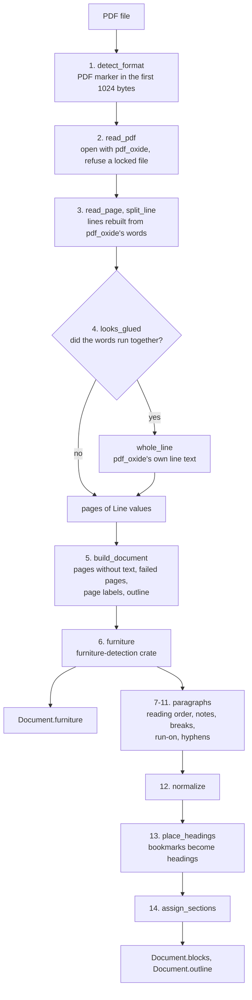

# Reading a PDF

`src/extract/pdf.rs` turns a PDF into the `Document` of `src/document/mod.rs`: the book's text as blocks in reading order, each with a locator that names the page the block is printed on and the block's box on that page, beside a table of the pages' printed labels. Passages, the search indexes, `read`, `verify` and the concept graph read this `Document` and never change it. The reader therefore decides what text a search can find and which page a result cites.

## What the reader writes

| Field | What the PDF reader puts there |
|---|---|
| `source` | the file's SHA-256 as the caller computed it, the file name, and `format: "pdf"` |
| `metadata.title`, `metadata.authors` | the `Title` and `Author` entries of the PDF's Info dictionary; `authors` holds the whole `Author` string as one entry |
| `metadata.page_count` | the number of pages in the file, with text or without |
| `metadata.language`, `metadata.spine_count` | always `null` |
| `outline` | the bookmarks that lead to a page, each with the id of its heading block |
| `sections` | one per heading, each naming its heading block and the section around it |
| `files` | always empty |
| `page_labels` | the printed label of each page, page 1 first; empty when the PDF defines no page labels |
| `blocks` | headings, paragraphs and notes in reading order, numbered from 0 |
| `furniture` | running heads, page numbers, stamps and other lines that other pages predict, in page order, numbered from 0 on their own |
| `warnings` | the pages without text, every part of the file that could not be read, and the pages read with pdf_oxide's own word breaks |

A block's `kind` is `heading` with a `level`, `paragraph`, or `note` with `label: null`. The PDF reader writes no `list_item` blocks and leaves `spans` and `ids` empty, so its JSON has neither field.

The locator of a PDF block has three fields:

| Field | Meaning |
|---|---|
| `page` | the physical page the block starts on, counted from 1 |
| `page_end` | the page the block ends on, set only when it is later than `page` |
| `bbox` | `[left, top, right, bottom]` in points from the top-left corner of the page's media box, covering the block's lines on `page` only; `null` for a heading the reader inserted |

`ebook-hero extract --format json` prints this paragraph of `tests/fixtures/sample.pdf` (text shortened), block 4. It lies on page 2, whose entry in `page_labels` is `1`, and in section 0, the one the heading `Entropy` opens:

```json
{
  "kind": { "type": "paragraph" },
  "text": "Entropy measures how much surprise a source of messages carries. A fair coin ...",
  "section": 0,
  "locator": {
    "page": 2,
    "page_end": null,
    "bbox": [133.768, 146.62244, 477.4826, 192.45105]
  }
}
```

## The pipeline



1. `detect_format` in `src/extract/mod.rs` recognises a PDF by its first bytes.
2. `read_pdf` opens the file with pdf_oxide and refuses an encrypted file that needs a password.
3. `read_page` takes each page's text lines from pdf_oxide, and `split_line` rebuilds every line from its words.
4. `looks_glued` checks the rebuilt words of each page, and a page whose words ran together falls back to pdf_oxide's own line text.
5. `build_document` sets aside the pages without text and the pages that failed, and reads the page labels and the outline.
6. `furniture` marks the running heads and page numbers.
7. `paragraphs` in `src/extract/pdf_layout.rs` drops those lines and puts each page into reading order.
8. `split_notes` sets the footnotes apart from the body.
9. `Flow` measures the lines and cuts them into paragraphs.
10. A paragraph that ends a page unfinished may continue onto the next page.
11. `join_lines` joins each paragraph's lines and mends the words hyphenated at line ends.
12. `normalize` in `src/normalize.rs` cleans the text of every paragraph.
13. `outline_entries` and `place_headings` turn the bookmarks into heading blocks.
14. `assign_sections` in `src/extract/mod.rs` gives every heading a section and every block the section it is in.

### 1. Format detection

`detect_format` decides the format from the file's content and never from its name, so a PDF saved as `book.bin` still reads as a PDF. A file with the marker `%PDF-` anywhere in its first `PDF_MARKER_WINDOW` = 1024 bytes is a PDF. A file without the marker goes on to the EPUB test, and a file that passes neither fails with `Unsupported`. `extract` hands a PDF to `read_pdf` with a `Source` that holds the file's SHA-256, its name and the format.

### 2. Opening the file

`read_pdf` opens the file with `PdfDocument::open` from the pdf_oxide crate, pinned to version 0.3.78 in `Cargo.toml`. A file that pdf_oxide cannot parse fails with `Unreadable`, whose message carries pdf_oxide's error. On an encrypted file, pdf_oxide tries the empty password when it opens it. If that does not authenticate, the reader fails with `Unreadable` and the reason `password required`, because such a file opens and then reads as pages without text, which would pass for a scanned book.

### 3. Lines from words

`read_page` takes the page's media box and the lines that pdf_oxide's `extract_text_lines` returns. pdf_oxide groups the page's characters into words and the words into lines, and gives each word its text, its box and its average font size. The step's output is one `PageLines` per page: the page number, the width and height of the media box, and the page's lines as `Line` values with `text`, `left`, `top`, `right`, `bottom` and `font_size`.

PDF space has its origin at the bottom left, with y growing upward (ISO 32000-1, 8.3.2.3). `split_line` moves every box into top-origin points measured from the media box's left and top edges: `left = x - x0`, `top = y1 - (y + height)` and `bottom = y1 - y`, where `x0` is the media box's left edge and `y1` its top edge. Every later rule and every `bbox` uses these coordinates, in which `top` grows down the page in the direction a reader reads.

A word's size is pdf_oxide's average font size. When that is missing or not a positive number, `word_size` takes the height of the word's box, and 0 when neither is usable. A line's `font_size` is the mean of its words' sizes.

The reader rebuilds each line from pdf_oxide's words instead of taking pdf_oxide's line text, because that text puts a space between every two words: it breaks numbers apart (pdf_oxide cuts `1996` into `199 6`) and detaches a line-end hyphen from its word. `split_line` walks the words from left to right and measures each gap, from the right edge of one word to the left edge of the next, in font sizes of the word before the gap. A gap wider than `SPLIT_GAP` cuts the line in two, since a gap that wide is a column gutter or two labels on one baseline. Within a piece, `joins` decides whether two neighbouring words are one word or get a space between them:

- A word made only of closing punctuation (`CLOSING`: `. , ; : ! ? ) ] } ’ ” " ' … »`) joins the word before it when the gap is at most `CLOSING_GAP`, because some fonts set a comma or full stop a little apart.
- Any other pair joins only when the gap is at most `TOUCH_GAP` and one of four cases holds: digits on both sides of the gap, a word before the gap made only of opening punctuation (`OPENING`: `( [ { ‘ “ " ' « ¿ ¡`), a word after the gap that is a single hyphen, or a word before the gap that ends in a hyphen. Here `HYPHENS` holds `-`, U+2010 and the soft hyphen U+00AD.
- Two letters never join, however close they sit.

Overlapping boxes give a negative gap, which passes both limits, so overlap counts as touching. Overlap still never joins two letters, because some PDFs give word boxes that overlap their neighbours (`overlapping_word_boxes_keep_the_words_apart`). The test `digits_and_a_line_end_hyphen_join_when_they_touch` gives the words `in`, `199`, `6`, `infor` and `-`, and `split_line` returns the line `in 1996 infor-`.

| Constant | Value | Meaning |
|---|---|---|
| `SPLIT_GAP` | 2.0 | a gap over 2 font sizes cuts the line |
| `TOUCH_GAP` | 0.025 | two words this close, or overlapping, touch |
| `CLOSING_GAP` | 0.1 | closing punctuation joins the word before it up to this far |

All three are fixed thresholds. Each scales with the font size of the word before the gap, so one rule serves 8 pt notes and 14 pt headings. When that size is 0, no gap cuts the line and only words that touch or overlap can join.

### 4. Pages whose words ran together

On some pages pdf_oxide's words run several words together while its line text still has the spaces between them; the test helper `glued_line` builds such a line. Rebuilt from those words, the page would read as long strings of letters. `looks_glued` therefore counts the page's words of letters: words that hold only letters once every other character is trimmed from both ends (`letters_length`). A page with at least `GLUED_MIN_WORDS` = 50 such words, whose mean length is over `GLUED_WORD_LENGTH` = 9.0 characters, falls back to `whole_line`. That function takes each pdf_oxide line as it stands: its text, its box, and the mean font size of its words.

Both numbers are fixed thresholds. The minimum keeps a page with few words from being judged: in `long_words_on_a_page_with_few_words_are_kept`, 40 words of 11 letters keep their rebuilt lines. A fallback line is not cut at wide gaps, so a pdf_oxide line that spans a column gutter stays one line. The reader counts the fallback pages and reports them in one `UnreadablePart` warning with the part `word spacing` and the reason `geometry looked wrong on N pages; used the PDF's own word breaks`.

### 5. Pages without text and parts that fail

`build_document` sorts the pages into three groups:

- A page with lines goes on to the next steps.
- A page that was read but has no lines goes into one `PagesWithoutText` warning, which lists the page numbers.
- A page whose media box or text lines could not be read gets its own `UnreadablePart` warning, with the part `page N` and pdf_oxide's error, and is not counted among the pages without text.

When no page has text, the book fails: with `Unreadable` and the first failed page's error when any page failed, and with `NoTextLayer` (`no text layer; OCR is not supported`) otherwise. A scanned book and a damaged one thus get different errors.

An error while reading the page labels or the outline becomes an `UnreadablePart` warning with the part `page labels` or `outline`, and the book is read without that part. A PDF that has no outline gets no warning. The warnings come in a fixed order: pages without text, failed pages, word spacing, page labels, outline.

### 6. Furniture

`furniture` from the furniture-detection crate takes the pages with text, each line as its text and box, and returns the `(page, line index)` pairs of the lines that other pages predict, such as running heads and page numbers (folios). [Furniture detection](furniture-detection.md) explains how it decides. `paragraphs` leaves these lines out of the text, which matters for step 10: the run-on rule reads the first body line of a page, and a running head left in place would be that line.

The reader keeps each furniture line in `Document.furniture` as a `paragraph` block with its normalized text and a locator holding its page and the line's box. Furniture blocks come in page and line order, numbered from 0 separately from the ids of `blocks`.

### 7. Reading order

For each page, `paragraphs` drops the furniture lines and blank lines, and `order_columns` puts the rest into reading order.

A page counts as two columns when at least `COLUMN_MIN_LINES` = 4 lines lie wholly left of the page's centre and at least 4 lie wholly right of it. The centre is always half the page width. The count of 4 is a fixed threshold. Each line then falls into one of three zones: left, right, or across for a line that crosses the centre.

The columns start at the highest column line that shares a row with a line of the other column, two lines sharing a row when they overlap in height. When no lines share a row, the columns start at their first line. The lines read before the columns are the across lines whose middle lies above that start, together with any column line whose middle lies above the lowest of them, such as a short heading over a paragraph that spans the page. The order is then:

1. the lines above the columns,
2. the left column,
3. the right column,
4. the remaining across lines, including any that sit between column lines.

Each part runs top to bottom. A page that is not two columns keeps the order in which pdf_oxide gave its lines.

### 8. Footnotes

`split_notes` sets the footnotes of a page apart from its body. The body size is the font size that most lines share, within `FONT_TOLERANCE` = 0.25 pt; on a tie, `densest` takes the larger size. A line is small when its size is at most `NOTE_FONT_RATIO` = 0.85 of the body size. A small line whose middle lies below the bottom of every line that is not small is a note, so with 10 pt body text a line of 8.5 pt or less below the last larger line is a note. Both numbers are fixed thresholds. A page whose body size is 0 or not a number has no notes.

Notes become `note` blocks with `label: null`, placed after the body paragraphs of their page.

### 9. Paragraph breaks

`Flow` measures a page's body lines, and separately its note lines, before it decides any break. For each zone it takes the margin, which is the smallest left edge, and the width, from the margin to the largest right edge. For the flow as a whole it takes the pitch: the median step from one line's top to the next line's top in reading order. Steps under `MIN_PITCH` = 1.0 pt are left out as lines on one row. The same filter drops the step back up from the foot of the left column to the top of the right one, which is negative. Each page gets its own measures because recto and verso pages can sit at different margins; `margin_is_measured_per_page` uses 59.9 pt, 58.98 pt and 90 pt.

`starts_paragraph` then decides for each line whether it opens a new paragraph:

1. Gap: the line opens a paragraph when its top lies more than `GAP_FACTOR` = 1.5 pitches below the previous line's top. With a 12 pt pitch, that is a step of more than 18 pt.
2. Hanging notes: in a hanging-style note zone, the line opens a new note when it starts within `LEFT_TOLERANCE` = 1.0 pt of the margin, and continues the note otherwise. Rules 3 and 4 do not apply in such a zone.
3. Indent: the line opens a paragraph when it starts at least `INDENT_FACTOR` = 0.8 of its own font size right of the zone's margin, 8 pt for 10 pt type, and more than `LEFT_TOLERANCE` right of the previous line. The second condition keeps a block quote, whose lines are all indented, in one paragraph.
4. Short end: the line opens a paragraph when the previous line ends a sentence and is narrower than `SHORT_LINE_FRACTION` = 0.7 of its zone's width. A line ends a sentence when its last character is one of `SENTENCE_END`: `. ? ! : ” "`.

A note zone is hanging-style when its first line starts at the margin, within `LEFT_TOLERANCE`, and a later line starts at least `HANGING_FACTOR` = 0.5 font sizes right of it: the first line, with the note number, starts at the margin and the lines after it are indented under it. Notes whose first line is indented follow rules 3 and 4 like the body. A line whose font size is 0 or not a number has no indent to measure, so on such a page only gaps and short ends open paragraphs.

| Constant | Value | Meaning |
|---|---|---|
| `GAP_FACTOR` | 1.5 | a step of more than 1.5 pitches opens a paragraph |
| `INDENT_FACTOR` | 0.8 | a left edge 0.8 font sizes right of the margin is an indent |
| `HANGING_FACTOR` | 0.5 | a later note line 0.5 font sizes right of the margin makes the zone hanging-style |
| `SHORT_LINE_FRACTION` | 0.7 | a line under 0.7 of the zone width that ends a sentence ends its paragraph |
| `LEFT_TOLERANCE` | 1.0 pt | left edges this close are the same edge |
| `MIN_PITCH` | 1.0 pt | a smaller step is two lines on one row |

All six are fixed thresholds. The pitch, the margins, the widths and the font sizes they multiply all come from the page being read.

### 10. Paragraphs across pages

The last body paragraph of a page continues onto the next page when three conditions hold:

- the new page is the next page of the file, so a page without text or a failed page in between ends the paragraph;
- the paragraph's last line does not end a sentence;
- the first body line of the new page is not indented against that page's own margin.

The continued paragraph keeps its start page, and `page_end` becomes the new page. Its `bbox` still covers only its lines on the start page. Notes never continue. A page without a body paragraph ends the chain, since the page after it then has no paragraph to continue. The notes of the start page come after the whole continued paragraph, because the paragraph keeps the place it took on its first page.

A paragraph that runs from the foot of the left column to the top of the right one needs no such rule. The two columns are one sequence of lines, so the rules of step 9 decide whether the paragraph goes on (`a_paragraph_runs_on_from_the_left_column_to_the_right_one`).

### 11. Joining lines and mending hyphens

`join_lines` joins the lines of a paragraph with one space, except where a line ends in a hyphen:

- After a soft hyphen (U+00AD) the next line follows directly and the soft hyphen is dropped, whatever the next line starts with.
- After a hyphen (`-` or U+2010) that follows a letter or a digit, the next line follows directly. The hyphen stays when the next line starts with an uppercase letter or a digit, or when the same compound occurs inside a line somewhere in the book. Otherwise it is dropped.
- A hyphen after a space or punctuation, such as a dash, stays and is followed by a space.

| Lines | Result | Rule |
|---|---|---|
| `infor-` / `mation theory` | `information theory` | lowercase next line, no known compound |
| `Anglo-` / `Saxon` | `Anglo-Saxon` | uppercase next line |
| `pre-` / `1900 reforms` | `pre-1900 reforms` | digit next |
| `self-` / `evident truths.`, with `self-evident` inside another line | `self-evident truths.` | known compound |
| `Anglo` + soft hyphen / `Saxon` | `AngloSaxon` | a soft hyphen always joins |

`known_compounds` collects the compounds before any page is laid out: every `left-right` pair inside a hyphenated word on any line of the book, furniture lines included, lowercased. A compound printed whole inside a line shows that its hyphen belongs to the word, while a hyphen seen only at a line end may be the typesetter's.

The two joins use different hyphen sets. `HYPHENS` in `src/extract/pdf.rs` includes the soft hyphen, so a word split at a soft hyphen inside a pdf_oxide line joins its touching neighbour. `HYPHENS` in `src/extract/pdf_layout.rs` leaves it out, because `SOFT_HYPHEN` has its own rule there.

### 12. Normalizing text

`normalize` in `src/normalize.rs` runs on every finished paragraph, on bookmark titles, on the Info entries and on furniture lines. It applies four steps in order:

1. Expand the Latin ligatures U+FB00 to U+FB06 into their letters, so `fi` becomes `fi`.
2. Drop soft hyphens, zero-width spaces (U+200B), byte-order marks (U+FEFF) and every control character that is not whitespace.
3. Compose to Unicode Normalization Form C (NFC).
4. Collapse every run of whitespace to one space and trim both ends.

Composing after the drops lets a combining mark that followed a dropped character compose with its base, so the output is NFC and a second call returns it unchanged. The reader uses NFC rather than NFKC: NFKC would expand the ligatures too, but it would also turn `x²` into `x2`, and the test `preserves_accents_scripts_and_superscripts` requires `x²` to stay. `verify` normalizes a quote with the same function, so a quote typed with `fi` matches a book set with the `fi` ligature. A paragraph that is empty after normalizing is dropped.

### 13. Headings from the outline

`outline_entries` walks the bookmark tree depth first, in the order the bookmarks appear, and gives each bookmark its depth as its level, the top level being 1. It keeps a bookmark only when pdf_oxide resolves its destination to a page of the book and its title is not empty after normalizing. The children of a dropped bookmark are still walked and keep their depth, so levels can skip, from 1 to 3 for instance.

`place_headings` then looks for each bookmark's heading among the paragraphs that start on the bookmark's page, skipping notes and paragraphs that an earlier bookmark took:

1. The first paragraph whose text equals the title, ignoring case, becomes a `heading` block with the bookmark's level. It keeps its own text and locator, so the bookmark `Entropy` makes a heading that reads `ENTROPY` when the page prints it that way.
2. Failing that, the first paragraph that starts with the title, ignoring case, followed by whitespace, is split into a heading with that start and a paragraph with the rest. Both blocks share the paragraph's locator. This case covers a heading that the break rules left joined to the text below it.
3. Failing both, the reader inserts a new heading with the bookmark's title before the first paragraph that starts on or after the bookmark's page, or at the end of the book when there is none. Its locator has the page but no `bbox`.

A whole match on the page wins over a prefix match earlier on it. A paragraph serves one bookmark at most, so a second bookmark with the same title on the same page needs another matching paragraph or gets an inserted heading. The blocks are numbered once all headings are placed, and every outline entry gets the id of its heading block, so no entry of `outline` lacks a `block_id`. The outline entry keeps the bookmark's title, while the heading block holds the text as the page prints it.

### 14. Sections

`assign_sections` opens a section at every heading and gives every block the index of the section it is in. It keeps a stack of open sections. A heading of level n closes the sections of level n and deeper and opens its own inside the one left on top, so a heading's own section path ends with its own text. A skipped level opens nothing: under a level 1 heading `A`, a level 3 heading `C` has the section path `["A", "C"]`.

A PDF without bookmarks has no headings, so `sections` is empty and no block has a `section`. `src/passages.rs` packs two blocks into one passage only when they are in the same section, so blocks under different headings never share a passage.

## Page labels

A PDF can give its pages printed labels in ranges, such as `i` to `xii` for the front matter and `1` onward from the first chapter (ISO 32000-1, 12.4.2). pdf_oxide's `PageLabelExtractor` reads the ranges, and `page_labels` writes the label of every page into `Document.page_labels`, page 1 first. When the PDF defines no ranges, the list stays empty, because pdf_oxide would answer with the physical page number, which a locator's `page` already holds. In `tests/fixtures/sample.pdf` the title page is labelled `i` and the next page `1`.

## Reader version

`PDF_READER_VERSION` in `src/settings.rs` is 4. Every cached index records it in its manifest (`expected_stage1` in `src/index/cache.rs`). `load_current` in `src/index/book.rs` does not load an index whose manifest holds another number, so the book is read and indexed again. A change to the reader's output must therefore bump the number, as `AGENTS.md` requires; otherwise cached books keep the text the old reader produced.

## Principles

The unit of layout is the line. pdf_oxide gives a page as lines of words with boxes and font sizes, and a `Line` keeps of these exactly what the break rules read: the left edge for indents, the top for gaps, the width for short lines and the font size for notes. The functions in `src/extract/pdf_layout.rs` are pure and take plain `Line` values, so their tests build pages from hand-made lines without any PDF file.

The rules compare a line with measures of its own page: a word gap with the font size of the word before it, a line's size with the page's body size, a step with the page's pitch, a left edge with its zone's margin. The factors and tolerances applied to these measures are fixed while the measures change from page to page, so one rule serves pages of different type sizes and margins.

Headings come from the outline alone. The outline states each heading's title, level and page, while a page's lines carry only text, position and size, from which a level could only be guessed. The reader therefore takes headings and levels from the bookmarks and uses the page text only to find where each heading is printed.

The locator is standoff: it sits beside the text and points into the PDF, and nothing about the position is written into `text`. Search and `verify` thus compare text that holds only the book's words, with no page marker inside a paragraph that crosses a page, while a result can still name its physical page, its printed label and its box. The model keeps both page numbers, the physical one in the locator and the printed one in `page_labels`, because `read --page` and the MCP `read` tool take the physical page, while a citation needs the printed one. Passages map their text back to blocks by offsets (`BlockRange` in `src/passages.rs`) and take their page range from the blocks' locators.

Failures are named, following the rule in `AGENTS.md` that nothing falls back silently. A part that cannot be read is left out and named in a warning, a book without readable text is an error that names its cause, and the word-spacing fallback is reported with the number of pages it touched. Bookmarks are the exception: `outline_entries` drops a bookmark that leads to no page of the book, or whose title is empty, without a warning.

## Limits

- No OCR. A page without a text layer gives no text and is listed in `PagesWithoutText`. A book without any text fails with `NoTextLayer`.
- No passwords. An encrypted PDF that the empty password does not open fails with `password required`, and the reader has no way to take a password.
- No tagged structure. The reader reads no tagged-PDF structure tree: paragraphs and notes come from geometry, reading order from pdf_oxide and the column rule, and headings from the outline.
- Two columns, split at the centre. The split is always at half the page width and needs 4 lines wholly on each side. A line that crosses the centre counts as an across line, so the reader does not order a three-column page, or two columns whose gutter lies off the centre, by their columns.
- pdf_oxide's line order. On a page that is not two columns the reader keeps the order pdf_oxide gave.
- Notes by size and place only. Small type below the last larger line, such as a small-type quotation at the foot of a page, becomes a note. Footnote numbers are not parsed (`label` is `null`), note references in the body are not linked to their notes, and a note never continues onto the next page.
- Headings only from bookmarks. A PDF without an outline has no headings and no sections, and a bookmark whose destination pdf_oxide cannot resolve to a page is dropped.
- Prefix headings. When a bookmark's title is not a paragraph of its own on its page, a paragraph that merely begins with the same words is split, and those words become the heading.
- No lists or tables. The reader writes no `list_item` blocks, and list items and table cells go through the same line and paragraph rules as body text.
- No figures or formulas. Only text lines are read, and `spans`, reserved for formulas, stays empty.
- Hyphens by evidence. A compound broken at a line end loses its hyphen unless it occurs whole inside some line of the book or the next line starts with an uppercase letter or a digit.
- Word breaks between letters. Two letters never join, so a word that pdf_oxide cuts between two letters keeps a space inside it.
- Sentence ends. `SENTENCE_END` holds only `. ? ! : ” "`, so a line that ends with any other mark, such as a closing `’` or `)`, never ends a sentence. A short line ending that way opens no paragraph after it, and a paragraph ending that way at the foot of a page runs on into the next page unless that page's first line is indented.
- One box per block. The `bbox` of a paragraph that continues onto later pages covers its first page only.
- Info dictionary only. The reader reads no XMP metadata, `language` stays `null`, and `authors` holds the `Author` string as one entry.

## References

- ISO 32000-1:2008, Document management — Portable document format — Part 1: PDF 1.7. International Organization for Standardization, Geneva, 2008. The reader relies on 7.9.2.2 (text strings, the encoding of Info entries and bookmark titles), 8.3.2.3 (user space, with its origin at the bottom left), 12.3.3 (the document outline), 12.4.2 (page labels), 14.3.3 (the document information dictionary) and 14.11.2 (page boundaries, which define the media box).
- The Unicode Consortium. Unicode Standard Annex #15: Unicode Normalization Forms. https://www.unicode.org/reports/tr15/. It defines NFC, which `normalize` applies through the `unicode-normalization` crate (version 0.1.26, with Unicode 18.0.0 tables), and NFKC, which it does not use.
