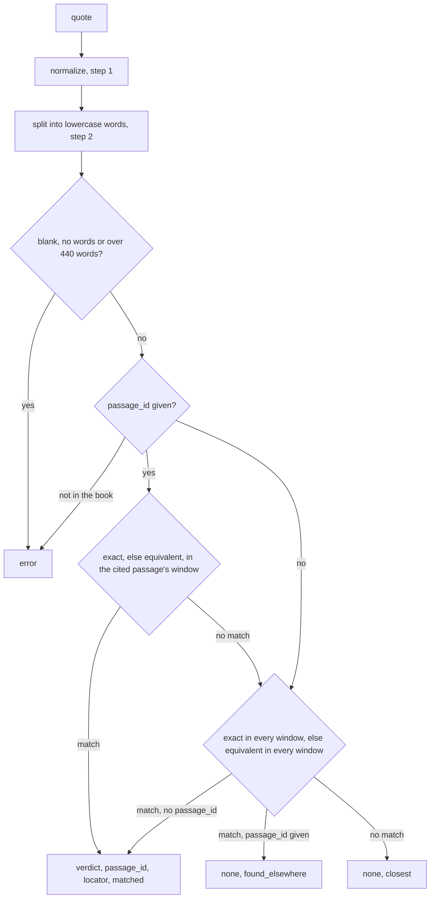

# Quote verification

`ebook-hero verify` and the MCP tool `verify_quote` answer two questions about a quote and one book: does the book contain these words, and if so, where do they start? A quote copied by hand, recalled from memory or taken from a summary can differ from the book by a single word, which is enough to make the citation wrong. For this reason the MCP server's instructions tell a client to check a quote with `verify_quote` before using it (`INSTRUCTIONS` in `src/mcp.rs`).

The answer is one of three verdicts:

- `exact`: the quote occurs as written, case included, from the start of a word to the end of a word.
- `equivalent`: the book has the same words in the same order, and only case, punctuation or spacing differ.
- `none`: neither. The result then names the passage that comes closest or, when a cited passage was checked, the passage where the quote really is.

## Inputs and outputs

```sh
ebook-hero verify book.pdf "the words to check"
ebook-hero verify book.pdf "the words to check" --passage-id 42
ebook-hero verify book.pdf "the words to check" --json
```

The MCP tool takes the same inputs as `path`, `quote` and an optional `passage_id` (`VerifyArgs` in `src/mcp.rs`). Both call `Session::verify` in `src/session.rs`, which opens the book's index, building it on the first call, and hands the book to `verify_quote` in `src/verify.rs`. Verification reads only the book's passages, so it needs neither the embedding model nor the reranker.

The text output gives the verdict and the passage:

```console
$ ebook-hero verify tests/fixtures/alice.epub "Off with her head!"
exact: passage 95 · CHAPTER VIII. The Queen’s Croquet-Ground ¶13–19
$ ebook-hero verify tests/fixtures/alice.epub "the Queen was very kind to everyone"
none; closest passage 93 · CHAPTER VIII. The Queen’s Croquet-Ground ¶10 (3 of 7 words; differs at "very")
```

The text output leaves out the matched range. `--json` prints the whole result, which is the structured result of `verify_quote` (`VerifyResult` in `src/verify.rs`):

```json
{
  "verdict": "exact",
  "passage_id": 95,
  "locator": {
    "format": "epub",
    "href": "4040227324556390537_11-h-8.htm.html",
    "para_start": 14,
    "para_end": 20,
    "print_page": null,
    "under_heading": {
      "text": "CHAPTER VIII. The Queen’s Croquet-Ground",
      "para_start": 13,
      "para_end": 19
    }
  },
  "matched": [1015, 1033],
  "closest": null,
  "found_elsewhere": null
}
```

Which fields are filled depends on the verdict:

| Field | With `exact` or `equivalent` | With `none` |
|---|---|---|
| `verdict` | `"exact"` or `"equivalent"` | `"none"` |
| `passage_id` | the passage the match starts in | the cited passage, or `null` |
| `locator` | that passage's place in the book | the cited passage's place, or `null` |
| `matched` | `[start, end]` in that passage's text | `null` |
| `found_elsewhere` | `null` | with a cited passage: `passage_id`, `locator` and `verdict` of a match in another passage |
| `closest` | `null` | when the quote is nowhere: the passage that shares the longest run of words, or `null` |

`matched` counts Unicode code points from the start of the passage's text. `start` is the first matched code point and `end` the one after the last. `read` prints a passage's text unchanged below its `<!-- passage … -->` line (`render` in `src/read.rs`), so the range applies to the text `read` shows.

A locator is a `PassageLocator` from `src/passages.rs`, tagged by `format`. In a PDF it holds the physical pages `page_start` to `page_end`, counted from 1, and their printed labels. In an EPUB it holds the file `href`, the blocks `para_start` to `para_end` of that file counted from 1, the printed page if the book marks one, and `under_heading`, the paragraphs counted from the nearest heading above. In a Markdown file it holds the lines `line_start` to `line_end` and the same `under_heading`.

Both refuse a quote that is blank, has no letters or digits, or has more than 440 words, and a `passage_id` the book does not have. Each error names its cause and a remedy, such as `passage 99999 does not exist; the book has 166 passages`. The command prints the error on stderr and exits with status 1. The MCP tool returns it as a tool result with `isError` set (`failure` in `src/mcp.rs`).

## What a quote is compared with

A quote is compared with the book's passages (`build_passages` in `src/passages.rs`). A passage is a run of paragraphs, list items, notes and code blocks of at most `PASSAGE_MAX_WORDS` (220) words. It never crosses a heading or a rule or, in an EPUB, a file. A block longer than the limit is split first, at sentences or, inside an overlong sentence, at words, so every passage keeps to the limit. The passage's text is the text of its blocks joined by a blank line. Its id is its position in reading order, counted from 0.

A heading closes the passage before it and reaches the passages after it only as their `section`, so its text is in no passage. A rule closes the passage too, and a block without words goes into none. Every reader normalizes the text of each block with `normalize` in `src/normalize.rs` when it extracts the book, the same function the quote goes through in step 1.

## Procedure



### 1. Normalize the quote

`Quote::new` passes the quote through `normalize`, which works in this order:

1. It expands the Latin ligatures U+FB00 to U+FB06 to their letters, so `fi` becomes `fi`.
2. It drops soft hyphens (U+00AD), zero-width spaces (U+200B), byte-order marks (U+FEFF) and every control character that is not whitespace.
3. It composes the text to Unicode Normalization Form C (NFC), so `e` followed by U+0301 becomes `é`.
4. It collapses every run of whitespace to one space and trims both ends.

Because the book's text went through the same function, a ligature, a soft hyphen or a line break in either text cannot make a quote fail. In `tests/verify.rs`, the book's paragraph is `The final answer is here.` with the ligature `fi`, two spaces after `final` and a soft hyphen after `answer`. The quote `final answer is here.`, typed with double spaces, matches it exactly.

A quote that is empty after normalization is refused with `quote is blank; give the words to check`.

### 2. Split the quote into words

The quote's words come from the `EXACT` analyzer in `src/analysis.rs`, which `find` uses for phrases, so both commands agree on what a word is. The analyzer has three stages:

- tantivy's `SimpleTokenizer` takes every maximal run of letters and digits as a word. A character counts when Rust's `char::is_alphanumeric` accepts it, that is, when it has the Unicode Alphabetic property or a number category (Nd, Nl, No). Every other character separates words.
- `RemoveLongFilter` drops words of 40 bytes or more (`TOKEN_MAX_BYTES`).
- `LowerCaser` lowercases each word.

The analyzer neither stems words nor drops stopwords, so `entropies` stays distinct from `entropy` and `the` counts as a word. The quote `The “Quick” brown fix` becomes the words `the`, `quick`, `brown`, `fix`.

A quote with no words, such as `...`, is refused with `quote has no words; give letters or digits to check`. A quote with more than `QUOTE_MAX_WORDS` words is refused. The limit is `2 * PASSAGE_MAX_WORDS`, 440, because a quote is checked against at most two passages (step 3).

### 3. Build a window for each passage

A quote may start near the end of one passage and run on into the next. `matched_in` therefore searches a window: the passage's own text, one space, and the text of the following passage. The last passage's window is its own text alone.

A match counts only if it starts inside the passage's own text. It then belongs to that passage, so its range is cut off where that passage ends. A quote that lies wholly inside the next passage fails this test and is found in the next passage's own window instead. No window holds three passages, so no quote can span three.

In the test `quote_may_cross_into_the_next_passage`, passage 1 is `The sum of all the parts is` and passage 2 starts `greater than the whole.` The quote `parts is greater than the whole` matches exactly in passage 1, and `matched` is `[19, 27]`, from `parts` to the end of passage 1.

### 4. Look for an exact match

`find_exact` makes the window comparable with the normalized quote by collapsing every whitespace run in it to one space. `collapse_whitespace` records, for each byte of the collapsed text, the byte of the window it came from, so a match can be mapped back. The blank line between two paragraphs then reads as one space, which lets a quote run across paragraphs.

The search repeats three steps:

1. Find the next occurrence of the normalized quote in the collapsed window, as a case-sensitive substring.
2. If the occurrence starts at or after the end of the passage's own text, stop. Every later occurrence starts later still, so the passage has no exact match.
3. If the occurrence starts and ends at word boundaries (step 5), it is the match. Otherwise search again from the character after its start, so an occurrence that overlaps a rejected one is still tried.

The match is mapped back to bytes of the window, where it can be longer than the quote. In `tests/verify.rs`, the quote `ends here. The second begins` has 28 code points and covers 29 of the passage, `[20, 49]`, because the passage has two newlines where the quote has one space.

### 5. Word boundaries

Both the exact and the equivalent test reject a match that begins or ends inside a word or a number. `on_word_boundaries` checks each end of the match with `joined`, which looks at the character at the edge of the match, the character just outside it, and the character beyond that. The end is joined to the text outside, and the match rejected, when the character just outside is:

- a letter or digit, as in `entropy measure` against `entropy measures`;
- `.` or `,` with a digit at the edge and a digit beyond, as in `5 percent` against `3.5 percent` or `000 people` against `10,000 people`;
- an apostrophe, `'` or `’`, with a letter at the edge and a letter beyond, as in `They don` against `They don't`.

Any other character is a boundary, so a match may touch punctuation, as `entropy` does in `(entropy)` and `“entropy”`. A `.` or `,` after a number is a boundary when no digit follows it, so a quote may end on a number that ends a sentence or a clause. A hyphen is not in the list, so `known` matches exactly inside `well-known`.

### 6. Look for an equivalent match

`find_equivalent` splits the window into words with the same `EXACT` analyzer. It looks for the first contiguous run of window words that equals the quote's words in order, passes the boundary test and starts inside the passage's own text. The range runs from the start of the run's first word to the end of its last, so it leaves out punctuation at either edge: `Entropy, it is said` against `entropy — it is said to measure disorder.` gives `[0, 20]`.

The words are lowercased, and every character that is not a letter or digit only separates them, so case, punctuation and spacing are the differences this test ignores. A window word is a maximal run of letters and digits, so the character outside a run is never a letter or digit. Only the number and apostrophe rules of step 5 can therefore reject a run here. A changed word form finds no run: `entropies measure` against `entropy measures` gives `none`.

### 7. Decide which passage answers

Both search orders take the tests in the order `FINDERS` lists them, strictest first: exact, then equivalent.

Without `passage_id`, `scan` runs the exact test on every window in reading order and returns the first match. Only if no window matches exactly does it run the equivalent test in the same order. An exact match in a late passage therefore beats an equivalent match in an early one.

With `passage_id`, `check` runs the exact test and then the equivalent test on the cited passage's window alone. A match there is the result, even when another passage holds the quote exactly. If the cited passage has no match, `scan` searches the whole book. A match it finds is reported as `found_elsewhere`, with its passage, locator and verdict. The result itself stays about the cited passage, with verdict `none` and the cited `passage_id` and `locator`. A `none` with `found_elsewhere` reads like a quote missing from the book, but it means the citation names the wrong passage. `found_elsewhere` carries no range; calling again with its `passage_id` gives one.

### 8. Find the closest passage

When no passage holds the quote, `closest` looks for the passage that shares the longest run of consecutive words with it, whether or not a passage was cited. It compares the quote's words with the `EXACT` words of each passage's own text, without the next passage, using `longest_common_run`. That function is the dynamic program for the longest common substring, applied to words. With `run(i, j)` the length of the shared run that ends at quote word `i` and passage word `j`:

```text
run(i, j) = run(i - 1, j - 1) + 1   if quote word i equals passage word j
run(i, j) = 0                       otherwise
```

The longest run is the largest `run(i, j)`. The function keeps only two rows of this table, so its memory grows with the passage's length alone.

The passage with the longest run wins, the earliest one on a tie. Within a passage, of two equally long runs, the one that ends earlier in the quote wins. `closest` reports:

- `matched_words`: the length of the run;
- `quote_words`: the number of words in the quote;
- `first_difference`: the quote word right after the run, lowercased, or `null` when the run reaches the end of the quote.

The quote `the Queen was very kind to everyone` shares `the queen was` with passage 93 of `alice.epub`, which gives 3 of 7 words, differing at `very`. When no passage shares a single word, `closest` is `null` and the command prints `none; no passage shares a word with the quote`.

### 9. Convert the range to code points

Ranges are UTF-8 byte offsets inside the library. `found_result` converts the match to code points with `to_char_ranges` in `src/search/highlight.rs`, which counts the characters of the passage text that start before each byte offset. In `tests/verify.rs`, `uncertainty of a variable` in `Shannon’s entropy measures the uncertainty of a variable.` is `[31, 56]`. In bytes it would start at 33, because `’` takes three bytes.

## Principles

- Quote and book pass through one normalization and one tokenizer, so a difference that normalization removes cannot turn a correct quote into `none`. `src/normalize.rs` serves every reader and verification. `src/analysis.rs` builds the `EXACT` analyzer in one place, for the index, `find` and verification.
- Only case, punctuation and spacing are forgiven. Search stems words, so a query for `heads` matches `head`, but verification never stems and computes no similarity score. A quote that changes one word, or the form of one, therefore gets `none`.
- The strictest verdict wins: an `exact` match anywhere in the book comes before an `equivalent` one anywhere.
- With a cited passage, the verdict says whether the quote is in that passage, as the argument's description puts it: "Look in this passage first, as a citation says."
- A match belongs to the passage it starts in, even when it runs on into the next.
- Offsets are UTF-8 bytes inside the library and Unicode code points in output (`AGENTS.md`), so `matched` is in code points.
- Nothing falls back silently (`AGENTS.md`). A `passage_id` the book does not have is an error rather than a search of the whole book. A quote over the word limit is refused rather than cut.
- `--json` prints the same result as `verify_quote` (`AGENTS.md`), so a script and an MCP client read the same fields.

## Limits

- A call reports one place: the cited passage, or the first match in reading order. `find` lists every occurrence of a phrase.
- A call checks one book (`AGENTS.md` puts several books per call out of scope), so a quote whose source is uncertain needs one call per candidate book.
- A quote spans at most two passages. A passage can hold far fewer than 220 words, so a quote below the word limit can still need three passages and get `none` (test `a_quote_does_not_span_three_passages`).
- The word limit and the passage size count words differently. The quote's 440 are `EXACT` words, while `PASSAGE_MAX_WORDS` counts words by Unicode word boundaries (UAX #29, `unicode_words` in `src/passages.rs`). `don't` and `3.5` are one word each in a passage but two `EXACT` words each, so 440 is not exactly two passages.
- Verification checks the extracted text, not the page. A heading is in no passage, so a quote that runs from a heading into its first paragraph gets `none`: in `alice.epub`, `Croquet-Ground A large rose-tree stood` shares only 5 of 7 words with passage 92. A quote that runs across a heading without its words matches, as in the test of step 3, where each passage sits under its own heading.
- Lines the PDF reader sets aside as furniture, such as running heads, go to `Document.furniture` and reach no passage, so they cannot be verified.
- The readers extract no text from a PDF without a text layer, nor from formulas and figures (README), so no quote from them can be verified.
- The PDF reader removes a hyphen at the end of a line unless the next line starts with a capital or a digit, or the same hyphenated word occurs inside a line elsewhere in the book (`join_lines` and `known_compounds` in `src/extract/pdf_layout.rs`). A quote that keeps a hyphen the reader removed gets `none`, because `co-operate` is two words and `cooperate` one.
- `exact` compares code points after NFC, so a straight apostrophe in the quote against a curly one in the book is `equivalent` at best: in `alice.epub`, `I don’t know` is exact and `I don't know` is equivalent. Apart from the seven ligatures, normalization keeps the compatibility characters that NFKC would fold. `x2` therefore does not match `x²` even as equivalent, because `²` is a number character and stays inside its word.
- `equivalent` ignores every character that is not a letter or digit. `3.5`, `3,5` and `3 5` are the same two words, as are `well-known` and `well known`, while `wellknown` is one different word.
- Words of 40 bytes or more are dropped from both the quote and the window. The equivalent test therefore ignores them: a quote that leaves out or changes such a word still matches.
- `closest` measures one contiguous run in one passage's own text. `first_difference` names only the word after that run, so in the heading example above, where the run reaches the end of the quote, no difference is named although the quote's first two words differ from the book.
- Verification does not use the search index, so a quote found nowhere takes three passes over every passage: the exact test, the equivalent test and the closest run.

## References

- The Unicode Consortium. Unicode Standard Annex #15: Unicode Normalization Forms. https://www.unicode.org/reports/tr15/. It defines NFC, which `normalize` applies through the `unicode-normalization` crate (version 0.1.26, with Unicode 18.0.0 tables).
- The Unicode Consortium. Unicode Standard Annex #29: Unicode Text Segmentation. https://www.unicode.org/reports/tr29/. It defines the word boundaries by which `unicode_words` in the `unicode-segmentation` crate (version 1.13.3, with Unicode 17.0.0 tables) counts the words of a passage.
