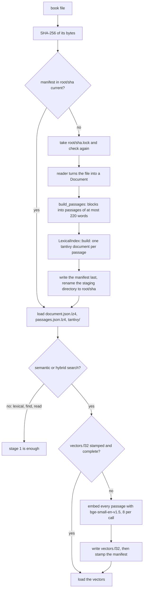
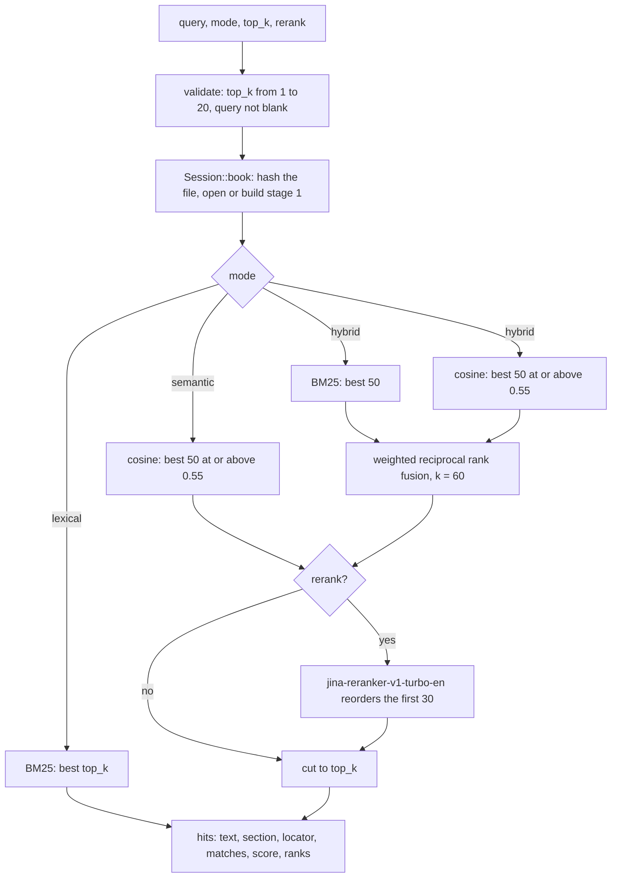

# Search

ebook-hero answers a question about a book with the passages that answer it best. It cuts the book's text into passages once, indexes them and caches the index. Each query then ranks the passages and returns the best few, each with a locator that says where it stands in the book, so a hit can be opened with `read` and cited.

There are three search modes. `lexical` ranks passages by the words they share with the query. `semantic` ranks them by closeness in meaning, as a machine-learned embedding model measures it. `hybrid`, the default, merges both rankings, and a reranking model then reorders the best candidates. `find` is a separate operation: it lists every passage that contains an exact phrase, in reading order.

`src/cli.rs` and `src/mcp.rs` parse arguments and format output, and both call `Session` in `src/session.rs`. The work is done in `src/passages.rs`, `src/analysis.rs`, `src/index/`, `src/embed.rs` and `src/search/`. The constants are in `src/settings.rs`.

## The two pipelines

Indexing has two stages. Stage 1 extracts the text, packs it into passages and builds a tantivy index. Every operation needs it, and it needs no model. Stage 2 embeds every passage. Only `semantic` and `hybrid` searches need it, so it is built by the first such search, or ahead of time by `ebook-hero index`.



A query takes the path its mode sets:



## Passages

`build_passages` in `src/passages.rs` turns the blocks of a `Document` into passages. The passage is the unit every later step works on: the index holds passages, the model embeds them, a search returns them, `read` prints them and quote verification checks them.

Packing follows these rules:

- Blocks are taken in reading order. Paragraphs, list items and notes go into passages.
- A heading goes into no passage. It closes the passage being built, and its text reaches the passages under it only through their `section`, the path of headings above them.
- A passage holds at most `PASSAGE_MAX_WORDS` = 220 words. Words are counted at Unicode word boundaries (UAX #29, through the `unicode-segmentation` crate), so punctuation is not counted.
- Blocks are added whole while they fit. A block that would take the passage past 220 words starts the next one.
- A passage never crosses a section and, in an EPUB, never crosses a file (`same_part`).
- A block of more than 220 words is split first, into pieces of whole sentences of at most 220 words (`split_ranges`). A single sentence longer than that is cut before a word, after the whitespace that precedes it (`split_at_words`), so punctuation and hyphenated parts stay with their word. The pieces then pack like blocks, so the last piece of a long paragraph can share a passage with the paragraphs after it.
- Pieces are joined with a blank line.

Each passage records:

- `id`: its position in reading order, from 0. Ids index the book's passage list and the rows of the vector file.
- `section`: the heading path of its first block.
- `blocks`: one `BlockRange` per piece, mapping the passage's text back to its block. `passage.text[start..end]` equals `block.text[block_offset..block_offset + end - start]`.
- `locator`: where it is. For a PDF, the first and last physical page, counted from 1, and the printed page labels when the PDF has them. For an EPUB, the file (`href`), the paragraph numbers within that file, the printed page if the book marks one, and `under_heading`: the nearest heading above and the paragraphs counted from it. That count runs on across files, so it stays unique when a chapter is split over several.

`locator_text` in `src/read.rs` prints a locator as a person would cite it: `p. 12–13 (xii–xiii)` for a PDF and `CHAPTER I ¶3–5, print p. 45` for an EPUB. EPUB text before the first heading is placed by its file, as in `cover.xhtml ¶1`.

## The lexical index

`LexicalIndex` in `src/index/lexical.rs` is a tantivy index with one document per passage. It stores no text. A hit comes back as a `passage_id`, read from a fast field, and the text is taken from the passage list.

| Field | Analyzer | Indexed with | Used for |
|---|---|---|---|
| `passage_id` | none, a u64 fast field | | mapping a hit to its passage |
| `text` | `STEMMED` | frequencies and positions | ranking query words |
| `text_exact` | `EXACT` | frequencies and positions | quoted phrases and `find` |
| `section` | `STEMMED` | frequencies | ranking query words found in the heading path |

`section` holds the heading path joined with spaces. A query word that occurs in a chapter title therefore matches every passage of that chapter.

The index is written once, with a writer budget of 50,000,000 bytes (`WRITER_BUDGET_BYTES`), and never changes afterwards. Its reader is opened with `ReloadPolicy::Manual`, since there is nothing to reload.

### Analyzers

`src/analysis.rs` defines both analyzers in one function, `build_analyzer`. The index registers them, and the highlighter, `find` and quote verification run the same function, so a marked range always covers a token the index holds.

Both analyzers begin with the same three steps:

1. tantivy's `SimpleTokenizer` splits the text at every character that is not alphanumeric. Punctuation and whitespace separate tokens and never become tokens.
2. `RemoveLongFilter` drops tokens of 40 bytes or more (`TOKEN_MAX_BYTES`), since URLs and encoded blobs are noise. A dropped token still takes up a position.
3. `LowerCaser` lowercases each token.

`EXACT` stops there. `STEMMED` goes on:

4. It drops tantivy's English stopwords, the 33-word list of Lucene's English analyzer: `a an and are as at be but by for if in into is it no not of on or such that the their then there these they this to was will with`.
5. It drops nine question words that list lacks: `how what when where which who whom whose why`. A query phrased as a question would otherwise match every passage that asks one.
6. It stems each token with tantivy's English stemmer, the Snowball English algorithm, so "heads" and "head" become one token.

For "How the Queen ran to a tree, and why", `STEMMED` gives `queen ran tree` and `EXACT` gives `how the queen ran to a tree and why`.

Dropped tokens leave gaps. In "the queen of the tree", `STEMMED` puts `queen` at position 1 and `tree` at position 4. Phrase queries keep these positions, so a quoted phrase that contains a dropped long token still finds the passage that holds it.

## The cache

### Layout

Indexes live under a cache root: `$EBOOK_HERO_INDEXES` if it is set, else `ebook-hero/indexes` in the user cache directory, which is `~/.cache/ebook-hero/indexes` on Linux. Each book has a directory named for the SHA-256 of the file's bytes (`src/index/cache.rs`):

```text
<root>/<sha>/                    manifest.json, document.json.lz4, passages.json.lz4, tantivy/,
                                 vectors.f32 once embedded, graph.json.lz4 once the concept graph is built
<root>/<sha>.lock                held while building; holds the builder's pid; never deleted
<root>/<sha>.staging-<pid>-<ns>/ a build in progress, renamed to <sha>/ when done
```

A `.json.lz4` file is JSON in one LZ4 frame with a content checksum (`write_lz4_json_atomic` and `read_lz4_json`). The checksum is what stops a damaged byte from decoding into a wrong character inside valid JSON. A file that is not a frame, or fails its checksum, gives an error that names the file and tells the user to run `ebook-hero cache clear`. `manifest.json` stays plain JSON.

Cached indexes are loaded without being checked, so the root must be private. `ensure_private_dir` creates a missing root with mode 0700. On Unix it refuses a root that is a symbolic link, belongs to another user, or lets group or others write to it, because anyone who can write there could plant an index. Every hash that names a path must be 64 lowercase hex digits (`require_sha256`), so no path built from it leads outside the root.

### When a cached index is reused

`manifest.json` records what stage 1 was built from:

| Field | Value this build expects |
|---|---|
| `schema_version` | `SCHEMA_VERSION` of the `Document` (`src/document/`) |
| `tool_version` | the crate version, `CARGO_PKG_VERSION` |
| `pdf_reader`, `epub_reader` | `PDF_READER_VERSION`, `EPUB_READER_VERSION` |
| `passages` | `PASSAGES_VERSION` |
| `analyzers` | `ANALYZERS_VERSION` |
| `embedding` | the stage 2 stamp: model name and dimension, or none |

Stage 1 is reused only when every field except `embedding` equals `expected_stage1()`. Any difference rebuilds it, a new release of ebook-hero included, and so does a new PDF reader version for an EPUB, since both reader versions are compared for every book. AGENTS.md requires a version bump for each change to a reader, to passage packing or to an analyzer, and this comparison is what makes old indexes rebuild. A rebuild first deletes the whole `<sha>/` directory (`remove_stale`), embeddings included, so the next semantic search embeds the book again.

Stage 2 loads `vectors.f32` only when the manifest is stamped with `{model: "BAAI/bge-small-en-v1.5", dim: 384}` and the file holds exactly one row per passage. The file stores the rows back to back as little-endian `f32`, so its size must be `passages × 384 × 4` bytes. A book of 1,000 passages has a vector file of 1,536,000 bytes.

### Building under a lock

`Book::open` in `src/index/book.rs` opens a book in four steps:

1. If `<sha>/manifest.json` is current, it loads `document.json.lz4`, `passages.json.lz4` and the tantivy index, and returns.
2. Otherwise it takes the book's lock, `<sha>.lock`. While another process holds it, it tries again every `LOCK_POLL` = 200 ms for up to `LOCK_WAIT` = 900 s, then fails with an error that names the pid of the holder.
3. Holding the lock, it checks the cache again, since another process may have built the index while it waited.
4. It deletes the stale directory and any staging directory a dead build left, extracts the document, packs the passages, and writes `document.json.lz4`, `passages.json.lz4` and `tantivy/` into a fresh staging directory. The manifest is written last, and the staging directory is then renamed to `<sha>/`. A build that fails or is killed leaves nothing that reads as an index.

A cache that does not load is rebuilt like a stale one, and the reason is logged as a warning.

Stage 2 (`Book::vectors`) takes the same lock. It embeds every passage, writes `vectors.f32.tmp`, renames it to `vectors.f32` and stamps the manifest last, so an interrupted run is redone. If the manifest no longer describes this build's stage 1 when the vectors are ready, another version rebuilt the index meanwhile. Nothing is written then, and the error asks for another call.

### The session

`Session::book` in `src/session.rs` turns the path a user typed into an open `Book`:

- It expands a leading `~`, makes the path absolute and follows symbolic links to the file.
- It hashes the file with SHA-256 and remembers the hash per path while the file's size and modification time stay the same, so a second call does not read the file again.
- It keeps the `OPEN_BOOKS` = 4 most recently used books in memory. A book whose cache directory was removed, by `cache clear` for one, is dropped from them and opened again.

## The models

`Models` in `src/embed.rs` holds two machine-learned models, run through the fastembed crate and ONNX Runtime. Both are downloaded on first use into the models directory: `$EBOOK_HERO_MODELS` if it is set, else `ebook-hero/models` in the user cache directory.

### Embedding model

`EMBEDDING_MODEL` = `BAAI/bge-small-en-v1.5` maps a text to a vector of `EMBEDDING_DIM` = 384 numbers, trained so that a query and a passage that answers it get vectors pointing in similar directions. fastembed 7.5 loads an ONNX export of the model from the Hugging Face repository `Xenova/bge-small-en-v1.5` and takes the output at the `[CLS]` token as the vector.

- Passages are embedded as they are, `EMBED_BATCH` = 8 per call. After each batch the progress callback runs. The CLI prints `embedding done/total` on stderr, and the MCP server sends progress notifications to a client that asked for them with a progress token.
- A query is embedded behind `QUERY_PREFIX` = `"Represent this sentence for searching relevant passages: "`, the instruction the model card gives for retrieval queries.
- Every vector is scaled to unit length, $\hat v = v / \lVert v \rVert$, and a vector of zeros stays zeros. The dot product of two unit vectors is their cosine similarity.

The model reads `passage.text` only. The heading path is not part of what it embeds.

### Reranker

`RERANKER_MODEL` = `jinaai/jina-reranker-v1-turbo-en` is a cross-encoder. It reads the query and one passage together and returns one number for how well the passage answers the query. ebook-hero uses that raw output, a logit, as the hit's score, which can only be compared with other scores from the same call.

It reads `RERANK_BATCH` = 4 candidates per run, to save memory. Each batch is padded to its longest candidate, and ONNX Runtime keeps the memory of the largest batch it has run. All 30 candidates at once held about 0.6 GB more than batches of 4, which rank the same.

### Loading and idle release

Each model sits in a `Slot` and loads on first use. The slot's mutex is held while the model loads, so two threads never load it at once. A failed load is not remembered, and the next call tries again, which succeeds once a missing connection is back. The failure is reported as `ModelUnavailable`, whose message names the model and the models directory and suggests `mode=lexical`, which needs no model.

Loaded, the two models hold about 0.6 GB. The MCP server checks every `MODEL_IDLE` = 300 s, or every `$EBOOK_HERO_MODEL_IDLE` seconds when that is set to a whole number of at least 1, and drops each model whose last use ended at least that long ago. A check only tries the slot's lock, so a model in use or being loaded is kept. Because the check runs once per period, a model goes between one and two periods after its last use. After a drop, `malloc_trim(0)` hands the freed memory back to the system on Linux with glibc, which would otherwise keep it for later allocations. The next search loads the models again, in about a second. The command line needs no release, since its process ends after one command.

## Answering a query

`search::search` in `src/search/mod.rs` runs a query.

### Arguments

`SearchParams` holds the query, the mode, `top_k` and `rerank`. The mode defaults to `hybrid`, `top_k` to `TOP_K_DEFAULT` = 5 and `rerank` to on; `--no-rerank` on the command line or `rerank: false` in MCP turns it off. `validate` requires `top_k` between 1 and `TOP_K_MAX` = 20 and a query that is not blank after trimming. `Session::search` validates before it opens the book, so a bad argument never starts an index build.

### Query syntax

`parse_query` in `src/search/query.rs` splits the query at whitespace into words, except that text between two double quotes is one phrase. An unmatched quote turns the rest of the query into words. `channel "mutual information" capacity` has the words `channel` and `capacity` and the phrase `mutual information`.

`LexicalIndex::search` builds tantivy queries from analyzer tokens directly and never uses tantivy's query parser. Characters such as `:` or `(` therefore mean nothing special, and no input fails to parse.

- Each `STEMMED` token of each word becomes two `Should` clauses: a term query on `text` and one on `section`.
- Each phrase becomes a `Must` clause on `text_exact`: a phrase query over its `EXACT` tokens at their analyzer positions, or a term query when it has one token.

A passage must match every phrase. A query without phrases matches a passage whose text or heading path holds at least one of its words. A query whose words are all stopwords or question words, such as "how is it", has no clauses and finds nothing lexically.

### Lexical mode: BM25

tantivy scores each clause with BM25, and the boolean query adds up the scores of the clauses a passage matches. For a term $t$ in field $F$ of passage $d$:

$$\mathrm{bm25}(t, d) = \mathrm{idf}(t) \cdot \frac{(k_1 + 1)\, f}{f + k_1 \left(1 - b + b \, \dfrac{|d|}{\mathrm{avgdl}}\right)}, \qquad \mathrm{idf}(t) = \ln\left(1 + \frac{N - n + 0.5}{n + 0.5}\right)$$

- $f$ is how often $t$ occurs in field $F$ of $d$.
- $|d|$ is the number of tokens the analyzer of $F$ kept for $d$, so stopwords do not lengthen a passage's `text`. tantivy stores this length in one byte: lengths up to 40 are exact, and longer ones are rounded down to the nearest value in its table.
- $\mathrm{avgdl}$ is the total number of tokens of $F$ over all passages divided by the number of passages.
- $N$ is the number of passages in the book and $n$ the number whose field $F$ contains $t$.
- $k_1 = 1.2$ and $b = 0.75$ are tantivy's constants (`src/query/bm25.rs` in tantivy 0.27).

For a phrase, $f$ is the number of times the phrase occurs in the passage, and the idf is the sum of the idfs of its terms. The score of a passage is the sum over the clauses it matches:

$$\mathrm{score}(q, d) = \sum_{c \,\in\, q,\; d \text{ matches } c} \mathrm{bm25}(c, d)$$

A word whose stem occurs both in a passage's text and in its heading path is counted twice, once per field.

Without relevance information, the idf in Robertson and Zaragoza's presentation is $\log \frac{N - n + 0.5}{n + 0.5}$, which turns negative for a term in more than half the passages. The 1 that tantivy adds inside the logarithm keeps its idf positive.

Lexical mode asks the index for the best `top_k` passages directly. Equal scores are ordered by ascending passage id inside tantivy's collector, so the cut at `top_k` keeps the earliest passages whatever segments the documents sit in. Lexical mode loads no model and ignores `rerank`, and a hit's `score` is its BM25 score.

### Semantic mode: cosine similarity

`semantic_hits` loads or builds stage 2, embeds the query, and takes the dot product of the query vector with every passage vector (`Vectors::nearest`). All vectors have unit length, so the dot product is the cosine similarity:

$$\cos(q, p) = \frac{q \cdot p}{\lVert q \rVert \, \lVert p \rVert} = \sum_{i=1}^{384} q_i \, p_i$$

Passages below `SEMANTIC_FLOOR` = 0.55 are dropped. The rest are sorted best first, lowest id first among equals, and cut to `SEMANTIC_CANDIDATES` = 50. Every passage has some similarity to any query, so without the floor the list would always be full; with it, an unrelated query returns nothing. The comparison is exhaustive, one dot product per passage, with no approximate index.

In semantic mode the 50 go to the reranker when `rerank` is on, and the result is cut to `top_k`. A hit's `score` is its cosine, or the reranker's logit after reranking.

### Hybrid mode: reciprocal rank fusion

Hybrid mode takes the best `LEXICAL_CANDIDATES` = 50 passages by BM25 and the best `SEMANTIC_CANDIDATES` = 50 by cosine, after the floor, and merges the two lists by weighted reciprocal rank fusion (`rrf` in `src/search/fusion.rs`):

$$\mathrm{rrf}(d) = \sum_{i \,:\, d \in L_i} \frac{w_i}{k + r_i(d)}$$

Here $r_i(d)$ is the rank of $d$ in list $L_i$, counted from 1, and $k$ = `RRF_K` = 60. The weight $w_i$ is `BM25_WEIGHT` = 1.25 for the lexical list and `VECTOR_WEIGHT` = 1.0 for the semantic one. A list that does not hold $d$ adds nothing. Cormack, Clarke and Büttcher defined the unweighted form with $k = 60$; the weights are ebook-hero's.

Fusion uses ranks only. BM25 scores have no upper bound and depend on the query's terms, while cosines lie between −1 and 1, so the raw scores have no common scale to add them on.

An example from the tests: the lexical list is 10, 20, 30 and the semantic list is 20, 40.

| Passage | Lexical rank | Semantic rank | rrf |
|---|---|---|---|
| 20 | 2 | 1 | 1.25/62 + 1/61 ≈ 0.03655 |
| 10 | 1 | | 1.25/61 ≈ 0.02049 |
| 30 | 3 | | 1.25/63 ≈ 0.01984 |
| 40 | | 2 | 1/62 ≈ 0.01613 |

Passage 20 is in both lists and comes first. Among passages that only one list holds, the weight favours the lexical list: lexical rank 16 scores 1.25/76 ≈ 0.01645 and beats semantic rank 1 at 1/61 ≈ 0.01639, while lexical rank 17 scores 1.25/77 ≈ 0.01623 and does not.

A fused hit keeps the ranks it had in each list (`lexical_rank`, `semantic_rank`), and its `score` becomes the fused score. Ties go to the lower passage id. When one list is empty, because no passage holds the query's words or none reaches the floor, the fused list is the other list in its own order.

### Reranking

With `rerank` on, in semantic and hybrid mode, `rerank_hits` sends the first `RERANK_CANDIDATES` = 30 hits and the query to the reranker. It sorts those 30 by the reranker's score, highest first and lowest passage id first among equals, and makes that score the hit's `score`. Hits after the first 30 keep their order behind them. Since `top_k` is at most 20, every hit returned has been reranked.

The fused or semantic order thus decides which 30 passages the reranker reads, and the reranker decides their final order. The ranks from the first stage are left as they were, so a hit still shows where each list had put it.

### What a hit holds

A `Hit` carries `passage_id`, `text`, `section`, `locator`, `matches`, `score`, `lexical_rank` and `semantic_rank`. `matches` are the ranges to highlight, from `match_ranges` in `src/search/highlight.rs`: the passage tokens whose `STEMMED` form equals that of a query word, plus every occurrence of each phrase, sorted and merged where they overlap or touch. Semantic hits are highlighted the same way, so highlights agree across modes. The ranges are byte offsets inside the library, and `to_char_ranges` converts them to Unicode code points for output, as AGENTS.md requires.

| Mode | Candidates | Reranked | `score` |
|---|---|---|---|
| `lexical` | best `top_k` by BM25 | never | BM25 |
| `semantic` | best 50 by cosine, at least 0.55 | first 30 | reranker logit, or cosine without reranking |
| `hybrid` | best 50 by BM25 and best 50 by cosine, fused | first 30 | reranker logit, or fused score without reranking |

A score orders the hits of one call and means nothing across calls.

## Find

`find` in `src/search/find.rs` lists every passage that contains a phrase, in reading order, with the number of occurrences. It needs stage 1 only and loads no model.

1. The phrase is trimmed and must contain at least one `EXACT` token.
2. `LexicalIndex::phrase_passages` runs the phrase's query on `text_exact` and collects every matching passage, unscored, sorted by id, which is reading order.
3. `phrase_ranges` tokenizes each of those passages with `EXACT` and finds every run of tokens equal to the phrase's tokens at the same relative positions. Overlapping occurrences count separately: "a a" occurs twice in "a a a".
4. `total_occurrences` and `total_passages` count the whole book. The passages come in pages of `FIND_PAGE` = 20, and `next_cursor` is the index, among all matching passages, of the first passage of the next page.

A match is exact in the sense of the `EXACT` analyzer: whole words, any case, no stemming, stopwords kept, and punctuation between words ignored. "off with her head" matches "Off with her head!" and does not match "off with her heads".

## Locating a passage

Passage ids are positions in the passage list, so `read` in `src/read.rs` finds a passage by id directly. It resolves two other addresses to a range of passages:

- A PDF page: every passage whose page range holds the page, from the first to the last.
- An outline entry: from the first passage at or after the block the entry points at, to the passage before the next entry at the same level or above. `first_passage` finds that passage by binary search on the id of each passage's last block, which the passage's `blocks` record.

`before` and `after` widen the range by at most `READ_NEIGHBOURS_MAX` = 10 passages each. The Markdown comes in pages of at most `READ_MAX_CHARS` = 8000 characters, always with at least one passage, and `next_cursor` names the first passage left over.

## Why it works this way

### Passages of whole paragraphs

- One unit for every operation means a hit needs no further cutting. The text a search returns is the text `read` prints for that id and the text quote verification checks.
- Packing whole blocks makes a hit start and end at a paragraph or sentence boundary. A sentence is cut only when it alone has more than 220 words.
- Keeping a passage inside one section, and in an EPUB inside one file, gives it one heading path and one locator, so a hit can be cited as `CHAPTER VIII ¶64–69` or `p. 12–13`.
- Passages do not overlap. Each word of a paragraph, list item or note belongs to exactly one passage, so `find` counts each occurrence once.

### A stemmed and an unstemmed field

- Ranking wants inflections to match: a query for "heads" should find "head". The `text` field holds stems for that. It drops stopwords and question words, so a query phrased as a question is not matched on its "how", "the" or "to".
- Phrases, `find` and quote verification must report what the book says. In `text_exact`, "entropies" and "entropy" stay different tokens, and stopwords stay, so "off with her head", whose "with" is a stopword, still matches as a phrase.
- One function defines both analyzers, so the highlighter marks exactly the tokens the index matched.

### Hybrid ranking and a reranker

- Lexical ranking finds the words the user typed. Semantic ranking finds passages that say the same thing in other words. Fusing the two lets a passage rank high for its words or for its meaning.
- The embedding model encodes queries and passages separately, so the passage vectors are computed once and cached, and a query costs one model run plus one dot product per passage. The reranker reads the query and a passage together, which costs one model run per candidate on every query. The cheap rankings therefore pick 30 candidates, and the reranker orders only those.

### Indexes keyed by content hash

- Building stage 1 can take minutes for a large book, and embedding it can take minutes more. Each is done once per book and reused by every later call and every process.
- The key is the SHA-256 of the file's bytes and not its path. A file replaced under the same name is indexed again, and a copy under another name reuses the index.
- The manifest records the version of everything stage 1 depends on, so a change to a reader, to packing or to an analyzer rebuilds old indexes instead of serving them.
- The per-book lock and the staging directory let several processes share one cache: one builds, the others wait and load the result.

## Limits

- English only. The stemmer, the stopwords and the question words are English, and both models are English models.
- A token of 40 bytes or more, such as a long URL, is dropped from both fields and cannot be searched as a word.
- A phrase match, in search or in `find`, must lie inside one passage. An occurrence that runs across the boundary between two passages is not found.
- In hybrid mode, a quoted phrase binds only the lexical candidates. The semantic candidates come from embedding the whole query, quotes included, so a hybrid hit need not contain the phrase. `lexical` mode or `find` guarantees it.
- A query of only stopwords and question words has no lexical result. In hybrid mode the semantic list alone then decides.
- The heading path counts for BM25 through `section`, but neither model sees it.
- fastembed truncates each model input to at most 512 tokens. The reranker reads the query and the passage as one input, so the limit covers both together.
- The first semantic or hybrid search of a book downloads the models, about 270 MB, and embeds every passage, which can take minutes. Lexical search and `find` need neither.
- Semantic search compares the query with every passage, so its cost grows with the length of the book.
- A new ebook-hero version, or a new value of any stage-1 version, rebuilds each book's index on first use and discards its embeddings.

## Constants

From `src/settings.rs` unless another file is named.

| Constant | Value | What it sets |
|---|---|---|
| `PASSAGE_MAX_WORDS` | 220 | most words in a passage |
| `LEXICAL_CANDIDATES` | 50 | BM25 list in hybrid mode |
| `SEMANTIC_CANDIDATES` | 50 | cosine list in semantic and hybrid mode |
| `SEMANTIC_FLOOR` | 0.55 | lowest cosine kept |
| `RRF_K` | 60 | $k$ in reciprocal rank fusion |
| `BM25_WEIGHT` | 1.25 | weight of the lexical list in fusion |
| `VECTOR_WEIGHT` | 1.0 | weight of the semantic list in fusion |
| `RERANK_CANDIDATES` | 30 | hits the reranker reorders |
| `RERANK_BATCH` | 4 | candidates per reranker run |
| `TOP_K_DEFAULT` | 5 | hits returned by default |
| `TOP_K_MAX` | 20 | most hits returned |
| `FIND_PAGE` | 20 | passages per page of `find` |
| `READ_MAX_CHARS` | 8000 | characters per page of `read` |
| `READ_NEIGHBOURS_MAX` | 10 | most passages added by `before` or `after` |
| `EMBED_BATCH` | 8 | passages per embedding call |
| `EMBEDDING_MODEL` | `BAAI/bge-small-en-v1.5` | embedding model, stamped on the vectors |
| `EMBEDDING_DIM` | 384 | values per vector |
| `QUERY_PREFIX` | `"Represent this sentence for searching relevant passages: "` | text put before each query |
| `RERANKER_MODEL` | `jinaai/jina-reranker-v1-turbo-en` | reranking model |
| `MODEL_IDLE` | 300 s | idle time before the MCP server drops a model |
| `OPEN_BOOKS` | 4 | books a session keeps open |
| `LOCK_WAIT` | 900 s | longest wait for a book's build lock |
| `LOCK_POLL` | 200 ms | time between tries for the lock |
| `TOKEN_MAX_BYTES` (`src/analysis.rs`) | 40 | length from which a token is dropped |
| `WRITER_BUDGET_BYTES` (`src/index/lexical.rs`) | 50,000,000 | memory of the tantivy writer |

`PDF_READER_VERSION`, `EPUB_READER_VERSION`, `PASSAGES_VERSION`, `ANALYZERS_VERSION` and `SCHEMA_VERSION` (`src/document/`) go into the manifest and change with the code they version.

## References

- Robertson, S. and Zaragoza, H. (2009). The Probabilistic Relevance Framework: BM25 and Beyond. Foundations and Trends in Information Retrieval, 3(4), 333–389.
- Cormack, G. V., Clarke, C. L. A. and Büttcher, S. (2009). Reciprocal Rank Fusion Outperforms Condorcet and Individual Rank Learning Methods. In Proceedings of the 32nd International ACM SIGIR Conference on Research and Development in Information Retrieval, 758–759.
- Xiao, S., Liu, Z., Zhang, P. and Muennighoff, N. (2023). C-Pack: Packaged Resources To Advance General Chinese Embedding. arXiv:2309.07597. The paper the BGE models, bge-small-en-v1.5 among them, cite.
- BAAI. bge-small-en-v1.5, model card. https://huggingface.co/BAAI/bge-small-en-v1.5
- Jina AI. jina-reranker-v1-turbo-en, model card. https://huggingface.co/jinaai/jina-reranker-v1-turbo-en
- tantivy, a full-text search engine library in Rust, version 0.27. https://github.com/quickwit-oss/tantivy
- fastembed, version 7.5, a Rust library for embedding and reranking with ONNX models. https://crates.io/crates/fastembed
- Snowball, the English stemming algorithm. https://snowballstem.org/algorithms/english/stemmer.html
- Unicode Standard Annex #29, Unicode Text Segmentation. https://www.unicode.org/reports/tr29/
